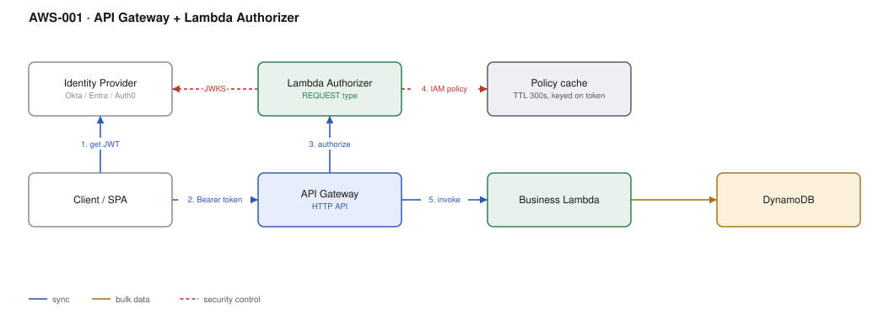

# AWS-001 · API Gateway + Lambda Authorizer

> **Category:** [01 · Edge, API & Identity](readme.md#01) · **Maturity:** Production · **Effort:** S

## The problem

Your API needs authorisation that AWS has no built-in for: a bearer token from an IdP you
do not control, a tenant lookup, a licence check, an IP + token combination, or a permission
model that lives in your own database. A Lambda Authorizer runs your code at the gateway so
none of that logic reaches your business handlers, and so an unauthenticated request never
costs you a backend invocation.

**Use it when** the authorisation decision needs data the gateway cannot see, or the token
format is not a plain JWT from a single issuer.

**Don't use it when** a stock JWT from one OIDC issuer is all you check — the built-in JWT
authorizer on HTTP APIs is free, faster, and one less function to own. Don't use it to
authorise *per object* either; that belongs in the handler, where you know what was asked for.

## Components

| Service | Role | The setting that actually matters |
|---|---|---|
| API Gateway (HTTP API) | Front door, invokes the authorizer | `AuthorizerResultTtlInSeconds` — the difference between one authorizer call per request and one per 300 |
| Lambda Authorizer | Returns an IAM policy or a simple allow/deny | Authorizer **type**: `TOKEN` caches on the token alone, `REQUEST` can cache on a composite key |
| Identity Provider | Issues the token | JWKS endpoint — cache the keys in module scope, not per invocation |
| Business Lambda | Runs only for authorised calls | Reads caller identity from `requestContext.authorizer`, never re-parses the token |
| DynamoDB | Tenant / permission lookup | Keep it to a single-digit-ms `GetItem`; no scans on the auth path |

## Flow

1. The client obtains a JWT from the identity provider, out of band.
2. It calls the API with `Authorization: Bearer <token>`.
3. API Gateway checks its **policy cache** for this identity source. On a hit it skips to step 5.
4. On a miss it invokes the authorizer, which validates the signature against cached JWKS,
   looks up tenant and permission context, and returns allow/deny plus a `context` map.
   The result is cached for the TTL.
5. API Gateway invokes the business function, passing the authorizer `context` through.
6. The handler trusts that context — it is gateway-supplied and cannot be spoofed by the client.

## Cost (us-east-1, on-demand — order of magnitude)

| Line item | Small · 100K req/mo | Medium · 10M req/mo | Large · 500M req/mo |
|---|---|---|---|
| HTTP API requests @ $1.00/M | $0.10 | $10.00 | $500.00 |
| Authorizer Lambda — cache off, 128MB/50ms | $0.03 | $3.00 | $150.00 |
| Authorizer Lambda — **300s cache, ~95% hit** | $0.00 | $0.15 | $7.50 |
| Business Lambda, 256MB/120ms | $0.08 | $7.70 | $385.00 |
| DynamoDB lookups (uncached path only) | $0.00 | $0.01 | $0.65 |
| **Total with caching** | **~$0.20** | **~$18** | **~$895** |

**Cost cliff:** switching from an HTTP API to a REST API is 3.5× on the request line alone
($3.50/M vs $1.00/M) — at 500M requests that is $1,750 instead of $500. Choose REST only for
something HTTP APIs genuinely lack: request validation against a model, WAF attached
directly, API keys with usage plans, or private endpoints.

**Biggest lever:** the authorizer cache TTL. With caching off you pay a second Lambda
invocation on every request, roughly doubling the compute line. The trade is revocation
latency — a token revoked at the IdP is still honoured until the cache expires. 300 seconds
is the usual compromise; go lower only if you can say why.

## Failure modes

| Failure | Symptom | Mitigation |
|---|---|---|
| Authorizer throws | `500` on every request, no backend reached | Catch everything and return an explicit deny; alarm on authorizer errors separately from API 5xx |
| IdP / JWKS unreachable | Total auth outage | Cache JWKS in module scope with a long TTL and serve stale on fetch failure |
| Cache key too broad | User A gets user B's permissions | On `REQUEST` authorizers, put **every** header that affects the decision in the identity source |
| Cold starts | p99 latency spike on sparse traffic | Keep the authorizer tiny and dependency-free; provisioned concurrency only if p99 is contractual |
| Clock skew | Valid tokens rejected | Allow a small leeway on `exp` and `nbf` validation |

## Security notes

- Return **deny**, not an error, for a malformed token. A `500` tells an attacker your parser broke.
- Never put secrets in the authorizer `context` — it appears in API Gateway execution logs.
- The `context` map is strings only. Serialising a permissions object into it is a common way
  to blow the size limit silently.
- Scope the authorizer execution role to the single table it reads. It is the most exposed
  function you own.

## What people miss

- **A `TOKEN` authorizer caches on the token string alone.** If the same token should get a
  different answer for `DELETE /admin` than for `GET /me`, the cache will happily return the
  earlier allow. You need `REQUEST` type with the method in the identity source, or a coarse
  allow plus a real check in the handler.
- **Simple responses beat hand-rolled policies.** HTTP APIs accept `{"isAuthorized": true}`.
  Hand-written IAM policy ARNs with `*` in the method position are a recurring source of
  privilege escalation.
- **The cache is per-stage, per-authorizer.** Promoting a build does not warm it.
- **Authorizer failures do not retry.** Unlike most Lambda integrations, a thrown error is a
  hard `500` to the caller.

## See also

- [`aws-002`](aws-002-cognito-oidc-spa.md) — if Cognito can be your IdP, the built-in JWT authorizer is simpler
- [`aws-008`](aws-008-m2m-auth.md) — the service-to-service variant of this decision
- [`aws-005`](aws-005-api-abuse-control.md) — authorisation is not rate limiting
- [`aws-007`](aws-007-mtls-partner-api.md) — when the credential is a certificate, not a token
