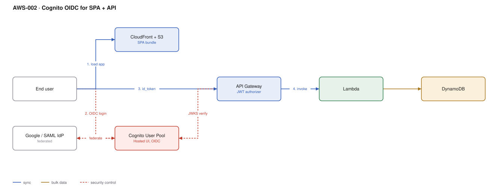

# AWS-002 · Cognito OIDC for SPA + API

> **Category:** [01 · Edge, API & Identity](readme.md#01) · **Maturity:** Production · **Effort:** S

## The problem

You are building a web app and need sign-up, sign-in, password reset, MFA, social login and
"log in with my company SSO" — without running an identity service. Cognito User Pools give
you an OIDC provider with hosted sign-in screens, and API Gateway validates its tokens
natively, so no authorizer function is involved.

**Use it when** you want a managed IdP inside your AWS account and your users are consumers,
or a single B2B tenant per pool.

**Don't use it when** you need rich enterprise identity — SCIM provisioning, per-tenant
branding at scale, a mature admin console. Auth0, Entra ID or Okta cost more and hurt less.
Also avoid it if you may need to migrate users out: you cannot export password hashes.

## Components

| Service | Role | The setting that actually matters |
|---|---|---|
| Cognito User Pool | Identity store and OIDC issuer | Pricing tier, and the token validity trio (`id`, `access`, `refresh`) |
| Hosted UI / Managed Login | Sign-in screens you do not build | Authorization-code + **PKCE**; the implicit flow is deprecated for good reason |
| App client | OAuth client config | **No client secret** for a SPA; exact callback URLs, no wildcards |
| Identity providers | Google / SAML / OIDC federation | Attribute mapping — get it right at creation, it is painful to change later |
| CloudFront + S3 | Serves the SPA bundle | See [`aws-003`](aws-003-cloudfront-s3-oac.md) |
| API Gateway JWT authorizer | Validates the token, free | `audience` lists your app client ID, `issuer` is the pool URL |
| Identity Pool (optional) | Exchanges a token for AWS credentials | Only if the browser must call AWS directly, e.g. a direct S3 upload |

## Flow

1. The browser loads the SPA from CloudFront.
2. Unauthenticated, the SPA redirects to `/oauth2/authorize` with a PKCE challenge.
3. The user authenticates locally, or is federated out to Google or a SAML IdP.
4. Cognito redirects back with a **code**; the SPA exchanges it at `/oauth2/token` for
   `id_token`, `access_token` and `refresh_token`.
5. The SPA calls the API with the **access token** — not the id token.
6. The JWT authorizer validates the signature against the pool JWKS, checks `iss`, `aud`
   and `exp`, and passes the claims to the handler.

## Cost (us-east-1 — order of magnitude)

| Line item | Small · 1K MAU | Medium · 50K MAU | Large · 500K MAU |
|---|---|---|---|
| Cognito Essentials (first 10K MAU free) | $0 | ~$600 | ~$7,350 |
| Threat protection tier, if enabled | $0 | +~$250 | +~$2,500 |
| HTTP API @ 20 req/user/mo | $0.02 | $1.00 | $10.00 |
| Lambda + DynamoDB backend | ~$1 | ~$15 | ~$150 |
| CloudFront + S3 for the SPA | ~$1 | ~$10 | ~$80 |
| **Total** | **~$2** | **~$875** | **~$10,000** |

**Cost cliff:** the free tier ends at 10,000 monthly active users, and the per-MAU price then
applies to the whole band, not just the excess. Going from 9,000 to 11,000 MAU is not a 20%
cost increase. Model it before launch, because identity cost scales with *users*, not traffic —
unlike everything else in your stack.

**Biggest lever:** tier selection. Lite, Essentials and Plus differ several-fold per MAU and
threat protection is the expensive one. Enable it for a reason you can name, not because it
sounds prudent.

## Failure modes

| Failure | Symptom | Mitigation |
|---|---|---|
| Refresh token expires | Users silently logged out mid-session | Match refresh validity to your session policy; refresh at ~75% of access-token life |
| Callback URL mismatch | `redirect_mismatch` on every login after a deploy | Register every environment URL explicitly; Cognito rejects wildcards |
| Calling the API with `id_token` | Works, then breaks when scopes are introduced | Send the `access_token`; the id token is for the client, not the resource server |
| Pool deleted or recreated | Every user gone, unrecoverable | Treat the pool as stateful infrastructure: `prevent_destroy`, separate state file |
| Lambda trigger throws | All sign-ups fail | Pre-sign-up and pre-token triggers are in the critical path — fail open where safe, alarm always |

## Security notes

- PKCE is mandatory for a public client. A SPA cannot hold a secret; do not configure one.
- Keep tokens in memory rather than `localStorage` if XSS is a realistic risk, or use the
  Cognito-managed cookie flow behind CloudFront.
- Enable MFA at least optionally from day one. Retrofitting it to an existing user base is a
  product problem, not a config change.
- Set `PreventUserExistenceErrors` so a failed login cannot be used to enumerate accounts.

## What people miss

- **You cannot export password hashes.** Migrating off Cognito means every user resets their
  password, or you run a migration trigger that re-authenticates against the old system on
  first login. Decide you are fine with that *before* you choose it.
- **Token size.** Custom claims and group memberships inflate the JWT. Past roughly 8KB it
  stops fitting comfortably in a header and the gateway starts rejecting requests.
- **`cognito:groups` is not authorisation.** It is a claim. Map it to a real permission model
  in your handler, or group names end up hardcoded across the codebase.
- **User pools are regional and cannot be replicated.** Active-active multi-region identity
  needs a different product.

## See also

- [`aws-001`](aws-001-lambda-authorizer.md) — when the built-in JWT authorizer is not enough
- [`aws-003`](aws-003-cloudfront-s3-oac.md) — hosting the SPA this logs into
- [`aws-060`](aws-060-identity-center-abac.md) — Cognito is for your *users*, Identity Center for your *staff*
- [`aws-008`](aws-008-m2m-auth.md) — the same pool can issue machine-to-machine tokens
