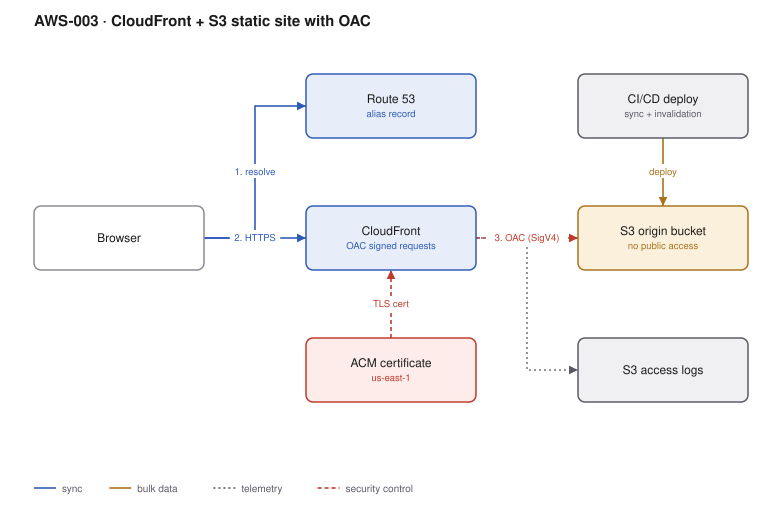

# AWS-003 · CloudFront + S3 static site with OAC

> **Category:** [01 · Edge, API & Identity](readme.md#01) · **Maturity:** Production · **Effort:** S

## The problem

You need to serve a static site or SPA bundle globally over HTTPS on your own domain,
cheaply, without the origin bucket ever being public. Origin Access Control is the mechanism
that lets CloudFront — and only CloudFront — read the bucket.

**Use it when** the content is static: a SPA, docs, a marketing site, downloads, build artifacts.

**Don't use it when** you need server-side rendering per request (use Lambda@Edge, an ALB
origin, or Amplify Hosting), or when the content is internal and small enough that a private
bucket with presigned URLs is less machinery.

## Components

| Service | Role | The setting that actually matters |
|---|---|---|
| Route 53 | DNS | An **alias** A/AAAA record to the distribution; an apex domain cannot be a CNAME |
| ACM | TLS certificate | Must be issued in **us-east-1**, wherever everything else lives |
| CloudFront | CDN and TLS termination | The cache policy, plus 403/404 → `/index.html` for SPA routing |
| Origin Access Control | Signs CloudFront→S3 requests with SigV4 | Bucket policy must match on the distribution ARN (`AWS:SourceArn`) |
| S3 bucket | Origin | Block Public Access on, all four toggles |
| S3 access logs | Audit and cache analysis | A *different* bucket, with its own lifecycle |
| CI/CD | Deploy and invalidate | Correct `Cache-Control` per file type, then invalidate `/index.html` only |

## Flow

1. The browser resolves the domain via Route 53 to the CloudFront distribution.
2. TLS terminates at the edge using the ACM certificate.
3. CloudFront checks the edge cache; on a hit it responds immediately.
4. On a miss it signs a SigV4 request to S3 using OAC and fetches the object.
5. The bucket policy allows `s3:GetObject` only from that distribution.
6. The response is cached per the cache policy and returned.
7. On deploy, CI syncs assets and invalidates `/index.html`.

## Cost (NA/EU edges — order of magnitude)

| Line item | Small · 50 GB, 1M req | Medium · 1 TB, 20M req | Large · 20 TB, 400M req |
|---|---|---|---|
| CloudFront data out @ ~$0.085/GB | $4.25 | $85.00 | $1,530.00 |
| CloudFront HTTPS requests @ $0.01/10K | $1.00 | $20.00 | $400.00 |
| S3 storage (5 GB of assets) | $0.12 | $0.12 | $0.12 |
| S3 GETs from origin (~2% miss) | $0.01 | $0.16 | $3.20 |
| Route 53 zone + queries | $0.60 | $0.90 | $2.50 |
| ACM certificate | $0 | $0 | $0 |
| **Total** | **~$6** | **~$106** | **~$1,936** |

**Cost cliff:** serving straight from S3 instead costs **$0.09/GB** egress with no caching —
at 20 TB that is $1,800 of pure S3 egress plus a GET per object and worse latency. CloudFront
in front of S3 is almost always *cheaper* than S3 alone, which surprises people.

**Biggest lever:** cache hit ratio. Every point of miss rate is an origin fetch plus origin
egress. Fingerprint asset filenames (`app.a3f91.js`), set
`Cache-Control: public, max-age=31536000, immutable` on them and `no-cache` on `index.html`.
Then you never invalidate anything but that one file.

## Failure modes

| Failure | Symptom | Mitigation |
|---|---|---|
| Certificate in the wrong region | CloudFront refuses it | Always issue in `us-east-1`; keep a second in-region cert for ALBs |
| SPA deep links 404 | `/dashboard` only works sometimes | Custom error responses: 403 **and** 404 → `/index.html` with status 200 |
| Stale `index.html` after deploy | Users on an old bundle calling a new API | `no-cache` on the entry document, invalidate it every deploy |
| Invalidating `/*` every deploy | Surprise bill, slow deploys | 1,000 paths/month free, then $0.005 each — invalidate one path, not the world |
| Bucket policy drift | 403 from CloudFront to origin | Manage the OAC policy in IaC and alarm on `4xxErrorRate` |

## Security notes

- Block Public Access at both bucket and account level, all four settings.
- Attach a response-headers policy: HSTS, `X-Content-Type-Options`, a CSP, `Referrer-Policy`.
  Doing it at CloudFront means the app never has to.
- Set the minimum TLS version to `TLSv1.2_2021`.
- Add WAF if the site accepts any input at all — see [`aws-005`](aws-005-api-abuse-control.md).

## What people miss

- **OAC, not OAI.** Origin Access Identity is legacy, does not support SSE-KMS buckets, and
  does not cover all origin types. Existing OAI setups keep working but should be migrated.
- **`DefaultRootObject` only applies to the root.** `/` serves `index.html`; `/docs/` does
  **not** serve `/docs/index.html`. That needs a CloudFront Function doing a URI rewrite.
- **Price class.** `PriceClass_All` buys the expensive edge locations. For NA/EU audiences
  `PriceClass_100` cuts the per-GB rate for no practical loss.
- **Compression is not always on.** Enable automatic compression explicitly — it is typically
  a 70% reduction on JS and CSS.

## See also

- [`aws-004`](aws-004-edge-personalization.md) — adding logic at the edge
- [`aws-002`](aws-002-cognito-oidc-spa.md) — authenticating the SPA this serves
- [`aws-082`](aws-082-s3-lifecycle.md) — what to do with the logs this produces
- [`aws-063`](aws-063-ddos-defense.md) — CloudFront is already your DDoS front line
