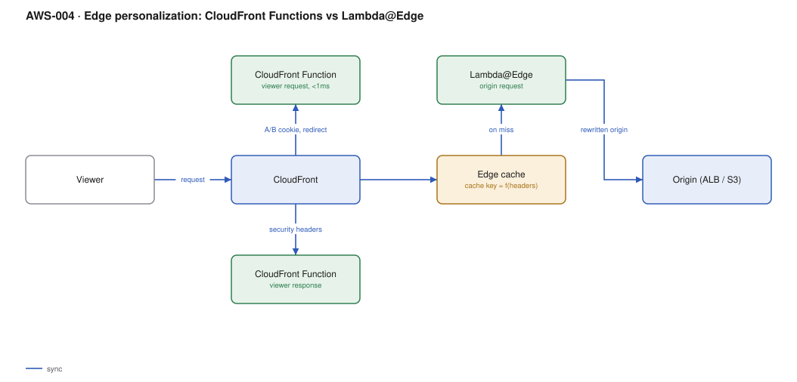

# AWS-004 · Edge personalization: CloudFront Functions vs Lambda@Edge

> **Category:** [01 · Edge, API & Identity](readme.md#01) · **Maturity:** Growing · **Effort:** S

## The problem

Some logic belongs in front of the cache, not behind it: A/B bucketing, country-based
redirects, security headers, URI rewrites, signed-cookie checks, legacy URL migration. Run
it at the origin and every variation becomes a cache miss. AWS gives you two edge runtimes
with very different capabilities, and picking the wrong one is the usual mistake.

**Use it when** the logic is small, has no dependencies, and must run before a cache lookup.

**Don't use it when** the logic needs a database, a secret, or more than a few milliseconds.
Edge functions are deployed globally and are hard to debug; keep them boring.

## The actual decision

| | CloudFront Functions | Lambda@Edge |
|---|---|---|
| Triggers | viewer request, viewer response | all four, incl. **origin** request/response |
| Runtime | JS (ECMAScript 5.1-ish), sandboxed | Node.js / Python, full runtime |
| Max duration | **< 1 ms** | 5 s (viewer) / 30 s (origin) |
| Network / disk access | **None** | Yes |
| Can read the request body | No | Yes (origin triggers) |
| Price | ~$0.10 per million | ~$0.60 per million + GB-s |
| Scale | ~10M req/s | ~10K req/s per region |

The rule of thumb: **if a CloudFront Function can do it, it should.** It is roughly 6× cheaper
and an order of magnitude faster. Reach for Lambda@Edge only when you need the network, the
body, or an origin trigger.

## Components

| Service | Role | The setting that actually matters |
|---|---|---|
| CloudFront Function (viewer request) | Bucketing, rewrites, redirects, normalising the cache key | Must be deterministic — it runs before the cache lookup |
| CloudFront Function (viewer response) | Security headers, cookies | Cheaper than a response-headers policy only if logic is conditional |
| Lambda@Edge (origin request) | Origin selection, signing, body inspection | Runs **only on a cache miss** — far cheaper than it looks |
| Cache policy | Decides what varies the cached object | Every header/cookie/query param you include multiplies the cache |

## Flow

1. The viewer request hits the nearest edge location.
2. The viewer-request function runs on **every** request: it may redirect, rewrite the URI,
   or normalise headers into a bucket value.
3. CloudFront computes the cache key from the cache policy and looks it up.
4. On a miss only, the origin-request Lambda@Edge runs and can rewrite the origin or sign it.
5. The origin responds; the object is cached.
6. The viewer-response function runs on every response and adds headers.

## Cost (order of magnitude)

| Line item | Small · 1M req/mo | Medium · 50M req/mo | Large · 1B req/mo |
|---|---|---|---|
| CloudFront Function @ ~$0.10/M | $0.10 | $5.00 | $100.00 |
| Lambda@Edge on *every* request | $0.60 | $30.00 | $600.00 |
| Lambda@Edge on origin trigger (5% miss) | $0.03 | $1.50 | $30.00 |
| CloudFront requests + transfer | ~$15 | ~$700 | ~$14,000 |
| **Total (CF Function + origin-only L@E)** | **~$15** | **~$707** | **~$14,130** |

**Cost cliff:** moving a function from a *viewer* trigger to an *origin* trigger drops its
invocation count to your cache miss rate. The same code on a viewer-request trigger at a 95%
hit ratio costs **20×** more. Always ask whether the logic can wait until a miss.

**Biggest lever:** cache key cardinality. Adding `Vary` on a user-specific cookie turns one
cached object into one per user and your hit ratio collapses to zero. Bucket into a handful
of values (`ab-group=a|b`) and key on *that*, never on the raw identifier.

## Failure modes

| Failure | Symptom | Mitigation |
|---|---|---|
| Function throws | 503 on every request globally | Test with the CloudFront test console; deploy behind a staging distribution first |
| Cache key explosion | Hit ratio drops, origin melts, bill jumps | Monitor `CacheHitRate`; alert if it falls below your baseline |
| Slow global rollout | New code live in some regions, not others | Deployments take minutes to propagate; never assume atomicity |
| Lambda@Edge logs scattered | Debugging across every region | Logs land in the *region nearest the viewer* — centralise before you need them |
| Non-deterministic bucketing | Users flip between A and B | Derive the bucket from a stable hashed cookie, set once |

## Security notes

- Edge functions cannot hold secrets — there is no environment-variable encryption and no
  Secrets Manager access from a CloudFront Function.
- Validate and bound anything taken from a header before using it in a rewrite; a crafted
  header turning into an origin path is a request-forgery primitive.
- Prefer a response-headers policy over a function for *static* security headers. It is free.

## What people miss

- **Lambda@Edge replicas are deleted asynchronously.** You cannot delete the function (or its
  IAM role, or the stack) until every replica is gone, which can take hours. This breaks
  `terraform destroy` on ephemeral environments.
- **Lambda@Edge must live in us-east-1** and be published as a numbered version. Aliases are
  not supported.
- **CloudFront Functions have no `async`/`await`** and no timers. If your code needs them, you
  have already chosen Lambda@Edge.
- **The viewer-response function cannot see the request body**, and on a cache hit it cannot
  see the origin response either — only what was cached.

## See also

- [`aws-003`](aws-003-cloudfront-s3-oac.md) — the distribution this runs on
- [`aws-005`](aws-005-api-abuse-control.md) — WAF is the right place for blocking, not a function
- [`aws-099`](aws-099-local-zones-wavelength.md) — when "edge" means compute, not request logic
