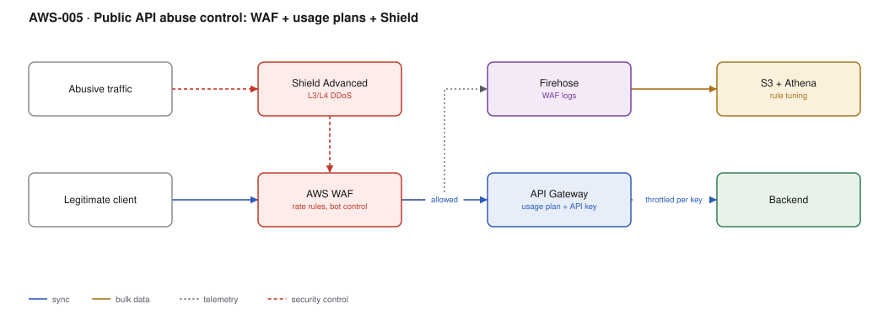

# AWS-005 · Public API abuse control: WAF + usage plans + Shield

> **Category:** [01 · Edge, API & Identity](readme.md#01) · **Maturity:** Production · **Effort:** M

## The problem

An authenticated caller can still ruin your day: credential stuffing, scrapers, a broken
client retrying in a tight loop, or a competitor enumerating your catalogue. Authorisation
answers *may you*; this answers *how much, how fast, and is this even a human*. The layers
are distinct and each catches what the others cannot.

**Use it when** the API is reachable from the internet and has any business value.

**Don't use it when** the API is private ([`aws-006`](aws-006-private-api-gateway.md)) — you
are paying for protection against a threat model that does not apply.

## The four layers

| Layer | Stops | Cannot stop |
|---|---|---|
| Shield (standard, free) | Volumetric L3/L4 floods | Anything application-shaped |
| WAF rate-based rules | A single IP or key hammering you | Distributed low-and-slow abuse |
| WAF Bot Control / managed rules | Known bad agents, scrapers, common exploits | A determined bespoke client |
| API Gateway usage plans | A specific *API key* exceeding its quota | Anonymous traffic (there is no key yet) |

## Components

| Service | Role | The setting that actually matters |
|---|---|---|
| AWS WAF | Inspection and rate limiting | Rate-based rule **aggregation key** — IP by default, but it can be a header or JA3 fingerprint |
| Managed rule groups | Common exploits, reputation lists, bot signatures | Run in **count mode** for two weeks before blocking |
| Shield Advanced (optional) | DDoS response team + cost protection | Only worth it above a real risk threshold — see [`aws-063`](aws-063-ddos-defense.md) |
| API Gateway usage plan | Per-key quota and burst | Throttle is **token bucket**: burst then steady rate, not a flat cap |
| Firehose → S3 → Athena | WAF log analysis | Without this you are tuning rules blind |

## Flow

1. Traffic arrives at CloudFront or the regional API endpoint; Shield absorbs L3/L4 floods.
2. WAF evaluates rules in priority order: allow-lists, then rate limits, then managed groups.
3. Blocked requests are terminated at WAF and never reach the gateway — you are not billed
   for a gateway request.
4. Allowed requests reach API Gateway, which applies per-key usage plan throttling.
5. Within the plan, the account-level and per-method throttles still apply.
6. Every WAF evaluation is logged to Firehose, landed in S3, and queried from Athena to tune
   the rules.

## Cost (us-east-1 — order of magnitude)

| Line item | Small · 1M req/mo | Medium · 50M req/mo | Large · 1B req/mo |
|---|---|---|---|
| WAF web ACL @ $5/mo | $5.00 | $5.00 | $5.00 |
| WAF rules (8 @ $1/mo) | $8.00 | $8.00 | $8.00 |
| WAF requests @ $0.60/M | $0.60 | $30.00 | $600.00 |
| Bot Control @ ~$1/M (if enabled) | $1.00 | $50.00 | $1,000.00 |
| WAF logs → Firehose + S3 (~1 KB/req) | $0.05 | $2.00 | $40.00 |
| Athena tuning queries | ~$1 | ~$5 | ~$20 |
| Shield Advanced (optional, per org) | — | — | $3,000.00 |
| **Total (no Shield Adv, no Bot Control)** | **~$15** | **~$45** | **~$673** |

**Cost cliff:** Bot Control roughly doubles the per-request WAF cost and is priced per
*inspected* request. Scope it with a rule-level scope-down statement so it only inspects
login and checkout paths, not your static assets — that is usually a 90% reduction.

**Biggest lever:** blocking early. A request blocked at WAF costs $0.0000006; the same
request reaching API Gateway and Lambda costs roughly 30× that. Under attack, the layer that
blocks first is the one that saves money.

## Failure modes

| Failure | Symptom | Mitigation |
|---|---|---|
| Managed rules block legitimate traffic | Mysterious 403s for a subset of users | Deploy in count mode, review `terminatingRuleId` in logs, then enable |
| Rate limit keyed on IP behind a NAT | A whole corporate office blocked at once | Aggregate on an API key or a custom header, not IP, for authenticated routes |
| WAF in the wrong scope | Rules silently do nothing | `CLOUDFRONT` scope ACLs must be created in us-east-1; regional ACLs attach to ALB/API GW |
| Usage plan but no API key requirement | Quotas never apply | The method must require an API key; otherwise the plan is decorative |
| Logs not enabled | No way to tune, no evidence after an incident | Enable logging on day one; it is the cheapest line in the table |

## Security notes

- WAF rate-based rules have a **5-minute evaluation window** and a sampling delay. They are a
  blunt instrument against a fast burst; pair with gateway throttling for immediate limits.
- Put allow-lists (your own monitoring, partner IPs) at the lowest rule priority so a managed
  rule cannot block your own health checks.
- Log the `x-amzn-RequestId` so a user complaint can be traced to a specific WAF decision.
- Do not treat an API key as a secret. It identifies a caller for metering; it does not
  authenticate one. Authentication is [`aws-001`](aws-001-lambda-authorizer.md).

## What people miss

- **API Gateway throttling is a token bucket, not a cap.** A plan set to 100 rps with a burst
  of 200 will happily serve a 200-request spike. Load tests that "prove" the limit works
  often just never exceeded the burst.
- **Account-level throttle is shared across every API in the region** (default 10,000 rps).
  One noisy API can throttle a quiet one. Request a raise before you need it.
- **WAF has a 1 MB body inspection limit** (8 KB on older configurations). Attacks hidden past
  that point are invisible to it.
- **Shield Advanced cost protection is a refund process**, not a cap. You still get the bill;
  you then claim credits for the attack-driven portion.

## See also

- [`aws-001`](aws-001-lambda-authorizer.md) — who the caller is
- [`aws-063`](aws-063-ddos-defense.md) — when the threat is volumetric and you need the SRT
- [`aws-009`](aws-009-api-canary-deploys.md) — shipping rule changes safely
- [`aws-065`](aws-065-notification-bus.md) — getting a WAF block spike into chat
