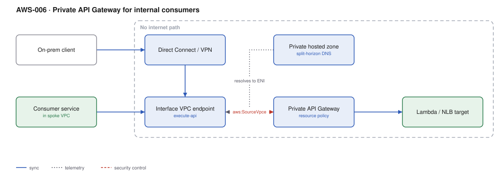

# AWS-006 · Private API Gateway for internal consumers

> **Category:** [01 · Edge, API & Identity](readme.md#01) · **Maturity:** Production · **Effort:** M

## The problem

An internal API — a platform service, a shared pricing engine, an internal admin tool —
should not be reachable from the internet at all. A private REST API is only addressable
through an `execute-api` interface VPC endpoint, so there is no public DNS name that
resolves and no public IP to scan.

**Use it when** every consumer is inside your VPCs or reachable over Direct Connect/VPN, and
"not on the internet" is a requirement you can be asked to prove.

**Don't use it when** consumers are external, mobile, or partner-operated — you will end up
building a public proxy in front of it, which defeats the point. Also skip it if an internal
ALB or [`aws-031`](aws-031-privatelink.md) already fits: private API Gateway is the right
answer specifically when you want the gateway's features (throttling, authorizers, usage
plans, request validation) on an internal API.

## Components

| Service | Role | The setting that actually matters |
|---|---|---|
| API Gateway (**REST**, private) | The API itself | Private endpoints are REST-only — HTTP APIs cannot be private |
| Interface VPC endpoint (`execute-api`) | The only way in | **Private DNS enabled** — or every caller must use the ugly endpoint-specific hostname |
| Resource policy | The actual access control | Must allow `aws:SourceVpce` (or `aws:SourceVpc`); without it, *everything* is denied |
| Route 53 private hosted zone | Friendly internal DNS | Needed to give the API a stable internal name across accounts |
| Direct Connect / VPN | On-prem reach | On-prem resolvers need a Route 53 Resolver inbound endpoint |
| Backend | Lambda, or a VPC-Link to an NLB | VPC-Link for anything already running in the VPC |

## Flow

1. A consumer in a spoke VPC resolves the API hostname. Private DNS on the endpoint makes
   `*.execute-api.<region>.amazonaws.com` resolve to the endpoint ENIs, not the public IPs.
2. An on-prem client reaches the same names via Direct Connect plus a Resolver inbound endpoint.
3. Traffic arrives at the interface endpoint ENI inside your VPC — it never leaves the AWS
   network and never touches an internet gateway.
4. API Gateway evaluates the **resource policy**. If the request did not arrive via an allowed
   VPC endpoint, it is rejected with a 403 regardless of IAM.
5. Authorisation and throttling run as normal.
6. The backend is invoked — Lambda directly, or through a VPC-Link to a private NLB.

## Cost (us-east-1 — order of magnitude)

| Line item | Small · 1M req/mo | Medium · 20M req/mo | Large · 300M req/mo |
|---|---|---|---|
| REST API requests @ $3.50/M | $3.50 | $70.00 | $1,050.00 |
| Interface endpoint, 3 AZs @ ~$0.01/AZ-hr | $21.90 | $21.90 | $21.90 |
| Endpoint data processing @ $0.01/GB | $0.01 | $0.20 | $3.00 |
| Backend (Lambda 256MB/100ms) | $0.60 | $12.00 | $180.00 |
| Route 53 private hosted zone | $0.50 | $0.50 | $0.50 |
| **Total** | **~$27** | **~$105** | **~$1,255** |

**Cost cliff:** the interface endpoint is a **fixed ~$22/month per VPC** (3 AZs) before a single
request. If you put one in each of 40 spoke VPCs, that is $880/month of pure overhead. The fix
is a single shared endpoint in a central VPC, reached over Transit Gateway — see
[`aws-029`](aws-029-transit-gateway-hub.md).

**Biggest lever:** private APIs force REST ($3.50/M) instead of HTTP ($1.00/M). At high volume,
consider whether an internal ALB plus your own auth is a better trade than 3.5× the request cost.

## Failure modes

| Failure | Symptom | Mitigation |
|---|---|---|
| No resource policy | Every request gets 403, including yours | A private API with no resource policy denies all traffic — this is the single most common mistake |
| Private DNS disabled | Clients resolve public IPs and time out | Enable private DNS on the endpoint, or publish the endpoint-specific name |
| Endpoint in one AZ | AZ failure takes the whole API down | Create endpoint ENIs in at least three subnets |
| Security group too tight | Intermittent connection refused | The endpoint SG must allow 443 from consumer CIDRs; it defaults to the VPC default SG |
| Overlapping private DNS | Two VPCs, two endpoints, wrong one wins | Use a private hosted zone with an explicit alias rather than relying on endpoint private DNS everywhere |

## Security notes

- The resource policy is the control boundary, not the security group. Write it to allow a
  named list of `aws:SourceVpce` values and deny everything else explicitly.
- Combine with IAM auth (`AWS_IAM`) so you get both network *and* identity controls. Network
  position alone is not authorisation.
- VPC endpoint policies are a second, independent layer — use them to restrict *which* APIs
  can be called through a shared endpoint.
- Enable execution and access logging; a private API is still worth auditing.

## What people miss

- **Private APIs cannot have a custom domain name** in the usual sense. You front them with a
  Route 53 private hosted zone record pointing at the endpoint, which means certificate and
  hostname handling is your problem.
- **HTTP APIs cannot be private.** If someone specified "HTTP API" and "private" in the same
  design, one of them has to go.
- **The endpoint is a billed resource per VPC per AZ**, and it is easy to forget in 30 accounts.
  This is one of the most common surprise lines in a multi-account bill.
- **`aws:SourceIp` does not work** in the resource policy for private APIs — the source is the
  endpoint, not the client. Use `aws:SourceVpce` or `aws:VpcSourceIp`.

## See also

- [`aws-031`](aws-031-privatelink.md) — exposing a *service* privately rather than an API
- [`aws-029`](aws-029-transit-gateway-hub.md) — sharing one endpoint across many VPCs
- [`aws-033`](aws-033-route53-strategies.md) — the private DNS half of this
- [`aws-008`](aws-008-m2m-auth.md) — authenticating the internal callers
