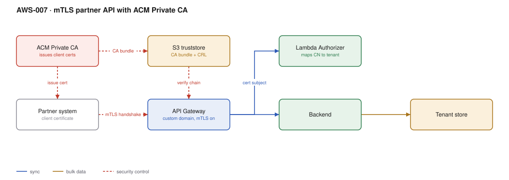

# AWS-007 · mTLS partner API with ACM Private CA

> **Category:** [01 · Edge, API & Identity](readme.md#01) · **Maturity:** Specialist · **Effort:** M

## The problem

A partner — a bank, an insurer, a payments network, a healthcare counterparty — will not
accept a bearer token as the only credential. They want mutual TLS: your server proves who it
is, and their client proves who it is, at the transport layer, before a single byte of HTTP is
parsed. Often this is a contractual or regulatory requirement rather than an engineering choice.

**Use it when** a counterparty requires it, or when you want a credential that cannot be
replayed out of a log file the way a bearer token can.

**Don't use it when** you control both ends and could use SigV4 or OAuth instead. mTLS moves
your hardest problem from "rotate a secret" to "operate a PKI", and certificate expiry is a
genuinely common cause of partner outages.

## Components

| Service | Role | The setting that actually matters |
|---|---|---|
| ACM Private CA | Issues and revokes client certificates | ~$400/month per CA **whether or not you issue anything** |
| S3 truststore | The CA bundle API Gateway validates against | **Enable bucket versioning** — the truststore is referenced by object version |
| API Gateway custom domain | Where mTLS is configured | mTLS is a property of the *custom domain*, not the API or the stage |
| Lambda Authorizer | Maps certificate subject → tenant | The cert proves identity; it does not grant authorisation |
| Certificate revocation (CRL) | Turning off a compromised partner | API Gateway does **not** check CRLs for you |
| DynamoDB | Tenant and entitlement store | Keyed on the certificate serial or subject CN |

## Flow

1. You issue each partner a client certificate from your private CA (or accept their CSR).
2. The CA bundle for all accepted issuers is uploaded to S3 as the truststore.
3. The partner opens a TLS connection to your custom domain and presents its client cert.
4. API Gateway validates the chain against the truststore object version configured on the
   domain. A bad or unknown chain is rejected during the handshake.
5. The request reaches the API with the certificate details in
   `requestContext.identity.clientCert`.
6. A Lambda Authorizer maps the subject CN or serial to a tenant, checks it has not been
   revoked, and returns the tenant context.
7. The backend serves the request scoped to that tenant.

## Cost (us-east-1 — order of magnitude)

| Line item | Small · 5 partners, 100K req/mo | Medium · 50 partners, 5M req/mo | Large · 500 partners, 100M req/mo |
|---|---|---|---|
| ACM Private CA @ ~$400/mo | $400.00 | $400.00 | $400.00 |
| Certificates issued @ ~$0.75 each (first 1K) | $4.00 | $38.00 | $375.00 |
| REST API requests @ $3.50/M | $0.35 | $17.50 | $350.00 |
| Custom domain + regional endpoint | $0 | $0 | $0 |
| Authorizer Lambda (cached) | $0.01 | $0.30 | $6.00 |
| S3 truststore | $0.01 | $0.01 | $0.01 |
| **Total** | **~$404** | **~$456** | **~$1,131** |

**Cost cliff:** the private CA is a flat ~$400/month floor. For five partners that is $80 per
partner per month before any traffic. If the partners already have certificates from a public
CA you both trust, you can skip the CA entirely and just maintain a truststore of their issuers
— that removes the single largest line in this table.

**Biggest lever:** whether you need to *issue* certificates at all. Accepting partner-supplied
certificates from their own CAs costs nothing but makes rotation their problem, which is
usually what partners want anyway.

## Failure modes

| Failure | Symptom | Mitigation |
|---|---|---|
| Certificate expires | Partner integration dies at a timestamp, hard outage | Track every cert expiry as a monitored date; alert at 60/30/7 days — this is **the** failure mode |
| Truststore updated in place | New version not picked up, or picked up unexpectedly | Versioned bucket + explicit object version on the domain; update is a deliberate change |
| CA bundle missing an intermediate | Some partners fail, others work | Include the full chain, not just the root |
| Revoked cert still accepted | Compromised partner retains access | API Gateway does not check CRLs — enforce revocation in the authorizer against your own list |
| mTLS enabled, old clients break | Everyone fails at once at cutover | Run a parallel domain with mTLS off during migration |

## Security notes

- A valid certificate proves identity only. Every authorisation decision still happens in the
  authorizer and the handler.
- Pin the mapping from certificate to tenant on the **serial number plus issuer**, not the CN
  alone — CNs are not unique across CAs.
- Keep the private CA in a separate, tightly-held account. Its root key is a crown jewel.
- Disable TLS 1.0/1.1 on the domain, and prefer a security policy that requires TLS 1.2+.
- Log the certificate serial on every request; it is your audit trail of which partner did what.

## What people miss

- **mTLS is configured on the custom domain**, so every API mapped to that domain inherits it.
  You cannot have one path require client certs and another not.
- **API Gateway does no revocation checking at all.** If you believed the handshake covered
  revocation, you have a gap. Build a deny-list check into the authorizer.
- **The private CA bills from the moment it is created**, even in `DISABLED` state, until it is
  deleted — and deletion has a mandatory waiting period of up to 30 days.
- **Truststore updates can take minutes to propagate** and are not transactional across edge
  locations on an edge-optimised domain. Use a regional domain for predictable behaviour.
- **Certificates are not secrets you can rotate on your own schedule** — every rotation is a
  coordinated change with a counterparty who has their own change freeze calendar.

## See also

- [`aws-001`](aws-001-lambda-authorizer.md) — the authorizer doing the tenant mapping
- [`aws-008`](aws-008-m2m-auth.md) — the cheaper options when you control both ends
- [`aws-059`](aws-059-kms-key-hierarchy.md) — key custody practices that apply to the CA
- [`aws-058`](aws-058-secrets-rotation.md) — the rotation discipline this needs, applied to certs
