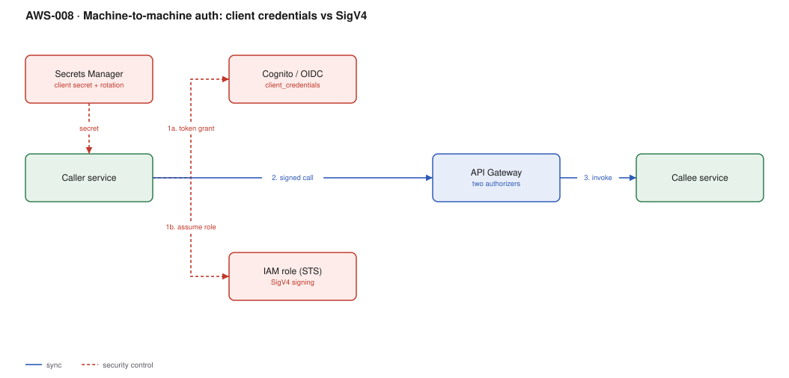

# AWS-008 · Machine-to-machine auth: client credentials vs SigV4

> **Category:** [01 · Edge, API & Identity](readme.md#01) · **Maturity:** Production · **Effort:** S

## The problem

Service A needs to call service B and there is no human in the loop, so there is no login
screen, no refresh token and nobody to approve a consent prompt. You have two good options
and they are good for different reasons: OAuth 2.0 client credentials (a bearer token from an
IdP) or AWS SigV4 (an IAM role signing the request). Most organisations need both.

**Use client credentials when** the caller is outside AWS, or when the API is also consumed
by partners who expect OAuth, or when you need scopes that mean something to your domain.

**Use SigV4/IAM when** both sides are AWS workloads. There is no secret to store, rotate or
leak — the credential is the role, delivered by the metadata service and rotated automatically.

**Don't** invent a third option with a static API key in an environment variable. That is the
thing both of these exist to replace.

## The actual decision

| | OAuth client credentials | SigV4 (IAM) |
|---|---|---|
| Credential | `client_id` + secret → short-lived JWT | Role credentials, auto-rotated |
| Secret to store | **Yes** — the client secret | **No** |
| Works from outside AWS | Yes | Awkward (needs IAM user keys or OIDC federation) |
| Cross-account | Natural | Natural (`sts:AssumeRole` or resource policy) |
| Granularity | OAuth scopes you define | IAM actions and resource ARNs |
| Revocation | Delete the client; tokens live until `exp` | Immediate, via policy change |
| Audit trail | Your IdP logs | CloudTrail, for free |
| Cost at the gateway | Free (JWT authorizer) | Free (`AWS_IAM` auth) |

## Components

| Service | Role | The setting that actually matters |
|---|---|---|
| Cognito app client (or your IdP) | Issues `client_credentials` tokens | Must have a **resource server with scopes**; a plain app client cannot do this grant |
| Secrets Manager | Holds the client secret | Rotation schedule, and caching the secret in the caller so you do not pay per call |
| IAM role | The SigV4 identity | Trust policy — the narrowest principal that works |
| API Gateway | Validates both | Two authorizers on one API is normal: `JWT` for external, `AWS_IAM` for internal |
| CloudTrail | Audit | SigV4 calls appear here automatically; OAuth calls do not |

## Flow

**Client credentials path**
1. The caller reads its client secret from Secrets Manager, cached in memory.
2. It POSTs to the IdP token endpoint with `grant_type=client_credentials` and a scope.
3. It receives a short-lived access token and caches it until shortly before `exp`.
4. It calls the API with `Authorization: Bearer <token>`; the JWT authorizer validates it.

**SigV4 path**
1. The caller assumes (or already runs as) an IAM role — via a task role, IRSA, or
   `sts:AssumeRole` for cross-account.
2. The SDK signs the request with those credentials automatically.
3. API Gateway with `AWS_IAM` auth verifies the signature and evaluates the resource policy
   plus the caller's identity policy.

## Cost (us-east-1 — order of magnitude)

| Line item | Small · 1M calls/mo | Medium · 50M calls/mo | Large · 1B calls/mo |
|---|---|---|---|
| HTTP API requests @ $1.00/M | $1.00 | $50.00 | $1,000.00 |
| JWT authorizer / IAM auth | $0 | $0 | $0 |
| Cognito M2M token requests @ ~$0.0015 each | ~$0.08 | ~$4.00 | ~$80.00 |
| Secrets Manager (1 secret + API calls) | $0.40 | $0.45 | $1.00 |
| STS calls (SigV4 path) | $0 | $0 | $0 |
| **Total — SigV4 path** | **~$1** | **~$50** | **~$1,000** |
| **Total — client credentials path** | **~$1.50** | **~$55** | **~$1,081** |

**Cost cliff:** Cognito bills M2M by **token request**, not by MAU. A caller that fetches a new
token for every API call instead of caching it turns a rounding error into a real line — at 1B
calls that is roughly $1,500/month of pure waste. Cache the token until 75% of its lifetime.

**Biggest lever:** token caching on the client, and the authorizer cache on the server. Both
are one line of config and both remove an entire round trip.

## Failure modes

| Failure | Symptom | Mitigation |
|---|---|---|
| Token fetched per request | Latency doubles, IdP throttles you, bill climbs | Cache in module scope with a refresh at ~75% of TTL |
| Secret rotated, caller caches forever | Auth fails hours after a successful rotation | Catch 401, invalidate the cache, retry once — then fail |
| Clock skew on the caller | SigV4 signatures rejected as expired | SigV4 allows a 5-minute window; run NTP |
| Role trust policy too broad | Any principal in the account can assume it | Scope the trust to a specific role ARN, and add `sts:ExternalId` for third parties |
| Scopes not checked | Any valid token can call any endpoint | The JWT authorizer can check scopes per route — configure it, do not assume it |

## Security notes

- A client secret in an environment variable is a secret in your deploy logs, your process
  list and your container image history. Read it from Secrets Manager at runtime.
- Give every caller its **own** client or role. Shared credentials make revocation an outage.
- SigV4 gives you CloudTrail for free: who called what, when, from where. That audit trail is
  often the deciding argument for internal traffic.
- Set short token lifetimes (5–15 minutes) for M2M. There is no user to re-prompt, so there is
  no cost to short expiry beyond a token fetch.

## What people miss

- **Cognito `client_credentials` requires a resource server.** You must define a resource
  server with custom scopes on the user pool before the grant is even available — plenty of
  people conclude Cognito cannot do M2M because of this.
- **The id token is not for this.** Client credentials issues an access token only; there is
  no user, so there is no id token. Code that expects one is confused about the flow.
- **IAM auth and resource policies are evaluated together**, and an explicit deny in either
  wins. A caller with a perfect identity policy still fails if the API resource policy does
  not allow it.
- **SigV4 from outside AWS is possible** via OIDC federation — a GitHub Actions workflow can
  assume a role with no stored keys at all. That is usually better than issuing IAM user keys.

## See also

- [`aws-001`](aws-001-lambda-authorizer.md) — when neither built-in validator fits
- [`aws-002`](aws-002-cognito-oidc-spa.md) — the human-facing half of the same user pool
- [`aws-058`](aws-058-secrets-rotation.md) — rotating the client secret without an outage
- [`aws-060`](aws-060-identity-center-abac.md) — the equivalent decision for human access
