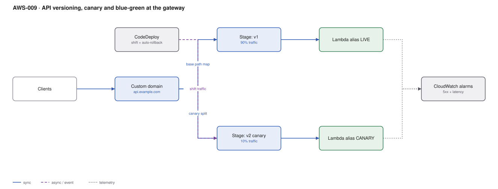

# AWS-009 · API versioning, canary and blue-green at the gateway

> **Category:** [01 · Edge, API & Identity](readme.md#01) · **Maturity:** Production · **Effort:** M

## The problem

You need to change a public API without breaking the clients you cannot upgrade. Two separate
problems hide inside that sentence: **versioning** (two contracts coexisting for months) and
**deployment** (one contract, new code, shifted gradually over minutes). Conflating them is
why teams end up with `/v7` and no way to ever delete `/v3`.

**Use canary deploys for** every change. **Use a new version for** breaking contract changes
only — and plan the sunset before you ship the new one.

**Don't** create a new version to deploy a bug fix. That is what stages and aliases are for.

## The two mechanisms, kept separate

| | Versioning | Canary / blue-green |
|---|---|---|
| Lives for | Months to years | Minutes to hours |
| Visible to clients | Yes — it is in the URL or a header | No |
| Mechanism | Base path mapping on a custom domain | Stage canary settings + Lambda alias weights |
| Rollback | Clients must change | Automatic, on an alarm |
| Ends when | The last client migrates | The deploy completes |

## Components

| Service | Role | The setting that actually matters |
|---|---|---|
| Custom domain + base path mapping | Maps `/v1` and `/v2` to different stages or APIs | This is where versioning actually lives |
| Stage canary settings | Percentage split within one stage | `percentTraffic` plus `useStageCache` — a shared cache across versions causes cross-contamination |
| Lambda alias + weighted versions | Shifts traffic at the compute layer | Weighted aliases are often simpler than gateway canaries |
| CodeDeploy | Automates the shift and the rollback | `DeploymentConfig` (linear/canary) + alarms as the rollback trigger |
| CloudWatch alarms | The thing that decides rollback | Alarm on **error rate and p99 latency**, not just invocation errors |

## Flow

1. Clients call `api.example.com/v2/...`; the base path mapping routes to the v2 stage.
2. A deploy publishes a new Lambda version and points the `CANARY` alias at it.
3. CodeDeploy begins shifting: 10% of traffic to the new version, 90% to the old.
4. CloudWatch alarms watch error rate and latency for the bake period.
5. If an alarm fires, CodeDeploy shifts 100% back to the previous version automatically —
   no human, no redeploy.
6. If the bake passes, the shift completes and `LIVE` is updated to the new version.
7. The old version stays published, so rollback remains one API call away.

## Cost (us-east-1 — order of magnitude)

| Line item | Small · 1M req/mo | Medium · 50M req/mo | Large · 500M req/mo |
|---|---|---|---|
| HTTP API requests @ $1.00/M | $1.00 | $50.00 | $500.00 |
| Lambda (both versions during bake) | $1.20 | $60.00 | $600.00 |
| CloudWatch alarms (6 @ $0.10) | $0.60 | $0.60 | $0.60 |
| CodeDeploy for Lambda | $0 | $0 | $0 |
| Stage cache (0.5 GB) if enabled | $14.60 | $14.60 | $14.60 |
| **Total** | **~$3** | **~$111** | **~$1,101** |

**Cost cliff:** API Gateway stage caching is billed **per hour per stage**, from $0.02/hr for
0.5 GB up to $3.80/hr for 237 GB. Enabling a large cache on every stage — including the three
you forgot in dev — is a four-figure monthly line that nobody attributes to deployments.
Running two versions permanently doubles whatever the stage-level fixed costs are.

**Biggest lever:** keeping the bake short and the version count low. Each live version is a
permanent duplicate of your fixed costs and your maintenance surface.

## Failure modes

| Failure | Symptom | Mitigation |
|---|---|---|
| No alarms wired to the deploy | Canary "succeeds" while shipping a broken build | A deployment without a rollback alarm is not a canary, it is a slow deploy |
| Alarm window longer than the bake | Deploy completes before the alarm could fire | Bake time must exceed the alarm evaluation period, with margin |
| Shared stage cache across canary | New version poisons cached responses for old | Disable `useStageCache` on canary, or key the cache on version |
| Database migration not backward compatible | Rollback restores code but not schema | Expand/contract: deploy schema changes that both versions tolerate, migrate, then contract |
| Versions never retired | Six live versions, nobody can change anything | Publish a sunset date with the launch; measure per-version traffic from day one |

## Security notes

- Authorizers are configured per stage. A new stage can silently ship with no authorizer —
  assert on it in a smoke test that runs before the shift begins.
- Keep old versions *published* but ensure retired ones are actually unreachable, not just
  undocumented. An unmapped base path is the enforcement point.
- Canary deployments log to the same place; include the version in your structured logs or
  you cannot tell which code produced an error during a shift.

## What people miss

- **Lambda alias weighting is usually simpler than API Gateway canary settings** and composes
  better with CodeDeploy. Reach for the gateway canary only when the change is in the gateway
  config itself — a new mapping template, a different integration.
- **Rollback does not undo a data change.** Expand/contract on the schema is the actual
  prerequisite for safe rollback, and it is a design discipline, not a feature you enable.
- **Stage variables are not secrets** and are visible in the console and in exports.
- **The 429 you see during a canary** is often the account-level throttle, not your usage plan —
  two versions briefly double your concurrency demand.
- **Header-based versioning is cleaner than URL versioning** (`Accept: application/vnd.api.v2+json`)
  but it is invisible in logs and dashboards unless you deliberately extract it. Most teams
  are happier with the ugly URL.

## See also

- [`aws-025`](aws-025-progressive-delivery.md) — the same idea for containers
- [`aws-072`](aws-072-slo-error-budgets.md) — the alarms that should gate a shift
- [`aws-005`](aws-005-api-abuse-control.md) — shipping WAF rule changes needs the same care
- [`aws-001`](aws-001-lambda-authorizer.md) — the per-stage authorizer trap above
