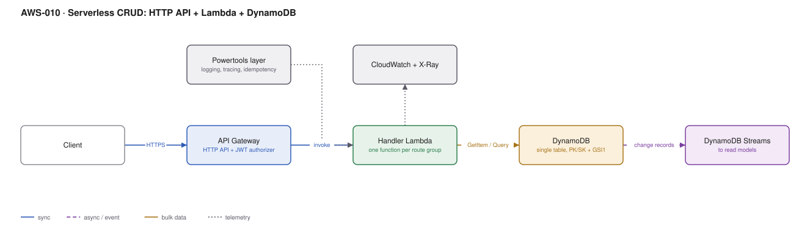

# AWS-010 · Serverless CRUD: HTTP API + Lambda + DynamoDB single-table

> **Category:** [02 · Serverless Application Patterns](readme.md#02) · **Maturity:** Production · **Effort:** S

## The problem

The default shape for a new backend: a REST-ish API over a handful of entities, no servers,
pay nothing when idle, scale without thinking about it. The architecture is easy. The part
teams get wrong is the data model — they bring a relational mindset to DynamoDB, end up with
five tables and a Scan, and conclude that DynamoDB does not work.

**Use it when** access patterns are known and bounded, latency matters, and traffic is spiky
or low. This is the cheapest way to run a real API that exists.

**Don't use it when** you need ad-hoc queries, reporting, joins across entities, or your
access patterns genuinely change every sprint. That is a relational workload — use
[`aws-018`](aws-018-lambda-rds-proxy.md) and be happier.

## Components

| Service | Role | The setting that actually matters |
|---|---|---|
| API Gateway HTTP API | Routing, auth, throttling | Payload format **2.0** and a JWT authorizer if you can use one |
| Lambda | Handlers | Memory size — it buys CPU proportionally, so 1024 MB is often *cheaper* than 256 MB |
| Lambda Powertools | Logging, tracing, idempotency, validation | The `@idempotent` decorator; retries are not optional at this layer |
| DynamoDB | Storage | **Single table** with generic `PK`/`SK` and one or two GSIs |
| DynamoDB Streams | Change feed for read models | Only if you need it — see [`aws-053`](aws-053-ddb-streams-views.md) |
| CloudWatch + X-Ray | Observability | Structured JSON logs; `logRetentionInDays` is infinite by default |

## Flow

1. The client calls the API with a bearer token.
2. API Gateway validates the JWT natively and routes to a handler.
3. The handler reads a typed, validated event (Powertools parser) and applies idempotency on
   a request key.
4. It issues a `GetItem`, `Query` or `TransactWriteItems` against the single table — never a
   `Scan` on the request path.
5. The change propagates to DynamoDB Streams for anything that needs a derived view.
6. Structured logs and traces land in CloudWatch and X-Ray.

## Cost (us-east-1, on-demand — order of magnitude)

| Line item | Small · 100K req/mo | Medium · 10M req/mo | Large · 300M req/mo |
|---|---|---|---|
| HTTP API @ $1.00/M | $0.10 | $10.00 | $300.00 |
| Lambda 512 MB / 80 ms | $0.05 | $4.00 | $120.00 |
| DynamoDB on-demand reads (2/req) | $0.05 | $5.00 | $150.00 |
| DynamoDB on-demand writes (0.3/req) | $0.04 | $3.75 | $112.50 |
| DynamoDB storage (20 GB) | $5.00 | $5.00 | $5.00 |
| CloudWatch Logs @ $0.50/GB ingest | $0.05 | $5.00 | $150.00 |
| **Total** | **~$5** | **~$33** | **~$838** |

**Cost cliff:** DynamoDB **provisioned** capacity with autoscaling is roughly 5–7× cheaper per
request than on-demand at a steady, predictable load. On-demand is right for spiky and unknown
traffic; past about 20% sustained utilisation, provisioned wins decisively. Switching mode is
allowed once every 24 hours.

**Biggest lever:** at high volume, CloudWatch Logs ingest quietly becomes one of your top three
lines. Drop `DEBUG` in production, sample verbose logs, and set a retention policy — logs
default to **never expire**.

## Failure modes

| Failure | Symptom | Mitigation |
|---|---|---|
| Hot partition | Throttling on one key while the table is mostly idle | Spread the partition key; add a write-sharding suffix for high-velocity keys |
| Retry without idempotency | Duplicate orders, double charges | Powertools idempotency with a DynamoDB persistence store |
| Scan on the request path | Fine with 100 rows, dies at 100,000 | Design the GSI for the query; treat any `Scan` in a handler as a bug |
| Cold starts | p99 much worse than p50 | Smaller bundles, ARM64, provisioned concurrency only if contractual |
| Item > 400 KB | Writes rejected at an unpredictable size | Store large bodies in S3 and keep a pointer in the item |

## Security notes

- One IAM role per function, scoped to the specific table and the specific actions. Not
  `dynamodb:*` on `*`.
- Use `dynamodb:LeadingKeys` in the IAM policy for genuine per-tenant isolation at the
  database layer, not just in code.
- Enable point-in-time recovery on the table. It is cheap and the alternative is a bad day.
- Turn off verbose request logging on anything carrying personal data; API Gateway execution
  logs capture more than people expect.

## What people miss

- **More memory is often cheaper.** Lambda allocates CPU in proportion to memory. A function
  that takes 400 ms at 256 MB may take 80 ms at 1024 MB — same GB-seconds, a quarter of the
  latency. Measure with Lambda Power Tuning rather than guessing low.
- **ARM64 (Graviton) is ~20% cheaper** for the same work and is usually a one-line change.
- **Single-table design is about joins, not tidiness.** The point is fetching a parent and its
  children in one `Query`. If you are not doing that, multiple tables are fine and much easier
  to reason about.
- **On-demand has no capacity planning but it does have warm-up.** A table idle for weeks will
  throttle a sudden 10× spike until it scales. Pre-warm before a known launch.
- **`TransactWriteItems` costs 2× a normal write** and is capped at 100 items. It is not a
  general-purpose transaction.

## See also

- [`aws-001`](aws-001-lambda-authorizer.md) — authorising this API
- [`aws-053`](aws-053-ddb-streams-views.md) — the read models fed by the stream
- [`aws-018`](aws-018-lambda-rds-proxy.md) — when the data is genuinely relational
- [`aws-012`](aws-012-async-job-submission.md) — for anything longer than a request
