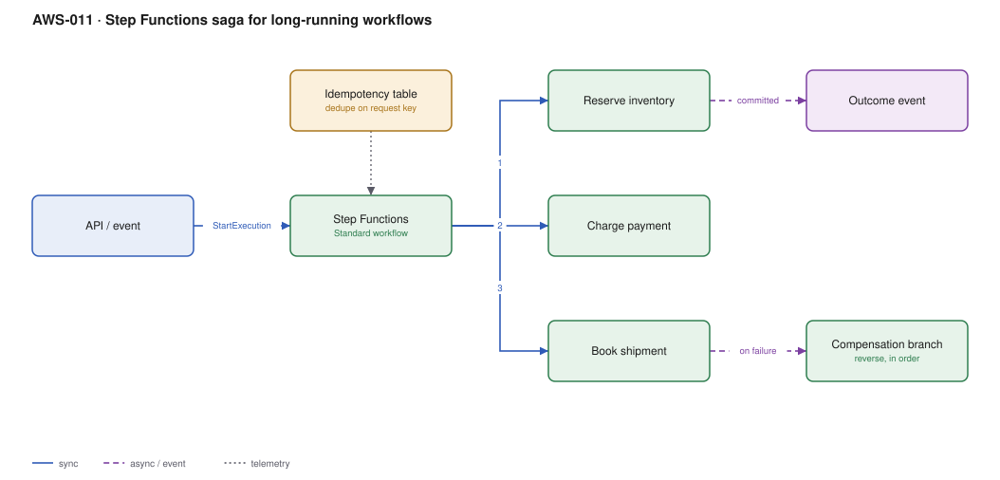

# AWS-011 · Step Functions saga for long-running workflows

> **Category:** [02 · Serverless Application Patterns](readme.md#02) · **Maturity:** Production · **Effort:** M

## The problem

An order has to reserve inventory, charge a card and book a shipment. Three systems, no
distributed transaction, and partial failure is routine. The saga pattern accepts that you
cannot roll back and instead defines a *compensating action* for every step. Step Functions
is the right place to run it because the orchestration state survives failures, deploys and
hours of waiting.

**Use it when** a business process spans multiple services, takes longer than a request, and
a half-completed state is unacceptable.

**Don't use it when** the steps are all in one service and one database — use a real
transaction. And don't use it as a general-purpose job runner for high-volume, low-value
events; at scale, state transitions get expensive.

## Components

| Service | Role | The setting that actually matters |
|---|---|---|
| Step Functions **Standard** | Orchestration with durable state | Standard vs Express — see the cost note, it is a 100× difference in billing model |
| Idempotency table | Dedupe duplicate starts | Execution names must be unique; derive from the business key |
| Task Lambdas | Each forward step | Must be idempotent — Step Functions retries |
| Compensation branch | Reverse completed steps, in reverse order | Compensations must also be idempotent and must not themselves fail hard |
| `Catch` / `Retry` blocks | Failure handling in the state machine | Per-state retry with backoff before falling through to compensation |
| EventBridge | Publishes the outcome | Decouples the saga from whatever cares about the result |

## Flow

1. An API or event starts an execution, named deterministically from the business key so a
   duplicate submit collides instead of double-running.
2. The state machine reserves inventory. On a transient error it retries with backoff.
3. It charges payment. Success advances; a terminal failure enters the catch path.
4. It books shipment.
5. If any step fails terminally, the compensation branch runs the reversals **in reverse
   order** — refund, then release the inventory.
6. The final outcome, success or compensated-failure, is published to EventBridge.

## Cost (us-east-1 — order of magnitude)

| Line item | Small · 10K sagas/mo | Medium · 1M sagas/mo | Large · 20M sagas/mo |
|---|---|---|---|
| Standard @ $0.025 / 1K transitions (12 each) | $3.00 | $300.00 | $6,000.00 |
| *Same volume on Express* @ $1.00/M + duration | $0.04 | $4.00 | $80.00 |
| Task Lambdas (3 × 200 ms × 512 MB) | $0.10 | $10.00 | $200.00 |
| DynamoDB idempotency writes | $0.02 | $1.50 | $30.00 |
| EventBridge @ $1.00/M | $0.01 | $1.00 | $20.00 |
| **Total (Standard)** | **~$3** | **~$313** | **~$6,250** |

**Cost cliff:** Standard bills **per state transition**; Express bills per request plus
duration. At 20M executions that is $6,000 versus $80 — a 75× difference. But Express
workflows have a 5-minute limit, at-least-once semantics, and no execution history in the
console. The honest rule: Standard for business-critical sagas where you need the audit trail
and exactly-once; Express for high-volume, short, idempotent processing.

**Biggest lever:** the number of states. Every `Pass`, `Choice` and `Wait` is a billed
transition. Collapsing three trivial states into one Lambda is a real saving at volume.

## Failure modes

| Failure | Symptom | Mitigation |
|---|---|---|
| Compensation itself fails | Stuck half-completed saga, money taken, no goods | Compensations retry forever into a DLQ + human queue; never let one fail silently |
| Non-idempotent task | Retry double-charges the customer | Idempotency key passed into every task, enforced at the task |
| Payload size exceeded | Execution fails at 256 KB of state | Pass S3 pointers, not payloads, between states |
| Execution history exhausted | Long-running saga dies at 25,000 events | Split into child executions, or use a `Map` with distributed mode |
| Duplicate start | Two sagas for one order | Deterministic execution name — a duplicate name is rejected for 90 days |

## Security notes

- The state machine role needs `lambda:InvokeFunction` on exactly the task functions, nothing
  wildcarded.
- Execution input appears in the console and in CloudTrail. Do not put card numbers or
  personal data in it; pass references.
- Enable logging at `ERROR` level minimum, `ALL` while developing — but `ALL` logs the payload,
  so turn it down before production.
- Use `.sync` integration patterns carefully: they grant the state machine broad permissions
  on the target service.

## What people miss

- **Compensation order matters and is the reverse of execution.** Refund before releasing
  inventory, not after — otherwise a concurrent order grabs the stock you have not paid back for.
- **A saga is not a rollback.** Intermediate states *are* visible to the outside world. If a
  partial state would be catastrophic rather than merely untidy, you need a different design
  (reserve-then-commit, or a single owning service).
- **`Wait` states are free to wait but not free to exist** — a one-year wait costs one
  transition, which makes Step Functions an excellent and widely-missed scheduler for
  "do X in 30 days".
- **Express workflows are at-least-once.** If your tasks are not idempotent, Express will
  eventually corrupt your data, and it will do it rarely enough to be hard to find.
- **Distributed Map** processes millions of S3 objects in parallel with its own child
  executions. People hand-roll this with SQS for years before discovering it.

## See also

- [`aws-012`](aws-012-async-job-submission.md) — the simpler queue-based alternative
- [`aws-014`](aws-014-eventbridge-scheduler.md) — if all you need is "later"
- [`aws-013`](aws-013-fanout-fanin.md) — parallel work without orchestration
- [`aws-080`](aws-080-media-pipeline.md) — a concrete Step Functions pipeline
