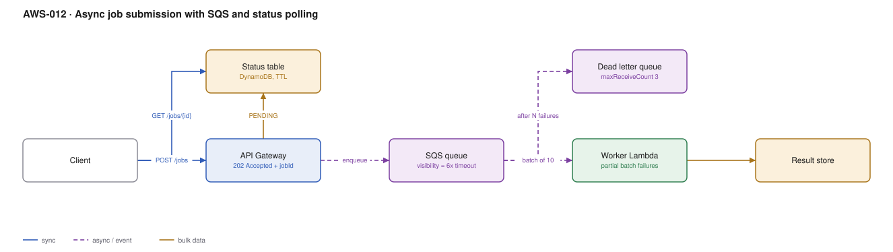

# AWS-012 · Async job submission with SQS and status polling

> **Category:** [02 · Serverless Application Patterns](readme.md#02) · **Maturity:** Production · **Effort:** S

## The problem

A request takes 40 seconds. Maybe it renders a report, calls a slow partner, or runs a model.
Holding an HTTP connection open for it is fragile and caps your concurrency on the wrong
resource. The fix is to accept the work, return a job id immediately, and let the client ask
later. Simple to describe, and there are four places people get it wrong.

**Use it when** the work is longer than a few seconds, can fail and be retried, and the client
can tolerate eventual completion.

**Don't use it when** the client genuinely needs the answer inline — adding polling to hide a
2-second call makes the system worse. And don't use it when you need ordered, orchestrated
multi-step work; that is [`aws-011`](aws-011-step-functions-saga.md).

## Components

| Service | Role | The setting that actually matters |
|---|---|---|
| API Gateway | Accepts the job, returns `202` + `jobId` | Can write to SQS **directly** via a service integration — no Lambda needed |
| DynamoDB status table | Job state the client polls | A TTL attribute, so completed jobs clean themselves up |
| SQS queue | Buffer and retry boundary | **Visibility timeout ≥ 6× the Lambda timeout** — the single most common misconfiguration |
| Worker Lambda | Does the work | `ReportBatchItemFailures` so one poison message does not fail the batch |
| Dead letter queue | Catches what cannot be processed | `maxReceiveCount` of 3–5, plus an alarm on `ApproximateNumberOfMessagesVisible > 0` |
| Result store | Where the output lands | S3 for anything large, with a presigned URL handed back |

## Flow

1. The client `POST`s the job. API Gateway writes directly to SQS and returns `202` with a
   `jobId` derived from an idempotency key the client supplies.
2. The status table is written as `PENDING`.
3. The worker Lambda polls the queue in batches, marks `RUNNING`, does the work.
4. On success it writes the result and sets `COMPLETE`; on failure it returns the failed
   message ids so only those are retried.
5. After `maxReceiveCount` attempts a message lands in the DLQ and the job is marked `FAILED`.
6. The client polls `GET /jobs/{id}` until it is terminal, honouring a `Retry-After` header.

## Cost (us-east-1 — order of magnitude)

| Line item | Small · 10K jobs/mo | Medium · 2M jobs/mo | Large · 50M jobs/mo |
|---|---|---|---|
| SQS requests @ $0.40/M (≈3 API calls/job) | $0.01 | $2.40 | $60.00 |
| Worker Lambda (1 GB × 20 s) | $3.33 | $666.00 | $16,650.00 |
| API Gateway (submit + 10 polls) | $0.11 | $22.00 | $550.00 |
| DynamoDB status (2 writes, 10 reads) | $0.03 | $5.50 | $137.50 |
| S3 results (1 MB each) | $0.30 | $55.00 | $1,350.00 |
| **Total** | **~$4** | **~$751** | **~$18,750** |

**Cost cliff:** polling. Ten polls per job costs more in API Gateway requests than the
submission itself, and at 50M jobs that is $500/month of clients asking "are we there yet".
If latency to notification matters, push instead: a WebSocket ([`aws-016`](aws-016-serverless-websockets.md)),
or an SNS/webhook callback. If it does not, use exponential backoff and send `Retry-After`.

**Biggest lever:** worker duration × memory. It dominates everything else by an order of
magnitude. If the work is CPU-bound and runs over ~60 seconds, price it against Fargate or
AWS Batch ([`aws-026`](aws-026-aws-batch.md)) — Lambda stops being the cheap option.

## Failure modes

| Failure | Symptom | Mitigation |
|---|---|---|
| Visibility timeout < function timeout | The same job runs two or three times concurrently | Set visibility to at least 6× the Lambda timeout; this is the classic SQS bug |
| No partial batch failure reporting | One bad message retries the whole batch of 10 forever | Enable `ReportBatchItemFailures` and return the failed ids |
| DLQ with no alarm | Jobs vanish, discovered weeks later by a customer | Alarm on DLQ depth > 0, route it to chat ([`aws-065`](aws-065-notification-bus.md)) |
| Lambda scaling floods the database | The worker scales to 1,000 and the RDS instance dies | Set **maximum concurrency** on the event source mapping, not just reserved concurrency |
| Status row never written | Client polls forever on a job that failed before start | Write `PENDING` before enqueueing, not after |

## Security notes

- The status endpoint must authorise by job *owner*, not just by a valid token. A sequential
  or guessable job id plus a missing owner check is a standard IDOR.
- Return results via short-lived presigned S3 URLs rather than streaming them through Lambda.
- Encrypt the queue with SSE-KMS if payloads carry anything sensitive; SQS messages are
  retained up to 14 days.
- Scope the API Gateway integration role to `sqs:SendMessage` on exactly one queue.

## What people miss

- **API Gateway can write to SQS directly.** The "submit" Lambda that almost every tutorial
  includes is pure cost and latency. A service integration removes it entirely.
- **A standard queue is at-least-once and unordered.** Workers must be idempotent. Reaching
  for FIFO to avoid that is usually the wrong trade — FIFO caps throughput per message group
  and costs more.
- **`maxReceiveCount` counts receives, not failures.** A message whose worker times out is
  received again; three timeouts exhaust the budget without a single explicit error.
- **Lambda event-source scaling is aggressive** — up to 1,000 concurrent executions within a
  minute. The thing downstream of your worker is what breaks first.
- **SQS has a 256 KB message limit.** The extended client library transparently stores larger
  payloads in S3, and almost nobody knows it exists.

## See also

- [`aws-011`](aws-011-step-functions-saga.md) — when the job has multiple orchestrated steps
- [`aws-016`](aws-016-serverless-websockets.md) — pushing completion instead of polling
- [`aws-026`](aws-026-aws-batch.md) — when the job is minutes or hours, not seconds
- [`aws-065`](aws-065-notification-bus.md) — getting the DLQ alarm in front of a human
