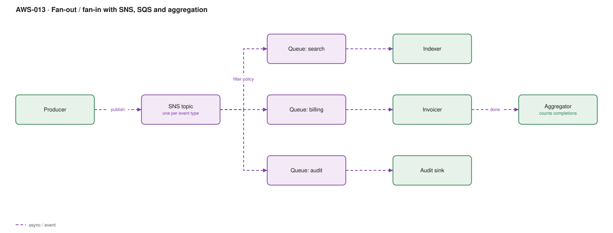

# AWS-013 · Fan-out / fan-in with SNS, SQS and aggregation

> **Category:** [02 · Serverless Application Patterns](readme.md#02) · **Maturity:** Production · **Effort:** M

## The problem

One business event — "order placed" — needs to reach the search indexer, the invoicing
service and the audit sink. Calling all three from the producer couples them together: a slow
indexer becomes a slow checkout, and adding a fourth consumer means changing the producer.
SNS fans out; a queue per consumer gives each one its own retry budget and its own failure
domain.

**Use it when** multiple independent consumers care about the same event and must not affect
each other.

**Don't use it when** there is exactly one consumer — that is just a queue. And don't use it
when consumers must run in a defined order with compensation; that is
[`aws-011`](aws-011-step-functions-saga.md).

## Why SNS → SQS → Lambda, not SNS → Lambda

Subscribing Lambda directly to SNS looks simpler and is almost always wrong. SNS retries a
failed Lambda delivery a few times over roughly 23 seconds and then **discards the message**.
The queue in between gives you a durable buffer, a configurable retry policy, a DLQ, batching,
and back-pressure when the consumer is slow. The extra $0.40 per million is the cheapest
insurance in AWS.

## Components

| Service | Role | The setting that actually matters |
|---|---|---|
| SNS topic | Fan-out point, one per event type | **Message filter policies** — subscribers declare what they want, so the topic stays generic |
| SQS queue per consumer | Independent buffer and retry domain | Its own DLQ and `maxReceiveCount` per consumer |
| Queue access policy | Lets the topic write to the queue | Must include `aws:SourceArn` of the topic, or anyone can publish |
| Raw message delivery | Strips the SNS envelope | On, unless consumers need SNS metadata |
| Aggregator | Fan-in: knows when all parts are done | A DynamoDB counter with a conditional update, not a timer |

## Flow

1. The producer publishes once to the topic and returns. It knows nothing about consumers.
2. SNS evaluates each subscription filter policy and delivers only to matching queues.
3. Each queue buffers independently; a consumer being down just grows its own backlog.
4. Each consumer Lambda polls its own queue with its own concurrency and retry settings.
5. Failures land in that consumer's DLQ, affecting nobody else.
6. For fan-in, each consumer atomically increments a counter keyed on the correlation id; the
   one that increments it to N triggers the completion path.

## Cost (us-east-1 — order of magnitude)

| Line item | Small · 100K events/mo | Medium · 20M events/mo | Large · 500M events/mo |
|---|---|---|---|
| SNS publishes @ $0.50/M | $0.05 | $10.00 | $250.00 |
| SNS → SQS deliveries (3 subs, free to SQS) | $0 | $0 | $0 |
| SQS requests @ $0.40/M (3 queues × ~2 ops) | $0.24 | $48.00 | $1,200.00 |
| Consumer Lambdas (3 × 256 MB × 100 ms) | $0.15 | $30.00 | $750.00 |
| Aggregator DynamoDB updates | $0.13 | $25.00 | $625.00 |
| **Total** | **~$0.60** | **~$113** | **~$2,825** |

**Cost cliff:** SNS deliveries **to SQS are free**, but deliveries to HTTP/S, email or SMS are
not — SMS in particular is cents per message and has turned a fan-out bug into a five-figure
incident more than once. Keep SMS behind a rate limit and a budget alarm.

**Biggest lever:** batching. SQS `ReceiveMessage` with a batch of 10 and long polling cuts the
request line by roughly 10×. Short polling with batch size 1 is the default-ish mistake that
makes SQS look expensive.

## Failure modes

| Failure | Symptom | Mitigation |
|---|---|---|
| SNS → Lambda directly | Messages silently lost under load | Always put a queue in between |
| No filter policy | Every consumer gets every event and filters in code | Filter at the subscription — you pay for deliveries you then discard |
| Fan-in by timer | Aggregation fires before slow consumers finish | Atomic counter with a conditional update; timers are a guess |
| One queue for all consumers | Consumers steal each other's messages | A queue is point-to-point; N consumers need N queues |
| Missing queue policy source condition | Any principal can inject events | `aws:SourceArn` on the queue policy |

## Security notes

- Encrypt the topic and the queues with SSE-KMS. Note that cross-account SNS→SQS with KMS
  needs the key policy to allow the SNS service principal — a common silent failure.
- Topic access policies should name the exact publishing principals; a wide-open topic is an
  event-injection vector into every downstream consumer.
- Consumers must validate the event payload. A compromised publisher should not be able to
  drive the invoicing service by shape of JSON alone.

## What people miss

- **Filter policies are evaluated by SNS at no charge to you**, and support prefix, numeric
  range, `anything-but`, and OR logic. Most teams filter in the consumer and pay for the
  delivery, the invocation and the discard.
- **Fan-in is the hard half.** Fan-out is a config change; knowing that all branches finished
  requires a durable counter and a decision about what to do when one never does.
- **SNS FIFO exists** and preserves ordering across the fan-out, but every subscriber queue
  must also be FIFO and throughput is capped.
- **Message size is 256 KB** on both SNS and SQS. The extended client stores the body in S3
  and passes a pointer.
- **EventBridge may be the better bus.** If routing rules are content-based and change often,
  EventBridge rules beat SNS filter policies for expressiveness and give you an archive and
  replay. SNS wins on raw throughput and cost. See [`aws-065`](aws-065-notification-bus.md).

## See also

- [`aws-065`](aws-065-notification-bus.md) — EventBridge as the routing layer above this
- [`aws-012`](aws-012-async-job-submission.md) — the single-consumer case
- [`aws-053`](aws-053-ddb-streams-views.md) — fan-out driven by a database change
- [`aws-011`](aws-011-step-functions-saga.md) — when order and compensation matter
