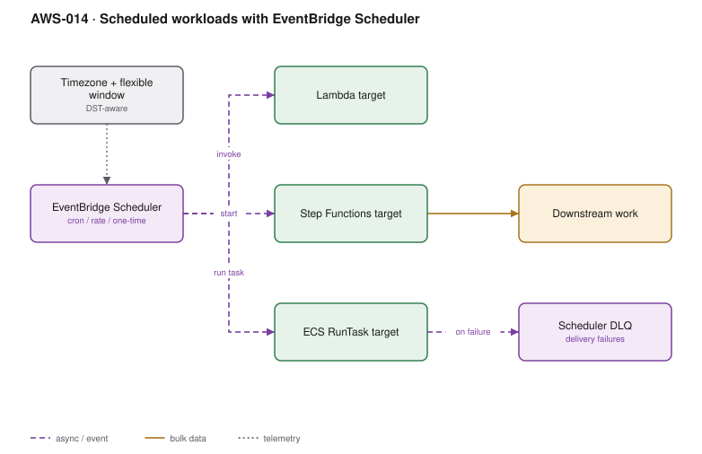

# AWS-014 · Scheduled workloads with EventBridge Scheduler

> **Category:** [02 · Serverless Application Patterns](readme.md#02) · **Maturity:** Production · **Effort:** S

## The problem

Something needs to happen at 02:00 local time, or every five minutes, or exactly once in 90
days when a trial expires. The old answer was an EventBridge rule, which is fine for a handful
of cron jobs and falls apart when you need a schedule **per customer**. EventBridge Scheduler
is a separate, newer service built for millions of individual schedules, and most teams have
not noticed it exists.

**Use it when** you need cron, rate, or one-time invocations — especially per-entity ones.

**Don't use it when** the trigger is an event rather than a time. And note that for a long
single delay inside a workflow, a Step Functions `Wait` state is often simpler and costs one
state transition ([`aws-011`](aws-011-step-functions-saga.md)).

## Scheduler vs EventBridge rules vs cron on a box

| | Scheduler | EventBridge rule | cron on EC2 |
|---|---|---|---|
| Schedules supported | **Millions** | ~300 rules/bus (soft) | As many as fit |
| One-time schedules | **Yes**, `at()` | No | Via `at` |
| Timezone + DST | **Yes** | UTC only | Yes |
| Flexible time window | **Yes** — spreads load | No | No |
| Targets | 270+ API actions | ~20 target types | Whatever you code |
| Built-in retry + DLQ | **Yes** | Partial | No |
| Cost | $1.00/M invocations | Free | An instance, forever |

## Components

| Service | Role | The setting that actually matters |
|---|---|---|
| EventBridge Scheduler | Fires the schedule | `FlexibleTimeWindow` — spreads a thundering herd across minutes |
| Schedule group | Organisation and tagging | Group per tenant or per domain; tags flow to cost allocation |
| Universal target | Calls almost any AWS API directly | Removes the "glue Lambda" that exists only to call another service |
| Dead letter queue | Captures undeliverable invocations | Configure it, or failures are invisible |
| Execution role | What the schedule is allowed to invoke | One role per target type, least privilege |

## Flow

1. A schedule is created — by IaC for fixed jobs, or by application code for per-entity ones
   (for example, "charge this subscription in 30 days").
2. At the due time, Scheduler resolves the timezone, applies DST, and picks a moment inside
   the flexible window if one is configured.
3. It assumes the execution role and invokes the target directly: a Lambda, a Step Functions
   execution, `ecs:RunTask`, an SQS send, or any of 270+ API actions.
4. On a delivery failure it retries with backoff for up to 24 hours, then writes to the DLQ.
5. A one-time schedule deletes itself if `ActionAfterCompletion` is set to `DELETE`.

## Cost (us-east-1 — order of magnitude)

| Line item | Small · 50 schedules | Medium · 100K invocations/mo | Large · 20M invocations/mo |
|---|---|---|---|
| Scheduler invocations @ $1.00/M (14M free/mo) | $0 | $0 | $6.00 |
| Lambda targets (512 MB × 2 s) | $0.02 | $1.70 | $340.00 |
| Step Functions targets, if used | — | ~$30 | ~$600 |
| DLQ (SQS) | $0 | $0.04 | $8.00 |
| **Total** | **~$0** | **~$2** | **~$354** |

**Cost cliff:** there is barely one — the first 14 million invocations per month are free, so
the scheduler itself is effectively free for most workloads. The cost is entirely in what it
*invokes*. The real trap is the opposite direction: a 1-minute rate schedule invoking a
2-minute Lambda, giving you unbounded overlapping executions and a bill that grows forever.

**Biggest lever:** the flexible time window. Ten thousand tenant schedules all set to `0 2 * * *`
arrive simultaneously, spike concurrency, and throttle. A 15-minute flexible window flattens
that to a trickle at no cost.

## Failure modes

| Failure | Symptom | Mitigation |
|---|---|---|
| Overlapping executions | Two runs of the same job in flight | Scheduler does not prevent overlap — take a lock (a conditional DynamoDB write) in the job |
| No DLQ | Failed invocations vanish silently | Always attach a DLQ and alarm on its depth |
| DST assumption | Job runs an hour early or late twice a year | Use a named timezone (`Europe/London`), never `UTC+1` |
| Thundering herd | Throttles at the top of the hour | Flexible time window, or hash the entity id into a minute offset |
| Orphaned one-time schedules | Quota exhaustion from millions of completed schedules | `ActionAfterCompletion: DELETE` |

## Security notes

- The execution role is assumable by the scheduler service — scope its trust policy with
  `aws:SourceArn` to the specific schedule or group, or any schedule in the account can use it.
- Per-tenant schedules created from application code mean application code can create
  arbitrary invocations. Constrain the target ARNs the creating role may specify.
- Schedule input payloads are stored in the service; treat them as you would log output.

## What people miss

- **This is not EventBridge rules.** It is a distinct service with its own API, console and
  quotas. Teams hit the ~300-rules-per-bus ceiling and conclude AWS cannot do per-customer
  schedules.
- **Universal targets eliminate glue Lambdas.** A schedule can call `ecs:RunTask`,
  `sqs:SendMessage`, `bedrock:InvokeModel` or `rds:StopDBInstance` directly. The classic
  "stop non-prod at 7pm" job needs no code at all — see [`aws-095`](aws-095-rightsizing-waste.md).
- **One-time schedules are the cleanest way to do "in N days"** — better than a daily sweep
  job scanning for due rows, and far better than a 30-day `Wait` state per entity if you have
  millions of entities.
- **Schedules are regional and are not backed up.** Application-created schedules are
  application state: be able to rebuild them from your database.
- **Minimum granularity is one minute.** Sub-minute scheduling needs a different approach
  entirely.

## See also

- [`aws-011`](aws-011-step-functions-saga.md) — `Wait` states for in-workflow delays
- [`aws-095`](aws-095-rightsizing-waste.md) — the night-time shutdown this enables
- [`aws-065`](aws-065-notification-bus.md) — EventBridge the bus, as opposed to the scheduler
- [`aws-026`](aws-026-aws-batch.md) — when the scheduled work is heavy compute
