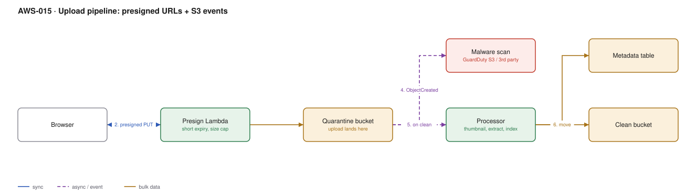

# AWS-015 · Upload pipeline: presigned URLs + S3 events

> **Category:** [02 · Serverless Application Patterns](readme.md#02) · **Maturity:** Production · **Effort:** S

## The problem

Users need to upload files — avatars, invoices, CAD drawings, a 4 GB video. Routing those
bytes through your API is the obvious design and the wrong one: API Gateway caps payloads at
10 MB, Lambda at 6 MB synchronous, and you pay to move every byte twice. Presigned URLs let
the browser `PUT` straight into S3, and an S3 event starts the processing.

**Use it when** users upload anything at all. This is the default.

**Don't use it when** the file is tiny, always trusted, and must be transformed before it is
stored at all. Even then, consider landing it first and transforming after.

## Components

| Service | Role | The setting that actually matters |
|---|---|---|
| Presign Lambda | Issues a short-lived signed `PUT` | Expiry (5–15 min), and **`Content-Length` range** so nobody uploads 5 TB |
| Quarantine bucket | Where uploads land, untrusted | Separate bucket, not a prefix — bucket policies and events are cleaner |
| Malware scanning | Decides clean vs infected | GuardDuty Malware Protection for S3, or a third-party scanner |
| Processor Lambda / Batch | Thumbnails, text extraction, indexing | Triggered by event notification or EventBridge, not polling |
| Clean bucket | Serving location | Only this one is reachable by the CDN |
| Metadata table | Upload status and provenance | Written at presign time, so an abandoned upload is visible |

## Flow

1. The client asks the API for an upload URL, authenticated as itself.
2. The presign Lambda records a `PENDING` row keyed to the user, then returns a presigned
   `PUT` URL scoped to one exact key, with a size limit and a short expiry.
3. The browser uploads **directly to S3**. No bytes touch your compute.
4. `ObjectCreated` fires. The scanner inspects the object and tags it.
5. On a clean verdict, the processor runs: thumbnails, text extraction, virus-free copy.
6. The object is moved to the clean bucket and the metadata row is marked `READY`.

## Cost (us-east-1 — order of magnitude)

| Line item | Small · 10K uploads, 50 GB | Medium · 1M uploads, 5 TB | Large · 20M uploads, 100 TB |
|---|---|---|---|
| S3 PUT @ $0.005/1K | $0.05 | $5.00 | $100.00 |
| S3 storage, quarantine + clean (1 mo) | $2.30 | $230.00 | $4,600.00 |
| Presign Lambda (128 MB × 30 ms) | $0.00 | $0.10 | $2.00 |
| GuardDuty Malware Protection @ ~$0.60/GB | $30.00 | $3,000.00 | $60,000.00 |
| Processor Lambda (1 GB × 3 s) | $0.50 | $50.00 | $1,000.00 |
| **Total with scanning** | **~$33** | **~$3,285** | **~$65,700** |
| **Total without scanning** | **~$3** | **~$285** | **~$5,700** |

**Cost cliff:** malware scanning is priced **per GB scanned** and will dwarf everything else
the moment files get large. Scan selectively — by prefix, by content type, by whether the file
is ever served to another user. A private backup bucket that nobody downloads from rarely
justifies $60K/month of scanning.

**Biggest lever:** lifecycle on the quarantine bucket. Objects there have already been copied
on; expire them after 1–7 days. Teams routinely keep two full copies of everything forever
because the quarantine bucket has no lifecycle rule.

## Failure modes

| Failure | Symptom | Mitigation |
|---|---|---|
| No size limit on the presigned URL | A user uploads 5 TB and you pay for it | Include `content-length-range` in the signed policy |
| Abandoned uploads | Orphaned `PENDING` rows and partial multipart data | TTL on the metadata row + a lifecycle rule to abort incomplete multipart uploads after 7 days |
| Event notification lost | Processing silently skipped | S3 events are at-least-once but not guaranteed ordered; reconcile with a periodic sweep |
| Processor times out on a big file | Large uploads never complete | Route by size: Lambda under ~500 MB, Fargate or Batch above |
| CORS not configured | Browser upload fails, works fine from curl | The bucket needs a CORS rule allowing `PUT` from your origin |

## Security notes

- Sign for **one exact key**, generated server-side. A presigned URL with a client-supplied
  key lets a user overwrite someone else's object.
- The presigned URL carries the *signer's* permissions. Give the presign Lambda a role that
  can write only to the quarantine prefix — never a broad S3 role.
- Never serve from the quarantine bucket. Block Public Access on both, and point the CDN at
  the clean bucket only ([`aws-003`](aws-003-cloudfront-s3-oac.md)).
- Strip EXIF and other metadata from images before serving; location data in user photos is a
  routine privacy leak.
- Validate content type by inspecting magic bytes, not by trusting the extension or the
  `Content-Type` header.

## What people miss

- **Presigned POST is better than presigned PUT for browsers.** It supports a policy document
  with conditions — size range, content type prefix, key prefix — which a presigned PUT URL
  cannot express as richly.
- **Multipart uploads leave garbage.** Incomplete multipart parts are billed as storage and
  are invisible in the object listing. A lifecycle rule to abort them is near-universal advice
  and near-universally skipped.
- **S3 event notifications can go to EventBridge** instead of directly to Lambda/SNS/SQS,
  which gives you filtering, replay and multiple targets without the bucket config becoming a
  bottleneck.
- **Transfer acceleration** exists for uploads from far away and is a per-bucket toggle plus a
  per-GB fee. Worth measuring before assuming you need a regional presence.
- **The 10 MB API Gateway limit** is a hard limit, not a quota you can raise. Any design that
  proxies uploads has a ceiling built into it.

## See also

- [`aws-003`](aws-003-cloudfront-s3-oac.md) — serving the processed result
- [`aws-080`](aws-080-media-pipeline.md) — what to do with the file once it lands
- [`aws-082`](aws-082-s3-lifecycle.md) — the lifecycle rules referenced above
- [`aws-056`](aws-056-guardduty-response.md) — what happens when the scanner finds something
