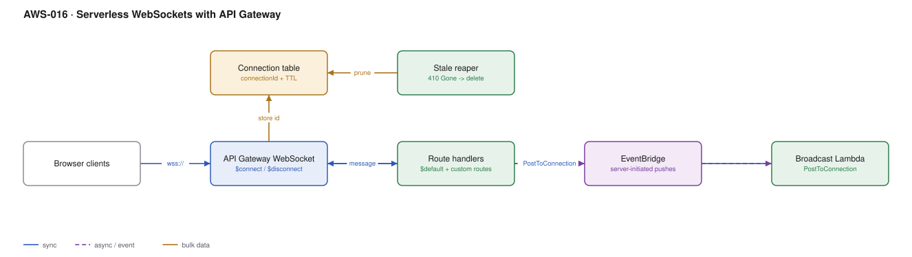

# AWS-016 · Serverless WebSockets with API Gateway

> **Category:** [02 · Serverless Application Patterns](readme.md#02) · **Maturity:** Growing · **Effort:** M

## The problem

You need to push to the browser: a live dashboard, collaborative editing, chat, job
completion, a trading price feed. Polling wastes requests and adds latency. API Gateway
WebSocket APIs hold the connections for you, so there is no fleet of long-lived servers — but
you inherit a problem the server-based design did not have: **connection state is now yours
to manage**.

**Use it when** the server initiates messages and the client count is large or spiky.

**Don't use it when** updates are infrequent — server-sent events over HTTP, or a webhook, is
far less machinery. And don't use it when you need sub-millisecond fan-out to a huge audience;
at that point look at IoT Core's MQTT broker or a managed pub/sub service.

## Components

| Service | Role | The setting that actually matters |
|---|---|---|
| API Gateway WebSocket API | Holds connections, routes frames | Idle timeout **10 min**, max connection duration **2 h** — both are hard limits |
| Connection table (DynamoDB) | Maps `connectionId` → user, topic, TTL | A TTL attribute matching the max connection duration |
| `$connect` handler | Authorises the connection | This is the **only** place you can authorise — do it here or not at all |
| Route handlers | Handle client→server messages | `$default` plus named routes via a route selection expression |
| `PostToConnection` (management API) | Server→client push | Returns **410 Gone** for a dead connection — that is your cleanup signal |
| Broadcast Lambda | Fans out to many connections | Must parallelise; serial `PostToConnection` does not scale |

## Flow

1. The client opens `wss://`. The `$connect` route runs with the request context, including
   query string and headers, and authorises the connection.
2. The handler stores `connectionId` plus user and subscription metadata in DynamoDB, with a
   TTL.
3. Client messages hit route handlers selected by a field in the payload.
4. Server-initiated events arrive on EventBridge or a queue.
5. A broadcast Lambda queries the connection table for interested connections and calls
   `PostToConnection` concurrently.
6. A `410 Gone` means the connection is dead; the row is deleted immediately.
7. `$disconnect` fires on a clean close and removes the row — but it is best-effort.

## Cost (us-east-1 — order of magnitude)

| Line item | Small · 100 concurrent | Medium · 5K concurrent | Large · 100K concurrent |
|---|---|---|---|
| Connection minutes @ $0.25/M | $1.08 | $54.00 | $1,080.00 |
| Messages @ $1.00/M (10/conn/min) | $0.43 | $21.60 | $432.00 |
| `$connect`/`$disconnect` Lambdas | $0.01 | $0.50 | $10.00 |
| Broadcast Lambda | $0.20 | $10.00 | $200.00 |
| DynamoDB connection table | $0.10 | $5.00 | $100.00 |
| **Total** | **~$2** | **~$91** | **~$1,822** |

**Cost cliff:** you are billed for **connection-minutes whether or not anything is sent**.
100,000 idle connections cost about $1,080/month in connection time alone. If your clients are
mostly idle, a polling design at a sensible interval can genuinely be cheaper — do the
arithmetic rather than assuming WebSockets are the efficient option.

**Biggest lever:** broadcast fan-out design. A naive loop calling `PostToConnection` for
50,000 connections in one Lambda will time out. Shard the connection table by topic, fan out
across many concurrent Lambdas, and batch.

## Failure modes

| Failure | Symptom | Mitigation |
|---|---|---|
| Stale connections accumulate | Broadcast slows down, costs rise, 410s everywhere | Delete on 410, plus a TTL on every row — belt and braces |
| 2-hour hard disconnect | Clients drop at exactly 2 h and blame your code | Client must reconnect with backoff; design for it, do not fight it |
| 10-minute idle timeout | Quiet clients disappear | Application-level ping every ~5 minutes (which you are billed for) |
| Broadcast Lambda timeout | Some clients get the message, others do not | Shard the fan-out; make it resumable |
| Authorising in `$default` | Unauthenticated clients hold connections | Authorise in `$connect`; a connection once accepted cannot be re-authorised |

## Security notes

- `$connect` is the single authorisation point. Browsers cannot set headers on a WebSocket
  handshake, so the token usually travels in the query string — which means it lands in access
  logs. Use a short-lived, single-use ticket rather than your main access token.
- A connection outlives a token's expiry. For sessions that must end promptly on revocation,
  track connections per user and disconnect them explicitly.
- Validate every inbound frame. There is no schema validation on WebSocket routes.
- Scope the `execute-api:ManageConnections` permission to the specific API and stage.

## What people miss

- **The maximum connection duration is 2 hours, full stop.** It cannot be raised. Any product
  expectation of an always-on socket must be implemented as transparent reconnection.
- **Browsers cannot send custom headers on the handshake.** Every token-in-header design
  works in Postman and fails in the browser.
- **`$disconnect` is not guaranteed.** A client that loses power never sends it. TTL is the
  only reliable cleanup.
- **AppSync subscriptions may be the better product.** If you already have GraphQL, you get
  managed subscriptions, filtering and connection handling with far less code — see
  [`aws-017`](aws-017-appsync-graphql.md).
- **IoT Core over MQTT-WSS** is cheaper per connection for very large idle fleets and gives
  you topic-based routing for free. The "IoT" name puts people off a service that is really a
  general pub/sub broker.

## See also

- [`aws-017`](aws-017-appsync-graphql.md) — managed subscriptions over the same transport
- [`aws-012`](aws-012-async-job-submission.md) — the polling alternative, with real numbers
- [`aws-054`](aws-054-realtime-counters.md) — the state behind a live dashboard
- [`aws-065`](aws-065-notification-bus.md) — the event source that drives most pushes
