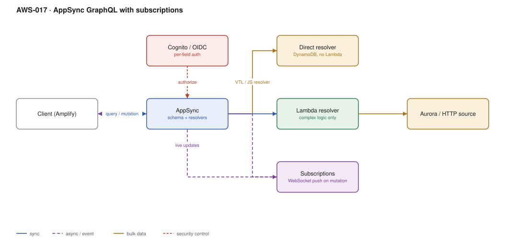

# AWS-017 · AppSync GraphQL with subscriptions

> **Category:** [02 · Serverless Application Patterns](readme.md#02) · **Maturity:** Growing · **Effort:** M

## The problem

Mobile and SPA clients want exactly the fields they need, from several sources, in one round
trip, with live updates. Building that over REST means either over-fetching or a proliferation
of bespoke endpoints. AppSync is managed GraphQL: it handles the schema, the resolvers, the
authorisation and — the genuinely differentiating part — WebSocket subscriptions that fire
automatically when a mutation runs.

**Use it when** you have multiple client types with different data needs, or real-time
updates are a core feature rather than a nice-to-have.

**Don't use it when** you have one client and a dozen endpoints — GraphQL is overhead you will
not recover. And don't adopt it purely for "one round trip" if your resolvers then fan out to
twelve services serially; that just moves the N+1 problem server-side.

## Components

| Service | Role | The setting that actually matters |
|---|---|---|
| AppSync API | Schema, resolvers, subscriptions | Resolver runtime: **APPSYNC_JS** over VTL for anything new |
| Direct data source resolvers | DynamoDB / RDS / HTTP with no Lambda | The main cost and latency win — no Lambda in the path |
| Lambda resolvers | Genuinely complex logic only | Use **batch invoke** to avoid N+1 |
| Authorisation modes | Cognito, OIDC, IAM, API key, Lambda | Multiple modes on one API, with `@aws_auth` directives per field |
| Subscriptions | WebSocket push on mutation | Only fire on mutations **through AppSync** — this is the big gotcha |
| Caching | Per-resolver server-side cache | Priced per hour like ElastiCache, because it is |

## Flow

1. The client sends a query, mutation or subscription over HTTPS (or WSS for subscriptions).
2. AppSync authorises — potentially per field, using different modes for different parts of
   the schema.
3. For each requested field, a resolver runs. A **direct** resolver maps straight to a
   DynamoDB call with no compute in between.
4. Complex fields route to a Lambda resolver, ideally batched across the list being resolved.
5. On a mutation, AppSync evaluates subscription filters and pushes to matching subscribers
   over the managed WebSocket.
6. Optional caching serves repeated resolver results without touching the data source.

## Cost (us-east-1 — order of magnitude)

| Line item | Small · 1M ops/mo | Medium · 50M ops/mo | Large · 500M ops/mo |
|---|---|---|---|
| Query/mutation @ $4.00/M | $4.00 | $200.00 | $2,000.00 |
| Real-time updates @ $2.00/M | $2.00 | $100.00 | $1,000.00 |
| Connection minutes @ $0.08/M | $0.40 | $20.00 | $200.00 |
| DynamoDB behind direct resolvers | $1.50 | $75.00 | $750.00 |
| Lambda resolvers, if used | $2.00 | $100.00 | $1,000.00 |
| Cache (cache.r4.large, if enabled) | $329.00 | $329.00 | $329.00 |
| **Total (direct resolvers, no cache)** | **~$8** | **~$395** | **~$3,950** |

**Cost cliff:** AppSync is **$4.00 per million operations** against API Gateway HTTP APIs at
$1.00 per million. You are paying 4× at the front door for the resolver engine and
subscriptions. That is good value if you use subscriptions and direct resolvers; it is poor
value if you wrapped REST in GraphQL and still call a Lambda for everything.

**Biggest lever:** direct resolvers. Replacing a Lambda resolver with a DynamoDB direct
resolver removes the Lambda cost, the cold start and roughly 20–40 ms of latency per field.
Most AppSync APIs could move the majority of their resolvers and never do.

## Failure modes

| Failure | Symptom | Mitigation |
|---|---|---|
| Mutation bypasses AppSync | Subscriptions never fire | Subscriptions trigger on AppSync mutations only; writes from a backend service must call the `None` data source mutation to notify |
| N+1 resolvers | One query, 300 Lambda invocations | Batch resolvers (`BatchInvoke`), or restructure the schema |
| Unbounded query depth | A single crafted query melts the backend | Set query depth and resolver count limits on the API |
| Subscription filter too broad | Every client receives every update | Filter server-side with `@aws_subscribe` arguments, not in the client |
| VTL resolver bugs | Opaque errors, painful debugging | Use APPSYNC_JS resolvers; VTL is effectively legacy |

## Security notes

- Field-level authorisation with `@aws_auth` / `@aws_cognito_user_pools` directives is the
  main advantage over hand-rolled GraphQL. Use it — do not authorise only at the operation level.
- API key auth is for prototypes. Keys are limited to 365 days and are not secrets.
- GraphQL introspection exposes your entire schema. Disable it in production if the schema
  itself is sensitive.
- Depth and complexity limits are a denial-of-service control, not a nicety.

## What people miss

- **Subscriptions only fire for mutations that go through AppSync.** A batch job writing
  straight to DynamoDB will not notify anyone. The workaround — a `None` data source mutation
  that the backend invokes purely to publish — is not obvious and is needed constantly.
- **Direct resolvers can do more than people expect**: conditional writes, transactions,
  `Query` with pagination, and HTTP calls with SigV4 signing, all with no Lambda.
- **Merged APIs** let separate teams own separate source APIs that combine into one endpoint —
  federation without running a gateway yourself.
- **The caching tier is a provisioned instance**, billed hourly, not per request. Turning it
  on "just to see" adds a few hundred dollars a month until someone notices.
- **Subscription connections share the API Gateway WebSocket limits in spirit but not in
  configuration** — AppSync manages them, which is precisely why it is easier than
  [`aws-016`](aws-016-serverless-websockets.md).

## See also

- [`aws-016`](aws-016-serverless-websockets.md) — the roll-your-own alternative
- [`aws-010`](aws-010-serverless-crud.md) — the REST equivalent, and usually cheaper
- [`aws-002`](aws-002-cognito-oidc-spa.md) — the auth mode most AppSync APIs use
- [`aws-053`](aws-053-ddb-streams-views.md) — pushing backend-originated changes into AppSync
