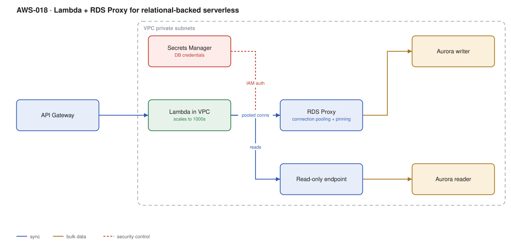

# AWS-018 · Lambda + RDS Proxy for relational-backed serverless

> **Category:** [02 · Serverless Application Patterns](readme.md#02) · **Maturity:** Production · **Effort:** M

## The problem

Lambda scales to a thousand concurrent executions in under a minute. A `db.r6g.large`
PostgreSQL instance accepts a few hundred connections, and each one costs it about 10 MB of
memory. Connect them directly and the first real traffic spike exhausts the connection limit,
every function starts failing, and the retries make it worse. RDS Proxy sits in between and
pools connections so the database sees a stable, bounded number.

**Use it when** your data is genuinely relational — joins, transactions, ad-hoc reporting,
an existing schema — and your compute is Lambda.

**Don't use it when** DynamoDB fits ([`aws-010`](aws-010-serverless-crud.md)). People reach
for Postgres out of familiarity and then spend a quarter making it work with serverless
compute. Also skip the proxy specifically if your compute is long-lived (ECS/EKS) and already
pools connections itself — then it is cost with little benefit.

## Components

| Service | Role | The setting that actually matters |
|---|---|---|
| Lambda in VPC | Application code | Needs subnets + SG; **Hyperplane ENIs** mean VPC cold starts are no longer the old 10-second penalty |
| RDS Proxy | Connection pooling and multiplexing | `MaxConnectionsPercent`, and understanding **pinning** |
| Secrets Manager | Database credentials | The proxy reads them; the function never sees a password |
| IAM database authentication | Token-based DB auth from Lambda | Removes the password from the application entirely |
| Aurora writer / reader | The database | Separate reader endpoint for read-heavy paths |
| Reserved concurrency | Back-pressure | The real protection against overwhelming the database |

## Flow

1. API Gateway invokes the Lambda, which runs inside private subnets.
2. The function gets a connection from RDS Proxy using an IAM auth token — no password in the
   function at all.
3. The proxy multiplexes many short function connections onto a small pool of real database
   connections.
4. Writes go to the writer endpoint; read-only queries go to the reader endpoint.
5. When a function finishes, its connection returns to the pool rather than being torn down.
6. On a database failover, the proxy holds client connections open and reconnects
   underneath — cutting failover impact from ~60 s to a few seconds.

## Cost (us-east-1 — order of magnitude)

| Line item | Small · 2 vCPU db | Medium · 8 vCPU db | Large · 32 vCPU db |
|---|---|---|---|
| Aurora PostgreSQL instance | $204 (r6g.large) | $817 (r6g.2xlarge) | $3,268 (r6g.8xlarge) |
| RDS Proxy @ $0.015/vCPU-hr of the DB | $21.90 | $87.60 | $350.40 |
| Aurora storage + I/O (100 GB, moderate) | ~$30 | ~$120 | ~$500 |
| Lambda (512 MB × 150 ms × 10M) | $12.50 | $12.50 | $12.50 |
| Secrets Manager | $0.40 | $0.40 | $0.40 |
| **Total** | **~$269** | **~$1,038** | **~$4,131** |

**Cost cliff:** RDS Proxy is billed **per vCPU of the underlying database instance, per hour** —
not per connection or per request. On a large instance it is a few hundred dollars a month
for what is conceptually a connection pooler. Also note Aurora Serverless v2 scales to 0.5 ACU
(~$43/month) for dev environments, where a provisioned instance would cost 5× that idle.

**Biggest lever:** instance right-sizing, which the proxy makes possible. Without pooling you
oversize the database purely for connection headroom; with it, you size for actual query load.
That is frequently a whole instance class.

## Failure modes

| Failure | Symptom | Mitigation |
|---|---|---|
| Connection pinning | Pool benefit disappears, connections exhausted anyway | Avoid session state: no `SET`, no temp tables, no prepared statements across calls, no advisory locks |
| Lambda scales past the pool | Timeouts waiting for a connection | Set **reserved concurrency** on the function to bound it, below what the pool can serve |
| Transaction left open | A connection is held for the whole function duration | Keep transactions tight; never await an external call inside one |
| No reader endpoint used | Writer saturated by reporting queries | Route read-only work to the reader endpoint explicitly |
| Lambda not in the VPC | Cannot reach the proxy at all | The proxy is VPC-only; the function must have subnets and a security group |

## Security notes

- Use IAM database authentication. The function gets a 15-minute token from its role; there
  is no long-lived credential in the application at all.
- The proxy enforces TLS to the database. Require it on the client side too.
- Put the database in isolated subnets with no route to a NAT gateway.
- The proxy's secret should be rotated by Secrets Manager; the proxy picks up the new value
  without an application deploy ([`aws-058`](aws-058-secrets-rotation.md)).
- Lambda in a VPC with no NAT cannot reach AWS APIs — add interface endpoints rather than a
  NAT gateway if the only outbound need is AWS services. That also saves real money
  ([`aws-030`](aws-030-centralized-egress.md)).

## What people miss

- **Pinning quietly destroys the whole value proposition.** When the proxy cannot safely share
  a connection it pins it to one client for the session. Session-level `SET` statements,
  temporary tables and some ORM behaviours trigger it. Watch the
  `DatabaseConnectionsCurrentlySessionPinned` metric — if it is high, you are paying for a
  proxy that is doing nothing.
- **VPC cold starts are no longer the problem they were.** The Hyperplane ENI change removed
  most of the penalty years ago, but the folklore persists and still drives bad architecture
  decisions.
- **Aurora Serverless v2 and RDS Proxy solve different problems** and compose well: v2 scales
  *capacity*, the proxy manages *connections*. Teams often treat them as alternatives.
- **The Aurora Data API** is a third option — HTTP-based, no VPC, no connection management at
  all. It is slower per query and has payload limits, but for low-volume or Step Functions
  integration it removes this entire category of problem.
- **Reserved concurrency is the real circuit breaker.** The proxy queues; it does not reject.
  Without a concurrency cap you convert a connection failure into a latency failure.

## See also

- [`aws-010`](aws-010-serverless-crud.md) — the non-relational alternative
- [`aws-085`](aws-085-aurora-global.md) — making this database multi-region
- [`aws-058`](aws-058-secrets-rotation.md) — rotating the credentials underneath it
- [`aws-030`](aws-030-centralized-egress.md) — why VPC Lambdas need an egress plan
