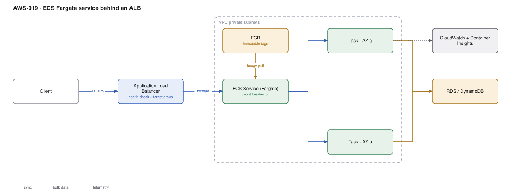

# AWS-019 · ECS Fargate service behind an ALB

> **Category:** [03 · Containers & Orchestration](readme.md#03) · **Maturity:** Production · **Effort:** S

## The problem

You have a containerised web service and you need it running, load balanced, across AZs,
with rolling deploys and no servers to patch. This is the boring answer, and it is the right
answer far more often than teams admit before they choose EKS instead.

**Use it when** you are running services rather than building a platform. If your Kubernetes
usage would be "a Deployment, a Service and an Ingress", ECS does that with a quarter of the
operational surface and no $73/month control plane.

**Don't use it when** you genuinely need the Kubernetes ecosystem: operators, CRDs, Helm
charts you did not write, or portability across clouds as an actual requirement rather than
an aspiration. Then [`aws-020`](aws-020-eks-baseline.md).

## ECS vs EKS, honestly

| | ECS Fargate | EKS |
|---|---|---|
| Control plane cost | **$0** | $73/month per cluster |
| Time to first service | Hours | Days to weeks |
| Who operates upgrades | AWS | You, every ~14 months |
| Ecosystem | AWS-native only | Everything |
| IAM integration | Task roles, trivial | IRSA / Pod Identity, more setup |
| Right when | You run services | You run a platform |

## Components

| Service | Role | The setting that actually matters |
|---|---|---|
| ALB | TLS termination, routing, health checks | **Deregistration delay** — the default 300 s makes every deploy feel broken |
| Target group | Where the ALB sends traffic | Health check path, interval, and healthy/unhealthy thresholds |
| ECS service | Keeps N tasks running | **Deployment circuit breaker with rollback** — off by default, should always be on |
| Task definition | The container spec | CPU/memory combination: Fargate only allows specific pairs |
| Fargate | The compute | Platform version, and ARM64 for ~20% off |
| ECR | Image registry | Immutable tags; `latest` makes rollback impossible |
| Container Insights | Metrics and logs | Costs real money at scale — see below |

## Flow

1. The client hits the ALB over HTTPS; the ACM certificate terminates there.
2. The ALB routes by host or path rule to a target group.
3. The ECS service maintains the desired task count across at least two AZs, registering each
   task's ENI as a target.
4. On deploy, ECS starts new tasks, waits for health checks, shifts traffic, then drains the
   old ones over the deregistration delay.
5. If new tasks fail health checks, the circuit breaker stops the deploy and rolls back.
6. Tasks assume a **task role** to reach the database and other AWS services — no credentials
   in the image.

## Cost (us-east-1 — order of magnitude)

| Line item | Small · 2 × 0.5 vCPU | Medium · 10 × 1 vCPU | Large · 60 × 2 vCPU |
|---|---|---|---|
| Fargate vCPU @ $0.04048/hr | $29.15 | $291.46 | $3,497.47 |
| Fargate memory @ $0.004445/hr (2 GB/vCPU) | $6.40 | $64.00 | $768.03 |
| ALB hours @ $0.0225/hr | $16.43 | $16.43 | $16.43 |
| ALB LCUs | ~$5 | ~$25 | ~$150 |
| ECR storage (20 GB) | $2.00 | $2.00 | $2.00 |
| Container Insights | ~$15 | ~$75 | ~$450 |
| **Total** | **~$74** | **~$474** | **~$4,884** |

**Cost cliff:** Fargate is roughly 1.5–2× the price of equivalent EC2 capacity for always-on
workloads. You are buying away node management. Above ~20 steady tasks, **Fargate Spot** (70%
off, for interruption-tolerant work) or EC2 capacity providers start to matter. Also note
Container Insights is billed per metric and can quietly become 10% of the bill.

**Biggest lever:** right-sizing the task. Fargate bills exactly what you request, not what
you use, and the default "1 vCPU / 2 GB because it was in the example" is the single most
common waste. Measure, then request. ARM64 is a further ~20% for a one-line change.

## Failure modes

| Failure | Symptom | Mitigation |
|---|---|---|
| Deregistration delay too long | Deploys take 10 minutes, connections hang | Drop to 30 s for stateless HTTP services |
| No circuit breaker | A broken image rolls out to 100% and stays | Enable deployment circuit breaker **with rollback** |
| Health check path does real work | Health checks hammer the database | A `/healthz` that checks liveness, not dependencies |
| Tasks in one AZ | AZ failure takes the service down | Subnets in ≥2 AZs and `spread` placement across them |
| Image pull throttling | Tasks fail to start during a scale-out | Use ECR, not Docker Hub; Docker Hub rate limits will find you |
| `latest` tag | Cannot roll back, cannot reproduce | Immutable tags, digest-pinned task definitions |

## Security notes

- Separate the **task role** (what your code can do) from the **execution role** (what ECS
  does on your behalf: pull the image, write logs). Conflating them over-privileges the app.
- Run tasks in private subnets with the ALB in public ones. Fargate needs outbound access for
  image pulls — use VPC endpoints for ECR, S3 and CloudWatch rather than a NAT gateway.
- Pull secrets via the task definition's `secrets` block from Secrets Manager or SSM; they
  arrive as environment variables without ever being in the image or the console.
- Enable ECS Exec for debugging rather than baking in SSH, and log its sessions.

## What people miss

- **The 300-second default deregistration delay** is responsible for most "ECS deploys are so
  slow" complaints. It is one setting.
- **Fargate CPU/memory pairs are constrained.** You cannot ask for 1 vCPU and 16 GB. The
  combination table is worth reading before designing around a memory-heavy container.
- **Each Fargate task gets its own ENI**, which consumes a subnet IP. A 250-task service in a
  /24 will exhaust the subnet. Size subnets for peak task count, not for nodes.
- **ECS Service Connect** replaced most of the reasons to want a service mesh here. It gives
  service discovery, retries and per-hop metrics with far less machinery than
  [`aws-024`](aws-024-service-mesh.md).
- **Capacity providers let you mix** Fargate, Fargate Spot and EC2 in one service with a base
  and weight. A common pattern is 2 on-demand tasks as a floor plus Spot for the rest.

## See also

- [`aws-020`](aws-020-eks-baseline.md) — when you genuinely need Kubernetes
- [`aws-025`](aws-025-progressive-delivery.md) — canary deploys for this service
- [`aws-027`](aws-027-container-supply-chain.md) — securing the image it runs
- [`aws-028`](aws-028-three-tier-vpc.md) — the network it sits in
