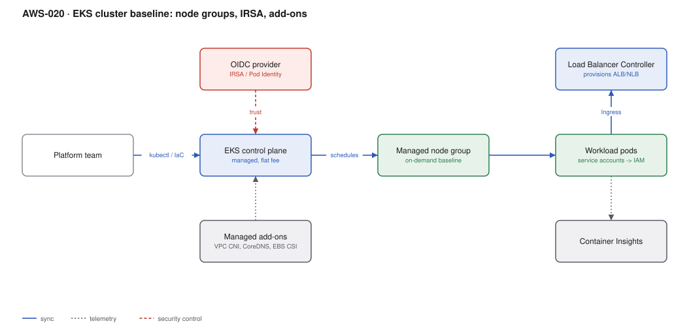

# AWS-020 · EKS cluster baseline: node groups, IRSA, add-ons

> **Category:** [03 · Containers & Orchestration](readme.md#03) · **Maturity:** Production · **Effort:** M

## The problem

`eksctl create cluster` gives you a cluster in 20 minutes. It does not give you something you
can hand to five teams and still sleep. The gap is identity (how a pod gets AWS permissions),
networking (how pods get IPs and how you avoid running out), add-on lifecycle, and an upgrade
path you can execute on a schedule AWS sets, not you.

**Use it when** you need the Kubernetes ecosystem, you have more than a couple of teams, or
you are building an internal platform.

**Don't use it when** you are running a handful of services —
[`aws-019`](aws-019-ecs-fargate-alb.md) does that with far less to own. The honest test: if
nobody on the team can name the current Kubernetes version and its end-of-support date, you
are not ready to operate a cluster.

## Components

| Service | Role | The setting that actually matters |
|---|---|---|
| EKS control plane | Managed API server and etcd | Version — AWS supports each for ~14 months, then charges extended support |
| Managed node groups | Worker capacity | Launch template + AMI release version, pinned, not floating |
| **EKS Pod Identity** | Pod → IAM role mapping | The newer, simpler replacement for IRSA — no OIDC trust policy per role |
| VPC CNI | Pod networking | **Prefix delegation**, or you will exhaust subnet IPs long before CPU |
| CoreDNS / kube-proxy | Cluster plumbing | Managed add-ons so upgrades are an API call, not a manifest you forgot |
| AWS Load Balancer Controller | Ingress → ALB/NLB | IngressGroup, to share one ALB across many Ingresses |
| Container Insights / ADOT | Observability | See [`aws-067`](aws-067-otel-adot.md) |

## Flow

1. The platform team provisions the control plane and node groups from IaC, pinned to an
   explicit Kubernetes version and AMI release.
2. Managed add-ons (VPC CNI, CoreDNS, kube-proxy, EBS CSI, Pod Identity Agent) are installed
   as EKS add-ons, so their versions are declared and upgradable through the EKS API.
3. A service account is associated with an IAM role via Pod Identity; pods assume it with no
   static credentials.
4. The VPC CNI assigns each pod a real VPC IP from the subnet, using prefix delegation to
   allocate /28 blocks rather than single addresses.
5. An `Ingress` resource causes the Load Balancer Controller to provision and configure an ALB.
6. Workloads emit metrics and logs to CloudWatch or a Prometheus-compatible backend.

## Cost (us-east-1 — order of magnitude)

| Line item | Small · 3 × m6g.large | Medium · 12 × m6g.xlarge | Large · 60 × m6g.2xlarge |
|---|---|---|---|
| EKS control plane @ $0.10/hr | $73.00 | $73.00 | $73.00 |
| Worker nodes (on-demand) | $166.44 | $1,331.52 | $13,315.20 |
| EBS gp3 root volumes (50 GB each) | $12.00 | $48.00 | $240.00 |
| NAT gateway (1 per AZ × 3) | $98.55 | $98.55 | $98.55 |
| NAT data processing | ~$20 | ~$150 | ~$900 |
| ALB + LCUs | ~$25 | ~$60 | ~$300 |
| Container Insights | ~$30 | ~$120 | ~$600 |
| **Total** | **~$425** | **~$1,881** | **~$15,527** |

**Cost cliff:** **extended support**. When a Kubernetes version leaves standard support, the
control plane price jumps from $0.10/hr to **$0.60/hr** — $438/month per cluster instead of
$73. With 20 clusters that is an $87,000/year penalty for being a year behind. Treat upgrades
as a scheduled, funded activity.

**Biggest lever:** node cost, which dwarfs everything else. Karpenter with Spot
([`aws-022`](aws-022-karpenter-spot.md)) routinely halves it. Second lever: NAT gateways —
three of them plus data processing is ~$250/month before any traffic
([`aws-030`](aws-030-centralized-egress.md)).

## Failure modes

| Failure | Symptom | Mitigation |
|---|---|---|
| Subnet IP exhaustion | Pods stuck `Pending`, no obvious resource shortage | Enable **prefix delegation** on the VPC CNI; size subnets as /19 or larger |
| Add-on version drift | Upgrade fails in a way that is hard to unwind | Use managed add-ons with explicit versions; upgrade add-ons *before* the control plane |
| Control plane upgraded past nodes | Nodes unsupported, workloads evicted | Kubelet may be up to 3 minor versions behind — but upgrade nodes promptly anyway |
| No PodDisruptionBudgets | Node rotation takes the service down | A PDB per workload is a prerequisite for safe upgrades, not an optimisation |
| `aws-auth` ConfigMap edited by hand | Everyone locked out of the cluster | Use **EKS access entries** (the API-based replacement) instead of the ConfigMap |
| Single NAT gateway | Cross-AZ data charges, and an AZ-level SPOF | One per AZ, or a centralised egress design |

## Security notes

- **Prefer EKS Pod Identity over IRSA** for new clusters: no OIDC provider trust relationship
  per role, simpler cross-account story, and roles are reusable across clusters.
- Restrict the public API endpoint. Private-only, or public with a CIDR allow-list; a wide
  open API endpoint plus a leaked token is a full cluster compromise.
- Enable control plane audit logging to CloudWatch. It is off by default and is the first
  thing you will want during an incident.
- Apply Pod Security Standards at the `restricted` profile by namespace, and block
  `hostNetwork`, `hostPID` and privileged containers via admission control.
- Encrypt secrets at rest with a KMS key (envelope encryption) — base64 in etcd is not
  encryption.

## What people miss

- **Extended support pricing is a 6× increase** and it applies automatically. It is the single
  largest avoidable EKS cost and it catches organisations with many clusters hardest.
- **The VPC CNI gives every pod a routable VPC IP**, which is excellent for security groups
  and terrible for IP budgets. Without prefix delegation an `m5.large` caps at 29 pods
  regardless of its CPU.
- **Fargate profiles work on EKS too**, and are a good fit for bursty or untrusted workloads
  where you do not want them sharing a node.
- **EKS Auto Mode** now manages nodes, scaling and core add-ons for you. If the reason you
  chose EKS was the ecosystem rather than the control, it removes most of this page.
- **Upgrades are not optional and not instant.** Budget a day per cluster per minor version,
  and do them in a non-prod cluster that actually resembles production.

## See also

- [`aws-019`](aws-019-ecs-fargate-alb.md) — the simpler option you should rule out first
- [`aws-022`](aws-022-karpenter-spot.md) — the node layer, done properly
- [`aws-021`](aws-021-eks-gitops-argocd.md) — how workloads get onto this cluster
- [`aws-023`](aws-023-eks-multi-tenancy.md) — sharing it between teams
