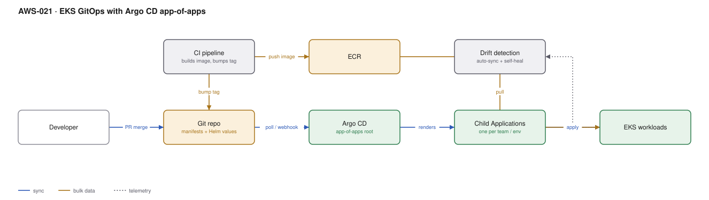

# AWS-021 · EKS GitOps with Argo CD app-of-apps

> **Category:** [03 · Containers & Orchestration](readme.md#03) · **Maturity:** Production · **Effort:** M

## The problem

Once more than one person deploys to a cluster, "what is actually running in production" stops
being answerable. GitOps makes the Git repository the declared desired state and a controller
in the cluster continuously reconciles reality to it. The practical payoffs are a complete
audit trail, rollback by `git revert`, and drift that is detected rather than discovered.

**Use it when** you have more than one environment or more than one team, and you want deploys
to be reviewable changes rather than pipeline runs.

**Don't use it when** you have one app and one cluster and a working pipeline. GitOps is an
operating model, not a deployment tool; adopting it halfway gives you two sources of truth,
which is worse than one.

## Components

| Service | Role | The setting that actually matters |
|---|---|---|
| Git repository | Declared desired state | Separate **config** repo from **source** repo, or CI commits trigger CI loops |
| CI pipeline | Builds images, bumps tags | CI stops at the registry and a commit; it must not run `kubectl` |
| ECR | Image registry | Digest references, not mutable tags |
| Argo CD | Reconciliation controller | `automated` sync with `prune` **and** `selfHeal` — without both, drift persists |
| App-of-apps root | One Application that creates the others | ApplicationSets for generating per-team/per-env apps from a template |
| Sync waves / hooks | Ordering (CRDs before CRs, migrations before rollout) | `argocd.argoproj.io/sync-wave` annotations |

## Flow

1. A developer merges a PR into the application source repo.
2. CI builds the image, pushes it to ECR, and commits the new digest into the **config** repo.
3. Argo CD notices the config change — by webhook, or by polling every three minutes.
4. The root app-of-apps renders its children: one Argo Application per team per environment.
5. Each child reconciles its manifests against the cluster, applying in sync-wave order.
6. `selfHeal` reverts anything changed outside Git; `prune` deletes anything removed from Git.
7. The Argo UI and CLI show per-app health and diff, which becomes the deployment status board.

## Cost (us-east-1 — order of magnitude)

| Line item | Small · 1 cluster, 20 apps | Medium · 4 clusters, 200 apps | Large · 20 clusters, 2000 apps |
|---|---|---|---|
| Argo CD compute (pods on existing nodes) | ~$30 | ~$120 | ~$600 |
| Additional nodes for the controller | $0 | ~$70 | ~$500 |
| ECR storage + pulls | $5 | $40 | $300 |
| Git hosting | $0 | ~$20 | ~$200 |
| Observability for Argo itself | ~$5 | ~$25 | ~$150 |
| **Total** | **~$40** | **~$275** | **~$1,750** |

**Cost cliff:** Argo CD itself is cheap; the cliff is operational. Past roughly 1,000
Applications on one Argo instance the repo-server and application-controller become the
bottleneck, and you move to sharded controllers or an Argo instance per environment. Plan the
sharding before you hit it, because migrating live Applications is disruptive.

**Biggest lever:** polling interval and manifest generation cost. A repo with hundreds of Helm
charts re-rendered every three minutes burns real CPU. Use webhooks instead of polling and
enable the manifest cache.

## Failure modes

| Failure | Symptom | Mitigation |
|---|---|---|
| Bootstrap chicken-and-egg | Argo manages everything, including itself — but who installs Argo? | Install Argo from Terraform/Helm once, then have it manage its own manifests thereafter |
| `selfHeal` off | Manual `kubectl edit` persists silently; Git is a lie | Enable `selfHeal` and `prune`; treat the cluster as read-only for humans |
| CI pushes to the same repo it watches | Infinite reconcile loops | Separate source and config repos |
| CRDs applied after the resources using them | Sync fails on a fresh cluster, works on an existing one | Sync waves, and `Replace=true` for large CRDs |
| Secrets in Git | Credentials in version history forever | External Secrets Operator or Sealed Secrets — never plaintext, and note that Git history is not revocable |
| Argo down during an incident | Cannot deploy the fix | Keep a documented, tested break-glass `kubectl` path |

## Security notes

- Argo CD holds cluster-admin on everything it manages. Its RBAC and SSO configuration is a
  tier-0 security control, not an application setting.
- Use the External Secrets Operator to pull from Secrets Manager at runtime. The manifest
  references a secret name; the value never enters Git.
- Enforce signed commits or a protected branch on the config repo. The repo is now the
  production control plane.
- Scope each Argo `Project` to specific destinations, namespaces and resource kinds so a team
  cannot deploy a `ClusterRole` by accident.

## What people miss

- **App-of-apps vs ApplicationSet.** App-of-apps is a static tree you maintain by hand;
  ApplicationSet *generates* Applications from a list, a Git directory, or cluster labels.
  For more than a handful of teams, ApplicationSet is what you actually want.
- **GitOps does not do progressive delivery.** Argo CD syncs; it does not shift traffic by
  metric. That is Argo Rollouts, a separate controller —
  [`aws-025`](aws-025-progressive-delivery.md).
- **The image tag bump has to come from somewhere.** The cleanest answer is Argo CD Image
  Updater or Renovate committing to the config repo, rather than a CI step with write access.
- **Pruning is terrifying until it is not.** Teams disable `prune` after one scare and then
  accumulate orphaned resources for years. Fix the root cause (scoped projects, sync waves)
  rather than disabling it.
- **Flux is a legitimate alternative** and is lighter if you do not need the UI. The UI is
  usually why people pick Argo.

## See also

- [`aws-020`](aws-020-eks-baseline.md) — the cluster this manages
- [`aws-025`](aws-025-progressive-delivery.md) — adding canary analysis on top
- [`aws-027`](aws-027-container-supply-chain.md) — verifying what Argo is about to deploy
- [`aws-023`](aws-023-eks-multi-tenancy.md) — Projects map onto tenant boundaries
