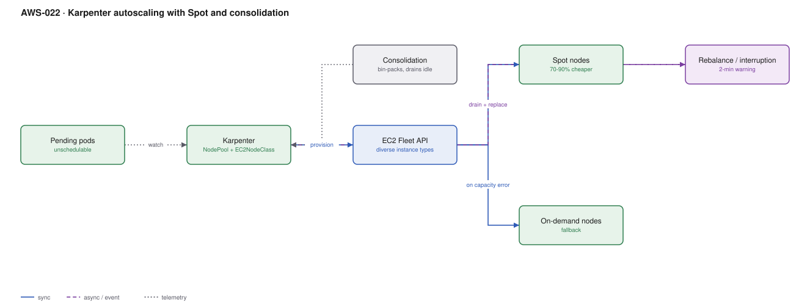

# AWS-022 · Karpenter autoscaling with Spot and consolidation

> **Category:** [03 · Containers & Orchestration](readme.md#03) · **Maturity:** Production · **Effort:** M

## The problem

Cluster Autoscaler works by adding nodes to a pre-defined node group, so you pick instance
types in advance and get whatever fit that compromise allows. Karpenter instead looks at the
actual pending pods and launches the cheapest instance that fits them — any type, any size,
Spot or on-demand — usually in under a minute. Then it keeps bin-packing and removes nodes it
no longer needs.

**Use it when** workloads are heterogeneous or bursty, or when node cost is a material part
of the bill. On a cluster of any size this is routinely a 40–60% saving.

**Don't use it when** you need rigid, predictable node inventory for licensing or compliance
reasons, or when every workload is identical and a fixed node group already bin-packs well.

## Components

| Service | Role | The setting that actually matters |
|---|---|---|
| Karpenter controller | Watches pending pods, provisions nodes | Runs *on* the cluster — needs a stable home, see failure modes |
| `NodePool` | What Karpenter may launch | **Requirements**: instance families, sizes, capacity type, architecture |
| `EC2NodeClass` | AMI, subnets, security groups, userdata | AMI selector — pin to a version, do not float on `latest` |
| EC2 Fleet API | Launches the instances | Diversity across types and AZs is what makes Spot reliable |
| Consolidation | Removes and replaces underused nodes | `WhenEmptyOrUnderutilized` — the main saving, and the main risk |
| Interruption handling | Drains on the 2-minute Spot warning | An SQS queue receiving EC2 interruption and rebalance events |

## Flow

1. Pods become unschedulable because no node has room.
2. Karpenter evaluates their combined CPU, memory, architecture, topology spread and
   tolerations, and computes the cheapest instance (or set of instances) that satisfies them.
3. It calls the EC2 Fleet API with a diverse list of acceptable types, preferring Spot.
4. The node joins in roughly 40–60 seconds and the pods schedule.
5. Continuously, consolidation looks for nodes whose pods would fit elsewhere more cheaply,
   cordons and drains them, and terminates them.
6. On a Spot interruption notice, the interruption queue triggers a drain and a replacement
   launch inside the 2-minute window.

## Cost (us-east-1 — order of magnitude)

| Line item | Small · ~20 vCPU | Medium · ~200 vCPU | Large · ~2000 vCPU |
|---|---|---|---|
| On-demand nodes, fixed node group | $600 | $6,000 | $60,000 |
| Karpenter, on-demand only + consolidation | $420 | $4,200 | $42,000 |
| Karpenter, 80% Spot + consolidation | **$168** | **$1,680** | **$16,800** |
| Karpenter controller overhead | ~$30 | ~$30 | ~$60 |
| SQS interruption queue | ~$1 | ~$1 | ~$2 |
| **Typical saving vs fixed on-demand** | **~65%** | **~70%** | **~70%** |

**Cost cliff:** there is no per-node licence or service fee — Karpenter is open source and the
saving is pure. The cliff runs the other way: Spot capacity for a *narrow* instance selection
can evaporate. A NodePool restricted to one family in one AZ gets interrupted constantly and
teams conclude Spot is unusable. Breadth is the reliability mechanism.

**Biggest lever:** instance-type diversity plus consolidation. Allow many families and sizes
(`c`, `m`, `r`, multiple generations, both architectures if your images are multi-arch), and
let consolidation bin-pack continuously.

## Failure modes

| Failure | Symptom | Mitigation |
|---|---|---|
| Karpenter evicts itself | Controller killed by its own consolidation, cluster stops scaling | Run Karpenter on a small managed node group or Fargate, never on nodes it manages |
| No PodDisruptionBudgets | Consolidation drains pods and causes outages | A PDB per workload is a hard prerequisite for consolidation |
| Spot concentration | Mass interruption of one instance type | Allow at least 10–15 instance types across ≥3 AZs |
| Stateful pods on Spot | Data loss on interruption | `karpenter.sh/do-not-disrupt` annotation, or an on-demand-only NodePool with a taint |
| Unbounded NodePool | A runaway Deployment provisions $40K of instances overnight | Set a `limits` block on CPU and memory per NodePool |
| Floating AMI selector | Nodes change AMI silently and a regression appears | Pin AMI versions; upgrade deliberately through drift |

## Security notes

- Karpenter's IAM role can create and terminate EC2 instances and pass IAM roles. Scope
  `iam:PassRole` to exactly the node role, with a condition on the service.
- Use IMDSv2-only on the `EC2NodeClass` and set the hop limit to 1 so pods cannot reach the
  instance metadata service and steal the node role.
- Node IAM roles should carry the minimum: ECR pull, CloudWatch, SSM. Workload permissions
  belong to pods via Pod Identity, never to the node.
- Subnet and security group selectors use tags. Loose tag selectors can place nodes in the
  wrong subnet — be specific.

## What people miss

- **Consolidation is where most of the saving is**, not Spot. Continuously replacing three
  half-empty nodes with one full one compounds all day. Teams enable Spot, skip consolidation,
  and get half the benefit.
- **Karpenter does not need node groups at all**, but you still want one small one as a home
  for Karpenter itself and other cluster-critical controllers.
- **`do-not-disrupt` is per-pod and respected by consolidation**, which makes it the right
  escape hatch for long-running jobs — far better than disabling consolidation globally.
- **Spot interruption rates are published per instance type and region.** Choosing families
  with low historical interruption is a two-minute decision that materially changes your
  experience.
- **Drift handling will replace nodes when the NodePool or AMI changes.** That is a feature,
  but it means editing a NodePool rolls your fleet. Do it during a change window the first time.

## See also

- [`aws-020`](aws-020-eks-baseline.md) — the cluster this provisions nodes for
- [`aws-026`](aws-026-aws-batch.md) — Spot for batch, outside Kubernetes
- [`aws-095`](aws-095-rightsizing-waste.md) — the broader waste-elimination picture
- [`aws-093`](aws-093-commitment-strategy.md) — Savings Plans still cover the on-demand floor
