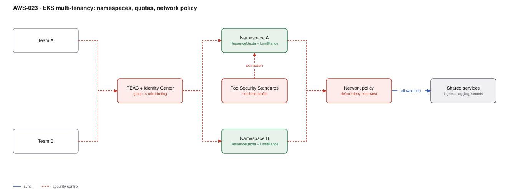

# AWS-023 · EKS multi-tenancy: namespaces, quotas, network policy

> **Category:** [03 · Containers & Orchestration](readme.md#03) · **Maturity:** Growing · **Effort:** L

## The problem

Running a cluster per team is clean and expensive: $73/month of control plane each, duplicated
add-ons, duplicated platform work, and poor bin-packing. Sharing one cluster is cheaper and
raises a hard question — what actually stops team A from reading team B's secrets, eating all
the CPU, or reaching their database?

This page is about **soft multi-tenancy**: trusted internal teams sharing a cluster. It is a
real and achievable goal, and it is important to know where it stops.

**Use it when** tenants are internal teams under one security policy.

**Don't use it when** tenants are external customers running arbitrary code. Kubernetes
namespaces are not a security boundary against hostile workloads — a container escape crosses
them. For hostile tenancy you need separate clusters, or at minimum separate nodes plus a
sandboxed runtime.

## The isolation layers

| Layer | Controls | Enforced by |
|---|---|---|
| Namespace | Naming and grouping | Kubernetes |
| RBAC | Who can do what, where | Kubernetes + IAM identity mapping |
| ResourceQuota / LimitRange | How much CPU, memory, storage, object count | Kubernetes |
| Pod Security Standards | Privileged, hostPath, hostNetwork | Admission |
| NetworkPolicy | Which pods may talk to which | VPC CNI or Cilium |
| Pod Identity | Which AWS resources a pod can reach | IAM |
| Node isolation | Whether tenants share a kernel | Taints, or separate node pools |

## Components

| Service | Role | The setting that actually matters |
|---|---|---|
| Namespace per tenant | The unit of isolation | Everything below is scoped to it |
| IAM Identity Center + access entries | Humans → cluster RBAC | Group-to-role mapping, not per-user entries |
| `ResourceQuota` | Caps total requests per namespace | Quota on **requests and limits**, plus object counts |
| `LimitRange` | Default and maximum per pod | Without it, one pod can consume the whole quota |
| NetworkPolicy | East-west traffic control | A **default-deny** policy per namespace, then explicit allows |
| Pod Security Admission | Blocks dangerous pod specs | `restricted` profile, enforced not just audited |
| Pod Identity | Per-service-account AWS access | One role per service account, scoped to tenant resources |

## Flow

1. A tenant is onboarded: namespace, quota, limit range, default-deny NetworkPolicy, PSS
   labels, and an Argo Project — all generated from one template.
2. Team members authenticate via Identity Center; their group maps to a Role binding scoped
   to that namespace only.
3. Pods are admitted only if they satisfy the `restricted` Pod Security Standard.
4. Scheduling is bounded by the ResourceQuota; a runaway Deployment fails to schedule rather
   than starving neighbours.
5. Network policy denies all east-west traffic by default; the tenant declares the specific
   flows it needs, plus allows to shared services (ingress, DNS, logging).
6. Pods reach AWS resources through a tenant-scoped IAM role via Pod Identity.

## Cost (us-east-1 — order of magnitude)

| Line item | 5 tenants, separate clusters | 5 tenants, shared cluster | 30 tenants, shared cluster |
|---|---|---|---|
| EKS control planes | $365 | $73 | $73 |
| Nodes (poor vs good bin-packing) | $3,000 | $1,900 | $9,000 |
| NAT gateways | $493 | $99 | $99 |
| Duplicated add-ons / observability | $400 | $120 | $300 |
| Platform engineering time | 5× | 1× | 1× |
| **Total** | **~$4,258** | **~$2,192** | **~$9,472** |

**Cost cliff:** the saving is not the $73 control plane — it is **bin-packing and duplicated
platform overhead**. Five clusters each sized for their own peak need far more total headroom
than one cluster absorbing uncorrelated peaks. That, plus one set of add-ons and one upgrade
cycle instead of five.

**Biggest lever:** quota discipline. Namespaces with generous quotas and no actual usage force
you to over-provision for a demand that never arrives. Review quotas against real usage
quarterly and reclaim.

## Failure modes

| Failure | Symptom | Mitigation |
|---|---|---|
| No LimitRange | One pod requests 64 CPU and consumes the whole quota | LimitRange with sane defaults and maxima per namespace |
| Noisy neighbour on I/O or network | Quotas respected, performance still terrible | CPU/memory quotas do not cover disk or network — isolate by node pool for sensitive workloads |
| CoreDNS saturation | Cluster-wide DNS failures from one tenant's retry storm | NodeLocal DNSCache, and per-namespace rate limiting |
| Shared CRDs | One tenant upgrades a CRD and breaks another | CRDs are cluster-scoped — platform team owns them exclusively |
| NetworkPolicy not enforced | Policies exist but traffic flows anyway | The VPC CNI only enforces policy if network policy support is **enabled**; verify, do not assume |
| Cluster-wide RBAC leak | A ClusterRole grants secret read across namespaces | Audit ClusterRoleBindings regularly; they are the usual escape hatch |

## Security notes

- **Namespaces are not a security boundary against untrusted code.** Say this out loud in the
  design review. A kernel escape is a cluster compromise.
- Secrets are namespaced, but anyone with `get secrets` plus a ServiceAccount token can move
  laterally. Audit `ClusterRole` grants for `secrets` specifically.
- Block the instance metadata service from pods (IMDSv2, hop limit 1) or any pod can assume
  the node role and bypass every per-pod control.
- For sensitive tenants, taint dedicated nodes rather than relying on scheduling preferences.

## What people miss

- **Default-deny NetworkPolicy must be created per namespace.** There is no cluster-wide
  default. A namespace created without one has full east-west reachability, which is exactly
  the opposite of what the design claims.
- **ResourceQuota requires every pod to set requests.** Once a quota exists, a pod with no
  resource requests is rejected — which breaks tenants mid-migration unless LimitRange
  provides defaults.
- **Hierarchical Namespace Controller and vCluster** are the next steps up if namespaces are
  too coarse. vCluster gives each tenant an apparent control plane, which solves the CRD
  conflict problem properly.
- **Cost allocation is the unspoken requirement.** Shared clusters make showback hard; tag
  namespaces and use Kubecost or split-cost-allocation data in the CUR —
  [`aws-092`](aws-092-finops-cur-pipeline.md).
- **Quota exhaustion looks exactly like a cluster problem** to the tenant. Give teams a
  dashboard of their own quota usage or you become the help desk.

## See also

- [`aws-020`](aws-020-eks-baseline.md) — the cluster being shared
- [`aws-024`](aws-024-service-mesh.md) — stronger identity-based east-west control
- [`aws-060`](aws-060-identity-center-abac.md) — the human identity half
- [`aws-092`](aws-092-finops-cur-pipeline.md) — charging tenants for what they use
