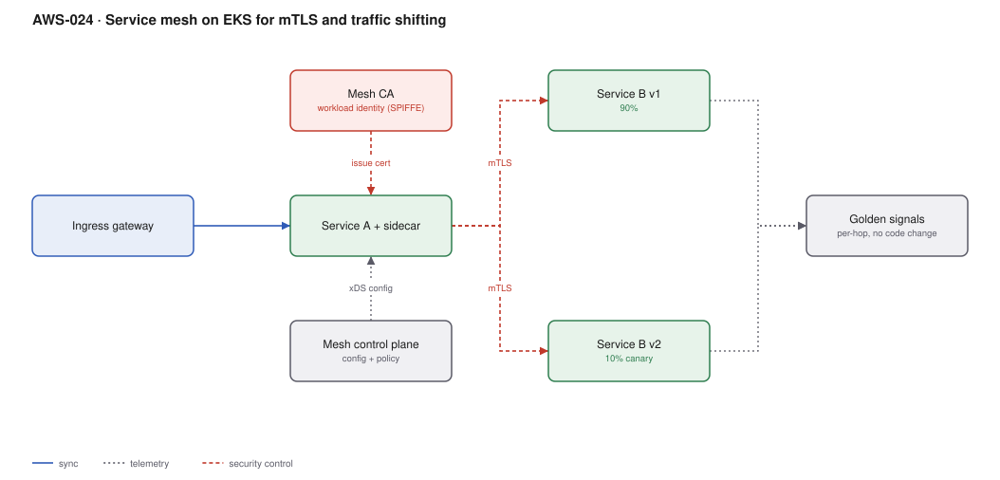

# AWS-024 · Service mesh on EKS for mTLS and traffic shifting

> **Category:** [03 · Containers & Orchestration](readme.md#03) · **Maturity:** Specialist · **Effort:** L

## The problem

You want encrypted, authenticated service-to-service traffic, per-hop golden signals, retries
and timeouts, and the ability to shift 5% of traffic to a new version — without changing
application code in eight languages. A mesh intercepts every connection with a proxy and
gives you all of that as configuration.

It also adds a proxy to every pod, a control plane to operate, and a new layer to debug.

**Use it when** you have enough services that per-service libraries have become unmanageable,
and you need **identity-based** authorisation (service A may call service B) rather than
network-based.

**Don't use it when** you have fewer than ~20 services. ECS Service Connect, an internal ALB,
or plain NetworkPolicy plus OpenTelemetry will give you most of the value for a fraction of
the operational cost. "We might need it later" is not a reason to run one now.

## The options

| | Istio (ambient) | Istio (sidecar) | Cilium | ECS Service Connect |
|---|---|---|---|---|
| Per-pod proxy | **No** — per-node ztunnel | Yes | eBPF, no sidecar | Yes, on ECS |
| mTLS | Yes | Yes | Yes (WireGuard/mTLS) | Yes |
| L7 traffic shifting | Via waypoint proxy | Yes | Partial | Yes |
| Resource overhead | Low | ~100–200 MB + 0.1 vCPU **per pod** | Low | Low |
| Operational burden | Medium | High | Medium | **Very low** |

Ambient mode changed the calculus here significantly: the per-pod tax that made meshes hard
to justify is now optional.

## Components

| Service | Role | The setting that actually matters |
|---|---|---|
| Control plane | Distributes config to proxies | Version skew with the data plane; upgrades are the main operational cost |
| Workload identity (SPIFFE) | Cryptographic service identity | This is the real product — identity, not encryption |
| Sidecar / ztunnel | Intercepts traffic | Ambient mode avoids the per-pod sidecar entirely |
| Ingress gateway | North-south entry | Often an ALB in front of a mesh gateway |
| `AuthorizationPolicy` | Service A may call B on path C | Default-deny, then explicit allows |
| `VirtualService` / `HTTPRoute` | Traffic splitting | How canaries are expressed |

## Flow

1. A request enters through the ingress gateway and is admitted to the mesh.
2. The calling workload's proxy presents its SPIFFE identity; the callee's proxy verifies it.
3. An `AuthorizationPolicy` decides whether this identity may call this service and path.
4. The route configuration splits traffic by weight between v1 and v2.
5. Both proxies emit identical metrics, traces and access logs for every hop, with no
   application instrumentation.
6. Retries, timeouts and circuit breaking are applied by the proxy per the policy.

## Cost (us-east-1 — order of magnitude)

| Line item | 20 services / 60 pods | 100 services / 400 pods | 400 services / 2000 pods |
|---|---|---|---|
| Sidecar overhead (0.1 vCPU + 128 MB each) | ~$180 | ~$1,200 | ~$6,000 |
| *Ambient mode equivalent* | ~$40 | ~$200 | ~$900 |
| Control plane pods | ~$70 | ~$140 | ~$350 |
| Added observability volume (per-hop metrics) | ~$50 | ~$300 | ~$1,500 |
| **Total (sidecar)** | **~$300** | **~$1,640** | **~$7,850** |
| **Total (ambient)** | **~$160** | **~$640** | **~$2,750** |

**Cost cliff:** the sidecar tax is per *pod*, not per service, so it scales with replica count
and is worst for small, numerous pods. A fleet of 2,000 small pods pays more for proxies than
for some of the applications. Ambient mode removes roughly two-thirds of that.

**Biggest lever:** choosing ambient over sidecar, and being selective about which namespaces
join the mesh at all. Not every workload needs it.

## Failure modes

| Failure | Symptom | Mitigation |
|---|---|---|
| Control plane version skew | Proxies and control plane disagree, traffic breaks subtly | Upgrade control plane first, then data plane; revision-based upgrades with canary namespaces |
| Sidecar starts after the app | App's startup connections fail | `holdApplicationUntilProxyStarts`, or native sidecar containers |
| Sidecar does not stop for Jobs | Jobs never complete | Native sidecar containers (Kubernetes 1.29+) solved this long-standing problem |
| mTLS in PERMISSIVE forever | Everyone believes traffic is encrypted; much of it is not | Migrate to STRICT per namespace and verify; PERMISSIVE is a migration state, not a destination |
| Debugging gets harder | A 503 with no obvious source | Learn to read proxy access logs *before* you need to; budget training time |
| Mesh becomes a SPOF | Control plane outage degrades everything | Proxies keep last-known config — verify this is true in your setup by testing it |

## Security notes

- The value is **identity-based authorisation**. mTLS encryption alone is often already
  satisfied by VPC encryption in transit; the new capability is "only the checkout service
  may call the payments service".
- Default-deny `AuthorizationPolicy` per namespace, then explicit allows. A mesh in
  allow-all mode is observability with extra steps.
- Certificate rotation is automatic and short-lived — verify the rotation actually works in a
  test before relying on it.
- The mesh does not protect against a compromised workload using its own legitimate identity.
  Combine with least-privilege policies, not just encryption.

## What people miss

- **Ambient mode is the headline change.** Most "we evaluated a mesh and it was too expensive"
  conclusions were reached against sidecar mode and deserve revisiting.
- **ECS Service Connect gives you 80% of this for ECS workloads** with essentially no
  operational cost — service discovery, retries, per-hop metrics. For ECS, start there.
- **You probably already have mTLS.** Traffic between instances in a VPC is encrypted at the
  physical layer by AWS for supported instance types. If the requirement is "encrypted in
  transit" for an auditor, you may already meet it — check before buying a mesh.
- **Per-hop metrics are the most-used feature by far.** Many teams install a mesh for mTLS and
  find the golden signals are what they actually keep it for. OpenTelemetry
  ([`aws-067`](aws-067-otel-adot.md)) may get you there more cheaply.
- **A mesh is a platform team commitment**, not a project. If no one owns upgrades, it will
  be two versions behind and unsupported within 18 months.

## See also

- [`aws-023`](aws-023-eks-multi-tenancy.md) — NetworkPolicy, the cheaper east-west control
- [`aws-025`](aws-025-progressive-delivery.md) — traffic shifting without a mesh
- [`aws-067`](aws-067-otel-adot.md) — golden signals without a mesh
- [`aws-019`](aws-019-ecs-fargate-alb.md) — ECS Service Connect as the low-cost alternative
