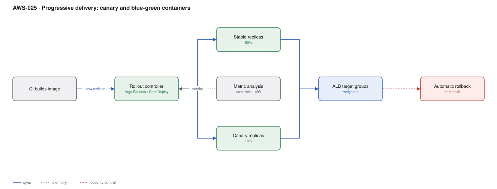

# AWS-025 · Progressive delivery: canary and blue-green containers

> **Category:** [03 · Containers & Orchestration](readme.md#03) · **Maturity:** Growing · **Effort:** M

## The problem

A Kubernetes rolling update replaces pods in batches and declares success when they pass
readiness checks. Readiness means "the process started", not "the new version is not losing
5% of requests". Progressive delivery closes that gap: shift a small slice of real traffic,
measure real metrics, and promote or roll back automatically on the evidence.

**Use it when** a bad deploy has real cost and you deploy often enough that a human watching
dashboards is not scalable.

**Don't use it when** you deploy monthly behind a change board — the automation has nothing
to automate. And do not adopt it before you have metrics worth gating on; a canary with no
meaningful analysis is just a slow rollout.

## Canary vs blue-green

| | Canary | Blue-green |
|---|---|---|
| Traffic during rollout | Split, gradually shifted | 100% old, then 100% new |
| Extra capacity needed | A few percent | **2×**, briefly |
| Blast radius of a bad build | 5–10% of users | 100%, after the switch |
| Rollback speed | Shift weight back, seconds | Switch back, seconds |
| Good for | Stateless services with good metrics | Changes that cannot run two versions at once |

Canary is the default. Blue-green is for when two versions genuinely cannot coexist — usually
because of a non-backward-compatible schema or a stateful protocol.

## Components

| Service | Role | The setting that actually matters |
|---|---|---|
| Argo Rollouts (or CodeDeploy for ECS) | Replaces Deployment with a staged rollout | The `steps` list: weight, pause, analysis |
| `AnalysisTemplate` | The pass/fail criteria | Query, threshold, and `failureLimit` — this is the whole point |
| ALB target groups | Weighted traffic split | ALB weighted target groups give true percentage splitting |
| Prometheus / CloudWatch | The metric source | Error rate **and** latency; one alone is not enough |
| Automatic rollback | Reverts on a failed analysis | Must be enabled and must be tested |

## Flow

1. CI pushes a new image and updates the Rollout manifest; Argo CD syncs it.
2. The rollout controller creates a canary ReplicaSet at 10% weight and adjusts the ALB
   target group weights.
3. It pauses and runs the `AnalysisTemplate`: query the error rate and p99 for the canary
   target group over the bake window.
4. If the analysis passes, it advances to the next step — 25%, 50%, 100% — re-analysing each
   time.
5. If any analysis fails, it shifts weight back to stable immediately and marks the rollout
   degraded.
6. On completion, the stable ReplicaSet is updated and the canary scaled down.

## Cost (us-east-1 — order of magnitude)

| Line item | Small · 10 pods | Medium · 60 pods | Large · 400 pods |
|---|---|---|---|
| Baseline workload compute | $300 | $1,800 | $12,000 |
| Canary overhead (~10% extra during rollout) | ~$5 | ~$30 | ~$200 |
| *Blue-green overhead (2× during cutover)* | ~$50 | ~$300 | ~$2,000 |
| Rollout controller | ~$20 | ~$20 | ~$40 |
| Metric queries / analysis | ~$5 | ~$20 | ~$100 |
| **Total added cost (canary)** | **~$30** | **~$70** | **~$340** |

**Cost cliff:** blue-green needs **double capacity** for the duration of the cutover. On a
400-pod service that is a brief but real doubling, and if your cluster cannot burst that far
the deploy simply fails. Canary needs only the canary slice, which is why it scales better.

**Biggest lever:** bake time. Long bakes are safer and tie up double capacity for longer. Most
teams over-bake early steps and under-bake the 50% step, where real traffic diversity first
shows up.

## Failure modes

| Failure | Symptom | Mitigation |
|---|---|---|
| Analysis with no teeth | Canary always passes, bad builds ship | Validate the analysis by deliberately deploying a known-bad build in staging |
| Metrics not segmented by version | Canary errors averaged away by stable traffic | Label metrics by target group or pod version; otherwise analysis is meaningless |
| Too little traffic to judge | A 5% canary on a low-traffic service gets 3 requests | Use a longer bake, a bigger slice, or skip canary and use blue-green |
| Session affinity | Users bounce between versions mid-session | Sticky sessions on the target group, or make the change backward compatible |
| Schema migration not compatible | Rollback restores code but the database has moved | Expand/contract — the actual prerequisite, as in [`aws-009`](aws-009-api-canary-deploys.md) |
| Rollback never tested | Discovers it does not work during an incident | Game-day it; a rollback path you have not executed does not exist |

## Security notes

- Rollout controllers mutate workloads cluster-wide. Scope their RBAC per namespace where
  possible, and treat the controller as tier-0.
- Analysis queries hit your metrics backend with credentials. Those credentials can read all
  tenants' metrics — scope them if you are multi-tenant.
- Canary pods are production pods. They need the same secrets, network policy and admission
  controls, not a relaxed variant "because it is only 10%".

## What people miss

- **Analysis quality is the whole product.** The rollout mechanics are easy; deciding
  "is this version worse?" from noisy metrics in five minutes is the hard part. Start with
  error rate plus p99 latency against the stable baseline, not against an absolute threshold.
- **ALB weighted target groups do the real splitting.** Scaling pod *counts* to approximate a
  percentage (the old trick) is inaccurate and wasteful at low replica counts.
- **Argo Rollouts replaces your Deployment object**, which is a bigger change than it sounds —
  HPA, PDB and anything referencing the Deployment need updating.
- **ECS has this built in via CodeDeploy** with linear and canary deployment configurations,
  and alarms as the rollback trigger. For ECS you do not need a new controller.
- **Feature flags often beat deployment canaries.** Shipping the code dark and ramping a flag
  decouples deploy from release entirely, and rolls back in milliseconds without a rollout.

## See also

- [`aws-021`](aws-021-eks-gitops-argocd.md) — the GitOps layer this plugs into
- [`aws-009`](aws-009-api-canary-deploys.md) — the same idea at the API gateway
- [`aws-072`](aws-072-slo-error-budgets.md) — where the analysis thresholds come from
- [`aws-070`](aws-070-chaos-fis.md) — proving the rollback path works
