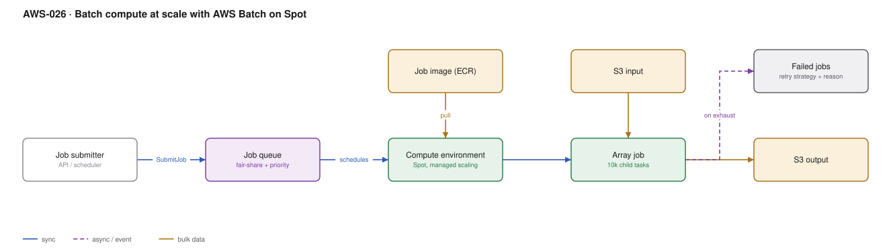

# AWS-026 · Batch compute at scale with AWS Batch on Spot

> **Category:** [03 · Containers & Orchestration](readme.md#03) · **Maturity:** Production · **Effort:** M

## The problem

You have thousands of independent compute tasks — render frames, run simulations, process
genomes, backtest strategies, transcode a catalogue. They are too long for Lambda, too bursty
for a fixed fleet, and too numerous to manage by hand. AWS Batch is a managed job queue that
provisions exactly the capacity the queue needs and tears it down afterwards.

**Use it when** work is embarrassingly parallel, interruption-tolerant, and takes minutes to
hours per task.

**Don't use it when** tasks are sub-second (use Lambda), need to talk to each other
(use a real HPC scheduler or ParallelCluster), or must run on a fixed schedule with
guaranteed latency.

## Batch vs the alternatives

| | AWS Batch | Lambda | ECS/EKS directly | Step Functions Map |
|---|---|---|---|---|
| Max duration | Unlimited | 15 min | Unlimited | Unlimited |
| Queueing + priority | **Built in** | No | No | Limited |
| Fair-share across teams | **Yes** | No | No | No |
| Spot management | **Built in** | N/A | You build it | You build it |
| Dependencies between jobs | **Yes** | No | No | Yes |
| Good for | 10K heavy tasks | 10M light tasks | Long-running services | Orchestrated steps |

## Components

| Service | Role | The setting that actually matters |
|---|---|---|
| Job queue | Holds and prioritises submitted jobs | **Fair-share scheduling policy** — stops one team starving the others |
| Compute environment | The capacity pool | `SPOT` with `SPOT_CAPACITY_OPTIMIZED` allocation, and a wide instance type list |
| Job definition | Container, vCPU, memory, retries | **Retry strategy with `evaluateOnExit`** — retry on Spot reclaim, fail fast on a bug |
| Array jobs | One submission, N children | Up to 10,000 children; the child index selects the work |
| S3 | Input and output | Jobs should be pure: read from S3, write to S3, hold no local state |
| EventBridge | Job state changes | How you notice failures without polling |

## Flow

1. A submitter creates an array job of N children with a shared job definition.
2. The queue schedules by priority and fair-share weight across tenants.
3. The compute environment scales up, requesting diverse Spot instance types.
4. Each child container reads `AWS_BATCH_JOB_ARRAY_INDEX`, pulls its slice of input from S3,
   computes, and writes output back to S3.
5. A Spot reclaim kills a child; the retry strategy sees the host-terminated exit reason and
   retries it elsewhere, without consuming the retry budget meant for real bugs.
6. When the queue drains, the compute environment scales back to zero.
7. EventBridge publishes terminal job states for alerting and downstream triggers.

## Cost (us-east-1 — order of magnitude)

| Line item | Small · 1K jobs × 5 min | Medium · 100K jobs × 15 min | Large · 2M jobs × 30 min |
|---|---|---|---|
| On-demand c6i.xlarge equivalent | $14 | $425 | $17,000 |
| **Spot (typical ~70% off)** | **$4** | **$128** | **$5,100** |
| AWS Batch service fee | $0 | $0 | $0 |
| S3 requests + storage | $1 | $30 | $600 |
| Data transfer (same region) | $0 | $0 | $0 |
| **Total on Spot** | **~$5** | **~$158** | **~$5,700** |

**Cost cliff:** cross-AZ data transfer. If jobs read from S3 that is free in-region, but if
they read from an EFS or a database in a different AZ you pay $0.01/GB each way, and at two
million jobs that line can exceed the compute. Keep data access in-AZ or in S3.

**Biggest lever:** Spot, plainly — typically 70% off, and batch work is the ideal Spot
workload because interruption just means retry. Second lever: **right-sizing vCPU/memory in
the job definition**, since Batch packs jobs onto instances by those requests.

## Failure modes

| Failure | Symptom | Mitigation |
|---|---|---|
| Retry on application bugs | A broken job retries 10 times and burns budget | `evaluateOnExit` — retry on `Host EC2*` termination, fail immediately on a non-zero app exit |
| Jobs stuck `RUNNABLE` | Nothing runs, no error message | Almost always capacity, subnet IPs, or a vCPU service quota — check the quota first |
| Non-idempotent jobs | Spot reclaim produces duplicate or corrupt output | Write to a temp key then atomically copy; make output keyed on the input hash |
| No fair-share policy | One team's 50,000-job submission blocks everyone | Fair-share scheduling policy with per-tenant weights |
| Huge array job output | 10,000 jobs each writing many small S3 objects | Aggregate output; small-object overhead is real at this count |
| Instance type too narrow | Spot capacity unavailable, queue stalls | List many families and sizes; let `SPOT_CAPACITY_OPTIMIZED` choose |

## Security notes

- Separate the **job role** (what the container can reach) from the instance role. Jobs should
  have access to exactly their input prefix and output prefix.
- On Fargate-backed compute environments there is no shared host, which matters if jobs
  process data from different tenants.
- Job definitions can take secrets from Secrets Manager; never bake credentials into the image.
- Container images for batch jobs are often neglected — they go through the same supply chain
  controls as services ([`aws-027`](aws-027-container-supply-chain.md)).

## What people miss

- **`evaluateOnExit` is the setting that makes Spot work.** Without it you cannot distinguish
  "Spot took my instance, please retry" from "my code threw", so you either retry bugs
  expensively or fail jobs that were merely interrupted.
- **Fair-share scheduling is underused.** It lets several teams share one queue with
  guaranteed shares and decay over time, which is exactly the problem most platform teams
  solve badly with separate queues.
- **Array jobs with 10,000 children cost one API call.** Submitting 10,000 individual jobs is
  slower, hits API limits, and loses the index-based work-splitting idiom.
- **Job dependencies** (`dependsOn`, including `N_TO_N` across arrays) let you express a DAG
  without Step Functions, which is cheaper at high job counts.
- **Batch on EKS** exists and runs jobs as pods on your existing cluster, which avoids a
  second compute pool if you already run Kubernetes.

## See also

- [`aws-022`](aws-022-karpenter-spot.md) — the Kubernetes-native equivalent of the Spot story
- [`aws-012`](aws-012-async-job-submission.md) — when the job is seconds, not hours
- [`aws-042`](aws-042-emr-serverless.md) — when the work is Spark rather than containers
- [`aws-093`](aws-093-commitment-strategy.md) — why Spot and Savings Plans interact
