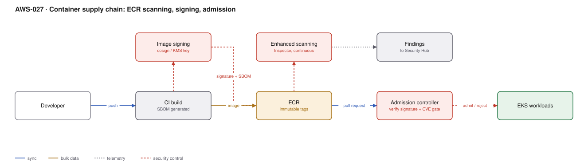

# AWS-027 · Container supply chain: ECR scanning, signing, admission

> **Category:** [03 · Containers & Orchestration](readme.md#03) · **Maturity:** Growing · **Effort:** M

## The problem

Your cluster will run any image anyone can push. That is three separate risks: a base image
with a critical CVE, a dependency compromised upstream, and an image that was never built by
your pipeline at all. Scanning tells you about the first. Signing plus admission control is
what stops the third — and it is the one most teams skip.

**Use it when** you run containers in production. The scanning half is table stakes; the
signing half is what regulators and serious threat models increasingly ask for.

**Don't** treat this as a one-time project. A clean image today has critical CVEs in six
weeks; continuous scanning and a rebuild cadence are the actual control.

## Components

| Service | Role | The setting that actually matters |
|---|---|---|
| CI build | Produces the image and the SBOM | Reproducible, pinned base images, no `latest` |
| cosign + KMS | Signs the image digest | The signing key lives in KMS and CI gets `kms:Sign` only — never a key file |
| ECR | Registry | **Tag immutability on**, plus a lifecycle policy |
| Amazon Inspector | Enhanced, continuous scanning | Continuous rescan of *existing* images, not just on push |
| Admission controller | Refuses unsigned or vulnerable images | Kyverno / Gatekeeper / Ratify, in **enforce** mode |
| Security Hub | Aggregates findings | Where the CVE findings become someone's queue |

## Flow

1. CI builds from a pinned base image and generates an SBOM.
2. CI requests a signature over the image **digest** using a KMS key it may use but cannot
   export.
3. The image, its SBOM and its signature are pushed to ECR with an immutable tag.
4. Inspector scans on push and then continuously rescans as new CVEs are published, sending
   findings to Security Hub.
5. At deploy time the admission controller verifies the signature against the expected key
   identity and checks the image is free of critical CVEs above policy.
6. Unsigned, unknown, or over-threshold images are rejected before a pod is created.

## Cost (us-east-1 — order of magnitude)

| Line item | Small · 50 images | Medium · 500 images | Large · 5,000 images |
|---|---|---|---|
| ECR storage @ $0.10/GB-mo (500 MB each) | $2.50 | $25.00 | $250.00 |
| Inspector enhanced scanning @ ~$0.09/image/mo | $4.50 | $45.00 | $450.00 |
| Inspector re-scans (included) | $0 | $0 | $0 |
| KMS key + signing requests | $1.20 | $1.50 | $4.00 |
| Admission controller compute | ~$20 | ~$40 | ~$120 |
| **Total** | **~$28** | **~$112** | **~$824** |

**Cost cliff:** ECR storage with no lifecycle policy. Every CI run pushes an image; at 50
builds a day with 500 MB images that is 7.5 TB a year — $750/month growing forever, for
artifacts nobody will deploy. A lifecycle policy keeping the last 10 tagged plus 7 days of
untagged images is usually a 90% reduction.

**Biggest lever:** base image choice. Moving from a full distro base to a distroless or
minimal base typically removes 80–95% of reported CVEs, because most of them are in packages
your application never invokes. That is less scanning noise, smaller images, faster pulls and
a smaller attack surface in one change.

## Failure modes

| Failure | Symptom | Mitigation |
|---|---|---|
| Admission in audit mode forever | Policy exists, nothing is enforced | Start in audit, set a date to enforce, and enforce |
| Breaking glass with no path | An incident fix is blocked by the CVE gate | A documented, audited exception mechanism with an expiry |
| Mutable tags | Signature verifies a tag that now points elsewhere | Immutable tags, and resolve to digest at deploy time |
| Scanning only on push | Images clean at build, critical six weeks later | Inspector continuous rescan + an alert that triggers a rebuild |
| Third-party images unsigned | Policy blocks nginx, ingress, everything | Allow-list specific external registries by digest, or re-sign vetted images into your own registry |
| CVE threshold too strict | Hundreds of unactionable findings, team disengages | Gate on critical + exploitable (reachable) rather than every high |

## Security notes

- Sign the **digest**, never the tag. A tag is a mutable pointer; signing it proves nothing.
- The signing key in KMS should be usable by the CI role for `kms:Sign` only, with no export
  and no admin. Verification needs only the public key.
- Admission must verify **key identity**, not merely that a valid signature exists. "Signed by
  someone" is not a control.
- Keep SBOMs. When the next widely-exploited library CVE lands, the question "which of our
  2,000 images contain it?" is answerable in seconds or in weeks, depending on this decision.
- Scan IaC and the Dockerfile too — see [`aws-064`](aws-064-shift-left-security.md).

## What people miss

- **Signing is the control that stops a compromised registry credential.** Scanning does not.
  If an attacker can push to ECR, only signature verification at admission prevents them from
  running code in your cluster.
- **ECR pull-through cache** mirrors upstream registries (Docker Hub, Quay, GHCR) into ECR.
  It removes Docker Hub rate limiting, keeps you running when upstream is down, and brings
  external images into your scanning scope. Very few teams enable it.
- **Inspector's continuous rescanning is the valuable half.** Scan-on-push tells you about
  today; the CVE that matters will be published next month against an image you already
  deployed.
- **Most CVEs in a scan report are not reachable** from your code path. Inspector's
  exploitability data and reachability analysis are what make the queue finite.
- **Image size is a security property**, not just a performance one. Fewer packages, fewer
  CVEs, fewer shells for an attacker to use.

## See also

- [`aws-064`](aws-064-shift-left-security.md) — the same gate applied to IaC
- [`aws-021`](aws-021-eks-gitops-argocd.md) — what deploys the verified image
- [`aws-059`](aws-059-kms-key-hierarchy.md) — custody of the signing key
- [`aws-061`](aws-061-config-compliance.md) — proving the control is on, continuously
