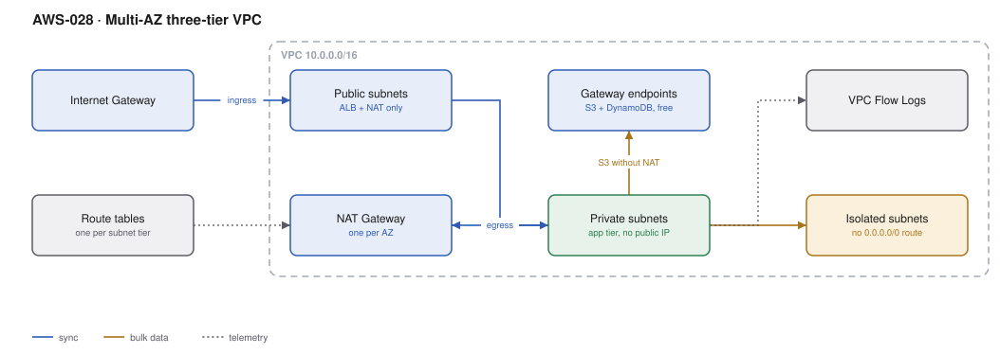

# AWS-028 · Multi-AZ three-tier VPC

> **Category:** [04 · Networking & Connectivity](readme.md#04) · **Maturity:** Production · **Effort:** S

## The problem

Every account needs a network, and the decisions you make in the first hour — CIDR size,
subnet tiers, how many NAT gateways — are the ones you cannot change later without a
migration. This is the default layout: public subnets for things that must face the internet,
private subnets for compute, isolated subnets for data.

**Use it when** you are creating a VPC. This is the baseline.

**Don't** create one VPC per application. VPCs are free; the things that connect them are not.
A VPC per account per environment, with multiple applications inside, is almost always right.

## Components

| Service | Role | The setting that actually matters |
|---|---|---|
| VPC CIDR | The address space | **Size it 4× what you think.** You cannot shrink it, and secondary CIDRs are a workaround, not a fix |
| Public subnets | ALB, NAT gateways | Small — a /24 is plenty. Nothing else belongs here |
| Private subnets | Application compute | Large. Fargate tasks and EKS pods each consume an IP |
| Isolated subnets | Databases | **No route to 0.0.0.0/0** — that is the definition, not the label |
| NAT gateway | Outbound internet for private subnets | One per AZ for resilience; this is the expensive decision |
| Gateway VPC endpoints | S3 and DynamoDB without NAT | **Free.** Always create them |
| Flow logs | Network forensics | To S3 in Parquet, not to CloudWatch Logs — see the cost note |

## Flow

1. Inbound traffic arrives at the internet gateway and reaches an ALB in the public subnets.
2. The ALB forwards to compute in the private subnets, which have no public IPs.
3. Outbound traffic from private subnets routes to the NAT gateway in the same AZ.
4. Traffic to S3 and DynamoDB instead takes the **gateway endpoint**, bypassing NAT entirely
   and costing nothing.
5. The application reaches the database in isolated subnets, which have no internet route at
   all in either direction.
6. Flow logs capture metadata for every accepted and rejected flow.

## Cost (us-east-1 — order of magnitude)

| Line item | Small · 1 AZ NAT, 100 GB | Medium · 3 AZ NAT, 2 TB | Large · 3 AZ NAT, 50 TB |
|---|---|---|---|
| VPC, subnets, route tables, IGW | $0 | $0 | $0 |
| NAT gateway hours @ $0.045/hr | $32.85 | $98.55 | $98.55 |
| NAT data processing @ $0.045/GB | $4.50 | $90.00 | $2,250.00 |
| Gateway endpoints (S3, DynamoDB) | $0 | $0 | $0 |
| Interface endpoints (5 × 3 AZ) | $0 | $109.50 | $109.50 |
| Flow logs to S3 (~2% of traffic volume) | $0.50 | $10.00 | $250.00 |
| **Total** | **~$38** | **~$308** | **~$2,708** |

**Cost cliff:** **NAT gateway data processing at $0.045/GB is the single most common surprise
line in an AWS bill.** It is charged *in addition to* any internet egress charge, so pulling
50 TB through NAT costs $2,250 in processing plus the egress. Worse, traffic to S3 through
NAT is billed at $0.045/GB when the gateway endpoint would make it free.

**Biggest lever:** gateway endpoints for S3 and DynamoDB, created in five minutes, free
forever. After that, interface endpoints for the AWS services you call most (ECR, Secrets
Manager, CloudWatch Logs, SSM) at ~$7.30/month each per AZ — cheaper than NAT above roughly
170 GB/month per service.

## Failure modes

| Failure | Symptom | Mitigation |
|---|---|---|
| CIDR too small | Cannot add subnets, cannot grow, migration required | Allocate a /16 and subnet generously; IPv4 space inside your VPC costs nothing |
| One NAT gateway | AZ failure removes egress for everything; cross-AZ data charges | One NAT per AZ, with route tables per AZ pointing at the local one |
| Overlapping CIDRs | Cannot peer or attach to Transit Gateway later | Central IPAM from day one ([`aws-035`](aws-035-ipam-ipv6.md)) |
| Databases in private, not isolated | A compromised app can exfiltrate directly | Isolated subnets with no 0.0.0.0/0 route; this is a real control |
| Flow logs to CloudWatch Logs | Logging bill exceeds the NAT bill | Send to S3 in Parquet; query with Athena |
| No endpoints, chatty AWS API usage | Thousands of dollars of NAT processing for API calls | Interface endpoints for high-traffic services |

## Security notes

- Security groups are stateful and should reference **other security groups**, not CIDRs.
  `app-sg` allows from `alb-sg` — that survives IP changes and documents intent.
- NACLs are stateless and are a blunt second layer. Use them for broad subnet-level denies
  only; most teams should leave them at default and invest in security groups.
- Isolated subnets are the control that makes "the database cannot reach the internet"
  verifiable rather than aspirational.
- Flow logs should capture `ACCEPT` and `REJECT`. Rejects are the interesting ones during an
  investigation ([`aws-048`](aws-048-vpc-flow-flink.md)).

## What people miss

- **Gateway endpoints are free and most VPCs lack them.** S3 traffic through a NAT gateway is
  pure waste. This is the highest-ratio fix in AWS networking.
- **Cross-AZ traffic costs $0.01/GB in each direction.** An ALB in AZ-a talking to a pod in
  AZ-b is billed. At scale, AZ-aware routing (topology-aware hints, zonal affinity) is real
  money.
- **A /24 of 256 addresses gives you 251 usable** — AWS reserves five per subnet. This bites
  when people size subnets exactly.
- **You can add secondary CIDRs** to an existing VPC, which rescues a too-small allocation,
  but the new range must not overlap anything you ever want to connect to.
- **IPv6 is free of NAT entirely.** An egress-only internet gateway costs nothing and has no
  per-GB processing charge — see [`aws-035`](aws-035-ipam-ipv6.md).

## See also

- [`aws-030`](aws-030-centralized-egress.md) — sharing NAT across many VPCs
- [`aws-029`](aws-029-transit-gateway-hub.md) — connecting these VPCs together
- [`aws-035`](aws-035-ipam-ipv6.md) — planning the CIDRs before you allocate them
- [`aws-048`](aws-048-vpc-flow-flink.md) — doing something useful with the flow logs
