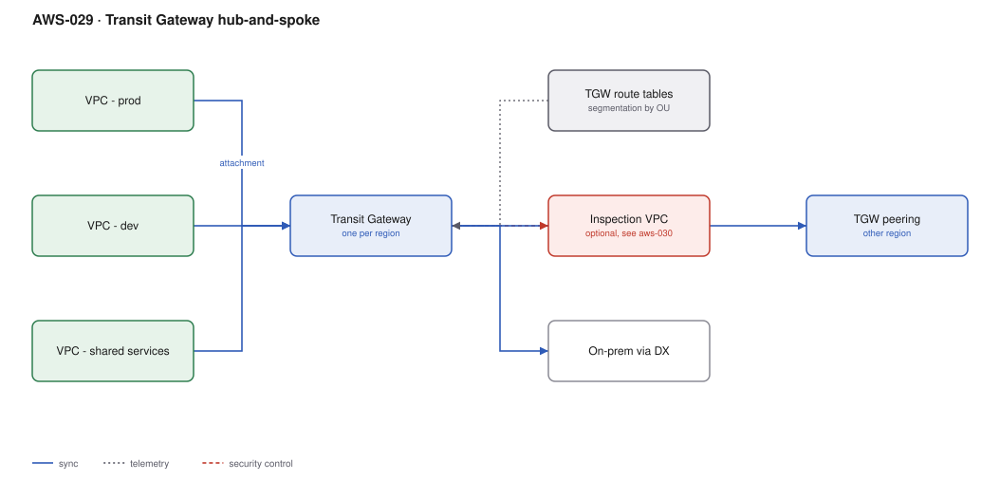

# AWS-029 · Transit Gateway hub-and-spoke

> **Category:** [04 · Networking & Connectivity](readme.md#04) · **Maturity:** Production · **Effort:** M

## The problem

VPC peering is point-to-point and non-transitive. Ten VPCs that all need to reach each other
is 45 peering connections and 45 route table entries per VPC, and adding the eleventh means
10 more. Transit Gateway is a regional router: each VPC attaches once, and routing is decided
centrally by route tables you control.

**Use it when** you have more than about four VPCs, or any requirement for on-prem plus VPC
connectivity, or cross-account networking at organisation scale.

**Don't use it when** two VPCs need to talk and that is the whole requirement — peering is
free of hourly charges and simpler. Also don't use it to connect a service to consumers who
should not share a routing domain; that is [`aws-031`](aws-031-privatelink.md).

## Components

| Service | Role | The setting that actually matters |
|---|---|---|
| Transit Gateway | Regional router | **Default route table association/propagation OFF** — otherwise every VPC can reach every other |
| Attachments | One per VPC, VPN, DX gateway, or peer | One subnet per AZ, in a dedicated small `/28` attachment subnet |
| TGW route tables | Segmentation | One per security domain: prod, non-prod, shared, inspection |
| RAM sharing | Cross-account attachments | Share the TGW with the organisation, not account by account |
| TGW peering | Cross-region | Static routes only — no propagation across peering |
| Flow logs | Visibility at the hub | The only place you see inter-VPC traffic centrally |

## Flow

1. Each VPC creates an attachment into dedicated `/28` subnets, one per AZ.
2. The attachment is **associated** with exactly one TGW route table — this decides what that
   VPC can reach.
3. The attachment **propagates** its CIDR into whichever route tables should be able to reach
   it — this decides who can reach the VPC.
4. Spoke VPC route tables point at the TGW for the organisation supernet (e.g. `10.0.0.0/8`),
   not for `0.0.0.0/0`, unless egress is centralised.
5. On-prem arrives via a Direct Connect gateway attachment and participates in the same tables.
6. Cross-region traffic uses a TGW peering attachment with static routes.

## Cost (us-east-1 — order of magnitude)

| Line item | Small · 5 VPCs, 1 TB | Medium · 25 VPCs, 20 TB | Large · 120 VPCs, 300 TB |
|---|---|---|---|
| Attachments @ $0.05/hr | $182.50 | $912.50 | $4,380.00 |
| Data processing @ $0.02/GB | $20.00 | $400.00 | $6,000.00 |
| Cross-AZ charges within attachments | ~$10 | ~$200 | ~$3,000 |
| TGW peering attachment (if cross-region) | $36.50 | $36.50 | $73.00 |
| Cross-region data @ $0.02/GB | — | ~$100 | ~$1,500 |
| **Total** | **~$249** | **~$1,649** | **~$14,953** |

**Cost cliff:** **$36.50 per attachment per month, before any traffic.** With 120 VPCs that is
$4,380/month just to be connected. Teams that create a VPC per application discover this at
about VPC sixty. Consolidating applications into shared VPCs is usually the right fix, not a
cheaper router.

**Biggest lever:** attachment count, then data processing. Note that traffic traversing the
TGW is billed at $0.02/GB **in addition to** any cross-AZ or egress charge — a packet can be
billed three times on one journey. Keep chatty services in the same VPC.

## Failure modes

| Failure | Symptom | Mitigation |
|---|---|---|
| Default route table enabled | Dev can reach prod; discovered during an audit | Disable default association and propagation; associate deliberately |
| Attachment subnets too small | Cannot attach in an AZ, silent single-AZ attachment | Dedicated `/28` per AZ, used for nothing else |
| Missing VPC-side route | TGW routes fine, traffic never arrives | Routes are needed on **both** the TGW route table and the VPC subnet route table |
| Appliance mode off | Asymmetric routing breaks stateful inspection | Enable appliance mode on the inspection VPC attachment |
| Peering expects propagation | Cross-region routes never appear | TGW peering requires **static** routes; propagation does not cross a peer |
| AZ mismatch | Traffic crosses AZs invisibly and is billed for it | Attach in every AZ where you have workloads |

## Security notes

- Route table segmentation is a security control. Prod and non-prod in separate TGW route
  tables with no mutual propagation gives you network isolation that an account-level
  mistake cannot undo.
- A shared-services route table that everyone can reach, but which cannot reach back, is the
  standard pattern for logging, DNS and CI runners.
- Route to an inspection VPC for east-west traffic if your compliance regime requires it
  ([`aws-030`](aws-030-centralized-egress.md)).
- TGW flow logs are the only central record of inter-VPC traffic. Enable them.

## What people miss

- **Association and propagation are different things** and conflating them is the most common
  TGW misconfiguration. Association = which table decides *this* attachment's routes.
  Propagation = which tables learn about *this* attachment's CIDRs.
- **Transit Gateway is regional.** Multi-region needs peering attachments, static routes, and
  careful thought about whether you actually want the regions routable to each other.
- **Connect attachments** carry GRE tunnels with BGP for SD-WAN appliances, and support much
  higher bandwidth than a VPN attachment (which caps at 1.25 Gbps per tunnel).
- **PrivateLink is often the better answer** for service-to-service access. TGW makes networks
  routable to each other; PrivateLink exposes one service without merging routing domains and
  without caring about overlapping CIDRs.
- **A TGW attachment to a VPC with overlapping CIDR simply will not route.** IPAM prevents
  this; discovering it at attachment time means renumbering.

## See also

- [`aws-030`](aws-030-centralized-egress.md) — the inspection and egress VPC pattern
- [`aws-031`](aws-031-privatelink.md) — exposing a service without routing
- [`aws-032`](aws-032-hybrid-dx-vpn.md) — bringing on-prem into the hub
- [`aws-035`](aws-035-ipam-ipv6.md) — preventing the overlap that breaks attachments
