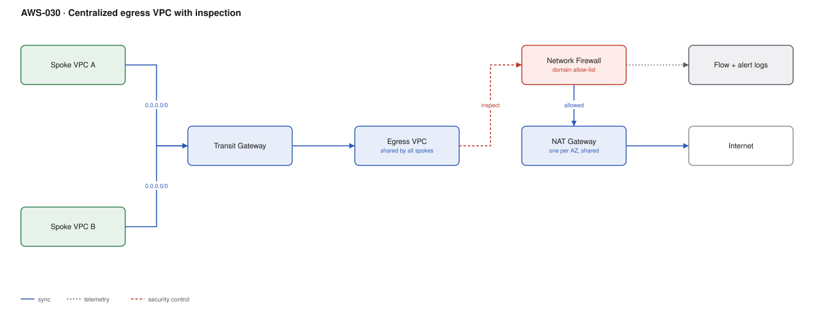

# AWS-030 · Centralized egress VPC with inspection

> **Category:** [04 · Networking & Connectivity](readme.md#04) · **Maturity:** Production · **Effort:** M

## The problem

Every VPC with private subnets needs NAT gateways, and three AZs of NAT is ~$99/month plus
data processing **per VPC**. Forty VPCs is ~$4,000/month of NAT hours before a single byte.
It is also forty places where egress could be misconfigured and forty sets of logs. A central
egress VPC gives you one NAT path, one inspection point, and one place to prove what can
leave your network.

**Use it when** you have more than roughly five VPCs with egress needs, or when a compliance
requirement says outbound traffic must be inspected and logged centrally.

**Don't use it when** you have a handful of VPCs — the Transit Gateway attachment and data
processing charges will exceed the NAT savings. Run the arithmetic below for your own numbers.

## When does it actually pay off?

Per VPC per month, roughly:

- **Distributed NAT:** $98.55 (3 AZs) + $0.045/GB
- **Centralized:** $36.50 (TGW attachment) + $0.02/GB (TGW) + $0.045/GB (shared NAT) + a
  share of the egress VPC fixed costs

The hourly saving is ~$62/VPC/month; the penalty is an extra $0.02/GB. **Break-even is around
3 TB per VPC per month.** Below that, centralizing saves money. Above it, you are paying TGW
processing on everything to save NAT hours — and distributed NAT may be cheaper.

Inspection usually changes the decision anyway: if you must run a firewall, running one
instead of forty is the point.

## Components

| Service | Role | The setting that actually matters |
|---|---|---|
| Egress VPC | Hosts shared NAT and firewall | Its own account, owned by the network team |
| Transit Gateway | Routes spoke `0.0.0.0/0` to the egress VPC | **Appliance mode** on the inspection attachment |
| AWS Network Firewall | Inspection and domain filtering | Stateful rule groups; see [`aws-036`](aws-036-network-firewall-egress.md) |
| NAT gateways | Shared outbound translation | One per AZ, in the egress VPC only |
| Route tables | The actual control | Spoke tables send `0.0.0.0/0` to TGW; egress VPC tables send through the firewall |
| Centralised logging | Flow + alert logs | One destination for the whole estate |

## Flow

1. A workload in a spoke VPC sends traffic to the internet. The spoke route table sends
   `0.0.0.0/0` to the Transit Gateway.
2. The TGW route table for spokes has a default route to the egress VPC attachment.
3. In the egress VPC, the attachment subnet route table sends traffic to the Network Firewall
   endpoint in the same AZ.
4. The firewall evaluates stateful rules — domain allow-lists, IPS signatures — and drops or
   passes.
5. Passed traffic goes to the NAT gateway in that AZ, then out through the internet gateway.
6. Return traffic follows the reverse path; **appliance mode** keeps it symmetric so the
   stateful firewall sees both directions.

## Cost (us-east-1 — order of magnitude)

| Line item | 10 spokes · 2 TB total | 40 spokes · 20 TB | 120 spokes · 200 TB |
|---|---|---|---|
| *Distributed NAT equivalent* | *$1,075* | *$4,842* | *$20,826* |
| TGW attachments @ $36.50 | $401.50 | $1,496.50 | $4,416.50 |
| TGW data processing @ $0.02/GB | $40.00 | $400.00 | $4,000.00 |
| Shared NAT (3 AZ) hours | $98.55 | $98.55 | $98.55 |
| Shared NAT data @ $0.045/GB | $90.00 | $900.00 | $9,000.00 |
| Network Firewall endpoints (3 AZ) | $864.00 | $864.00 | $864.00 |
| Firewall data @ $0.065/GB | $130.00 | $1,300.00 | $13,000.00 |
| **Total centralized** | **~$1,624** | **~$5,059** | **~$31,379** |

**Cost cliff:** **AWS Network Firewall is expensive** — ~$288/month per endpoint per AZ, plus
$0.065/GB. At 200 TB the per-GB firewall charge alone is $13,000/month, more than the NAT and
TGW combined. Inspect selectively: route only the traffic that needs inspecting, and consider
whether a domain allow-list on a smaller subset achieves the compliance goal.

**Biggest lever:** not sending traffic through this path at all. VPC endpoints keep AWS API
and S3 traffic off the egress path entirely, which is often the majority of it.

## Failure modes

| Failure | Symptom | Mitigation |
|---|---|---|
| Appliance mode off | Return traffic takes a different AZ, firewall drops it as asymmetric | Enable appliance mode on the inspection attachment — non-negotiable |
| Egress VPC is a single point of failure | One misconfiguration takes out internet access estate-wide | Multi-AZ everything, change control, and a tested rollback |
| Firewall rules too strict at cutover | Everything breaks simultaneously | Deploy in alert-only mode, review logs for two weeks, then enforce |
| Spoke keeps its own NAT | Paying for both, traffic bypasses inspection | Audit for NAT gateways outside the egress account with Config |
| Hairpinning AWS API calls | Huge TGW + NAT + firewall bill for traffic that should never leave | Interface endpoints in spokes, or centralised endpoints shared over PrivateLink |
| Bandwidth ceiling | Throughput plateaus mysteriously | A TGW attachment caps around 50 Gbps; NAT at 100 Gbps — scale out across attachments |

## Security notes

- This is the enforcement point for "data cannot leave except to approved destinations". That
  is its main value; the cost saving is secondary.
- Own the egress account separately from application accounts, with an SCP preventing
  application accounts from creating internet gateways or NAT gateways at all
  ([`aws-091`](aws-091-scp-guardrails.md)).
- Log both flow and alert logs centrally. Egress logs are what an investigation needs.
- Combine with a domain allow-list for the highest-value control: a compromised workload that
  can only reach `*.amazonaws.com` and three partner domains is substantially contained.

## What people miss

- **Centralised egress is usually justified by inspection and control, not by cost.** The
  arithmetic is closer than people expect, and at high volume distributed NAT can be cheaper.
  Decide on the control requirement, then optimise.
- **Centralised interface endpoints** can be shared across the organisation via PrivateLink
  and Route 53 private hosted zones, turning 40 × 5 × 3 endpoints into 5 × 3. That is often a
  larger saving than the NAT consolidation.
- **Appliance mode is the single setting** that separates a working inspection VPC from days
  of debugging asymmetric routing.
- **You still pay cross-AZ** inside the egress VPC if traffic lands in a different AZ than its
  NAT gateway. Keep the whole path AZ-local with per-AZ route tables.
- **Gateway Load Balancer** is the alternative when you want third-party virtual appliances
  instead of AWS Network Firewall — same topology, different inspection engine, often cheaper
  at very high throughput.

## See also

- [`aws-029`](aws-029-transit-gateway-hub.md) — the hub this depends on
- [`aws-036`](aws-036-network-firewall-egress.md) — the firewall rules themselves
- [`aws-028`](aws-028-three-tier-vpc.md) — the distributed alternative
- [`aws-091`](aws-091-scp-guardrails.md) — preventing spokes from making their own exits
