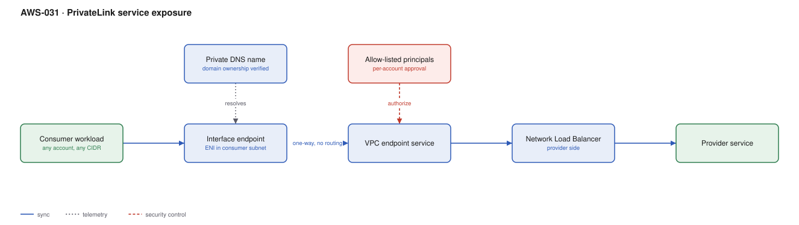

# AWS-031 · PrivateLink service exposure

> **Category:** [04 · Networking & Connectivity](readme.md#04) · **Maturity:** Production · **Effort:** M

## The problem

You run a service that other teams, other accounts, or other *companies* need to call. Giving
them network routing to your VPC means merging routing domains, caring about their CIDRs,
and trusting that they only reach the one thing you intended. PrivateLink exposes a single
service through an ENI in the consumer's own VPC — no peering, no routing, no CIDR
coordination, and traffic never traverses the internet.

**Use it when** you are the provider of a service consumed across account or organisation
boundaries, or when overlapping CIDRs make routing impossible.

**Don't use it when** both sides are yours and need broad mutual connectivity — that is
[`aws-029`](aws-029-transit-gateway-hub.md). PrivateLink is deliberately one service, one
direction.

## PrivateLink vs Transit Gateway vs peering

| | PrivateLink | Transit Gateway | VPC peering |
|---|---|---|---|
| Exposes | **One service** | Whole networks | Whole networks |
| Overlapping CIDRs | **Fine** | Breaks | Breaks |
| Direction | Consumer → provider only | Bidirectional | Bidirectional |
| Consumer sees | One ENI | Your whole VPC | Your whole VPC |
| Hourly cost | ~$7.30/AZ/endpoint | $36.50/attachment | $0 |
| Per-GB | $0.01 | $0.02 | $0 (same AZ) |

## Components

| Service | Role | The setting that actually matters |
|---|---|---|
| Network Load Balancer | Provider-side front door | PrivateLink requires an NLB or GWLB — **not** an ALB directly |
| VPC endpoint service | The published service | **Acceptance required** on, so consumers cannot self-connect |
| Allowed principals | Who may create an endpoint | Account ARNs or org paths; empty means nobody |
| Interface endpoint | The ENI in the consumer VPC | Consumer-side security group controls who inside can reach it |
| Private DNS name | Friendly hostname | Requires **domain ownership verification** via a TXT record |
| Endpoint policy | What can be called through it | A second control layer the consumer owns |

## Flow

1. The provider puts the service behind an NLB in private subnets and creates a VPC endpoint
   service from it.
2. The provider allow-lists specific consumer account principals.
3. The consumer creates an interface endpoint; an ENI with a private IP appears in their own
   subnets.
4. The provider accepts the connection request (or it auto-accepts, if configured).
5. The consumer resolves the private DNS name to their local ENI and connects.
6. Traffic flows one way over the AWS backbone into the provider's NLB. The provider cannot
   initiate connections back.

## Cost (us-east-1 — order of magnitude)

| Line item | Small · 5 consumers, 1 TB | Medium · 50 consumers, 20 TB | Large · 500 consumers, 200 TB |
|---|---|---|---|
| Interface endpoints @ ~$7.30/AZ-mo (3 AZ, consumer-paid) | $109.50 | $1,095.00 | $10,950.00 |
| Endpoint data processing @ $0.01/GB | $10.00 | $200.00 | $2,000.00 |
| NLB hours + LCU (provider) | $20.00 | $60.00 | $300.00 |
| Endpoint service (provider) | $0 | $0 | $0 |
| **Total across both sides** | **~$140** | **~$1,355** | **~$13,250** |

**Cost cliff:** the endpoint cost is **per consumer, per AZ**. 500 consumers × 3 AZs is 1,500
endpoint-AZs at ~$7.30 each — $10,950/month, paid by consumers. For an internal platform
service with many consumer VPCs that is a significant tax, and it argues for fewer, larger
VPCs ([`aws-023`](aws-023-eks-multi-tenancy.md)) rather than one per team.

**Biggest lever:** the number of consumer VPCs. Also consider whether consumers can share one
endpoint in a central VPC and reach it over Transit Gateway — one endpoint, many consumers,
though you then re-introduce routing.

## Failure modes

| Failure | Symptom | Mitigation |
|---|---|---|
| ALB used directly | Endpoint service will not create | Put an NLB in front; an ALB can be a *target* of the NLB |
| Private DNS not verified | Consumers must use the ugly `vpce-xxx` hostname | Add the TXT record and verify domain ownership |
| Auto-accept on | Any allow-listed account connects without review | Require manual acceptance for external consumers |
| Cross-AZ without zonal DNS | Consumer traffic crosses AZs and is billed | Enable cross-zone load balancing deliberately, or use zonal endpoint DNS |
| Health checks fail through the endpoint | Intermittent connection resets | NLB health checks come from the NLB, not the consumer; verify the target group separately |
| Provider needs to call back | Architecture does not support it | PrivateLink is unidirectional by design; the provider needs its own endpoint into the consumer |

## Security notes

- The provider never sees the consumer's VPC and cannot route into it. That asymmetry is the
  security property, and it is why PrivateLink is the standard for SaaS on AWS.
- Allowed principals should be specific account or organisation ARNs. A wildcard makes your
  service connectable by any AWS account on earth.
- Endpoint policies let the consumer restrict which API actions traverse their endpoint — use
  them on AWS service endpoints to prevent data egress to third-party buckets.
- Traffic stays on the AWS backbone. For many compliance regimes that alone satisfies the
  "not over the internet" requirement.

## What people miss

- **The NLB requirement surprises everyone.** You cannot expose an ALB directly. The standard
  workaround is NLB → ALB as a target, which adds a hop and a cost but works fine.
- **Source IP is lost unless you enable it.** The provider sees the endpoint's IP, not the
  consumer's. Enable the Proxy Protocol v2 on the NLB target group to recover the original
  source, or pass identity in the application layer.
- **AWS services use PrivateLink themselves.** Every interface endpoint you create for
  Secrets Manager, ECR or SQS is this exact mechanism, which is why those have the same
  per-AZ hourly cost.
- **Cross-region PrivateLink exists now**, removing one of the long-standing reasons to build
  a peering mesh for multi-region SaaS.
- **It is one-directional and single-service by design.** People try to use it as a cheap
  Transit Gateway and end up with dozens of endpoint services. If you need networks to talk,
  use a router.

## See also

- [`aws-029`](aws-029-transit-gateway-hub.md) — when you need actual routing
- [`aws-006`](aws-006-private-api-gateway.md) — the API Gateway flavour of the same idea
- [`aws-030`](aws-030-centralized-egress.md) — sharing endpoints to control their cost
- [`aws-033`](aws-033-route53-strategies.md) — the private DNS that makes it usable
