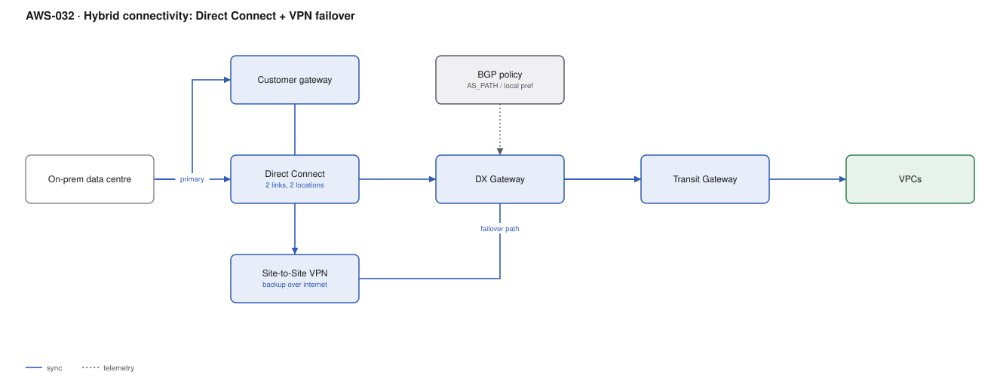

# AWS-032 · Hybrid connectivity: Direct Connect + VPN failover

> **Category:** [04 · Networking & Connectivity](readme.md#04) · **Maturity:** Production · **Effort:** L

## The problem

Your data centre needs a private, predictable, high-bandwidth path to AWS — for a migration,
for a database that cannot move, or because 40 TB a month over the public internet is neither
fast nor cheap. Direct Connect gives you a dedicated circuit. It also gives you a single
physical thing that a contractor with a digger can sever, so the design question is really
about the backup path.

**Use it when** you need consistent latency, high sustained bandwidth, or private
connectivity as a compliance requirement.

**Don't use it when** a Site-to-Site VPN at 1.25 Gbps per tunnel is sufficient. VPN is live in
an hour, costs $36/month, and is the right answer far more often than the DX sales
conversation suggests.

## The resilience tiers

| Tier | Design | Survives | SLA |
|---|---|---|---|
| Development | 1 connection, 1 location | Nothing | None |
| **Maximum resilience for critical** | 2 connections at **2 locations**, separate devices | Device, location, circuit | 99.99% |
| High resilience | 2 connections at 2 locations | Location failure | 99.9% |
| Pragmatic | 1 DX + VPN backup | Circuit failure, at reduced bandwidth | — |

The pragmatic tier is what most organisations actually build, and it is a reasonable choice —
as long as everyone knows the backup path is a fraction of the bandwidth.

## Components

| Service | Role | The setting that actually matters |
|---|---|---|
| Direct Connect connection | The physical circuit | Dedicated (1/10/100 Gbps) vs hosted (50 Mbps–25 Gbps from a partner) |
| Virtual interfaces (VIFs) | Logical connections over the circuit | Transit VIF to reach a DX gateway → TGW; private VIF for a single VPC |
| Direct Connect Gateway | Connects VIFs to VPCs/TGWs globally | A global resource — one DXGW can reach VPCs in any region |
| Site-to-Site VPN | The backup path | Two tunnels per connection; both should be up, not just configured |
| BGP | How failover actually happens | **AS_PATH prepending** and local preference decide the active path |
| Transit Gateway | Where both paths converge | See [`aws-029`](aws-029-transit-gateway-hub.md) |

## Flow

1. The on-prem router peers over BGP with AWS across the Direct Connect VIF.
2. The same router also maintains a Site-to-Site VPN over the internet to the same TGW.
3. AWS prefers the DX path by default (DX is preferred over VPN for the same prefix).
4. On-prem is configured to prefer DX outbound via local preference.
5. The circuit fails. BGP withdraws the DX routes within seconds and traffic shifts to the
   VPN tunnels — at reduced bandwidth, but up.
6. When DX recovers, BGP re-advertises and traffic shifts back.

## Cost (us-east-1 — order of magnitude)

| Line item | 1 Gbps hosted + VPN | 2 × 1 Gbps dedicated, 2 sites | 2 × 10 Gbps dedicated |
|---|---|---|---|
| DX port hours | ~$150 | $438.00 | $1,620.00 |
| Cross-connect / colo fees (third party) | ~$300 | ~$600 | ~$800 |
| DX data transfer out @ ~$0.02/GB (10 TB) | $200.00 | $200.00 | $200.00 |
| Site-to-Site VPN @ $0.05/hr | $36.50 | $36.50 | $73.00 |
| VPN data transfer out @ $0.09/GB (failover only) | ~$0 | ~$0 | ~$0 |
| TGW attachments | $73.00 | $73.00 | $73.00 |
| **Total** | **~$760** | **~$1,348** | **~$2,766** |

**Cost cliff:** DX data transfer out is **~$0.02/GB versus $0.09/GB over the internet** — a
78% reduction. At 100 TB/month that is $2,000 instead of $9,000, which alone pays for a
dedicated 10 Gbps port. Egress volume, not bandwidth need, is often the real business case.
Conversely, during a VPN failover you silently revert to $0.09/GB.

**Biggest lever:** the colocation and cross-connect fees are paid to a third party and do not
appear in your AWS bill. They are frequently larger than the AWS port charge and are missed
in the business case entirely.

## Failure modes

| Failure | Symptom | Mitigation |
|---|---|---|
| Both DX circuits in one location | A single site outage takes both | Maximum resilience requires **two separate DX locations**, not two ports in one |
| VPN configured but never tested | Failover does not work when needed | Test by shutting the DX BGP session, quarterly, in a window |
| Asymmetric routing | Traffic out via DX, back via VPN; stateful devices drop it | Consistent BGP policy on both sides; prepend on the backup path |
| VPN bandwidth assumed equal | Failover "works" but the application is unusable | Know your per-tunnel 1.25 Gbps ceiling; use ECMP across tunnels if you need more |
| MTU mismatch | Large packets silently dropped, small ones fine | DX supports 9001 jumbo frames; VPN is 1500. Path MTU discovery must work, or clamp MSS |
| BGP session flapping | Intermittent, hard-to-diagnose outages | BFD for sub-second detection, and alarm on session state |

## Security notes

- Direct Connect is **not encrypted** by default. It is private, not confidential. For
  encryption, run a VPN over the DX (public VIF + IPsec) or use MACsec on supported ports.
- A private circuit into your VPC is a path for lateral movement in both directions. Treat
  on-prem as an untrusted network and apply security groups accordingly.
- Routes learned over BGP from on-prem can hijack AWS-bound traffic if your on-prem is
  compromised. Apply prefix filters on what you accept.
- Log and alarm on BGP state changes; an unexplained session reset is worth investigating.

## What people miss

- **Lead time is weeks to months**, not minutes. Dedicated connections require a cross-connect
  order with a colocation provider. Hosted connections from a partner are much faster and are
  the right choice for most organisations.
- **MACsec** provides layer-2 encryption on dedicated 10/100 Gbps ports and solves the
  encryption gap without the VPN overhead — but only at specific locations.
- **A DX gateway is global.** One DX circuit in Virginia can reach VPCs in Tokyo. People build
  per-region circuits unnecessarily.
- **SiteLink** connects two on-prem locations *through* the AWS backbone, turning DX into a
  WAN. It is a genuinely useful capability that almost nobody knows exists.
- **Data transfer *in* is free** over both DX and the internet. The business case is always
  about egress.

## See also

- [`aws-029`](aws-029-transit-gateway-hub.md) — where both paths terminate
- [`aws-033`](aws-033-route53-strategies.md) — hybrid DNS resolution, which this needs
- [`aws-096`](aws-096-migration-7rs.md) — the migration this usually exists to serve
- [`aws-098`](aws-098-outposts-hybrid.md) — when the workload cannot move at all
