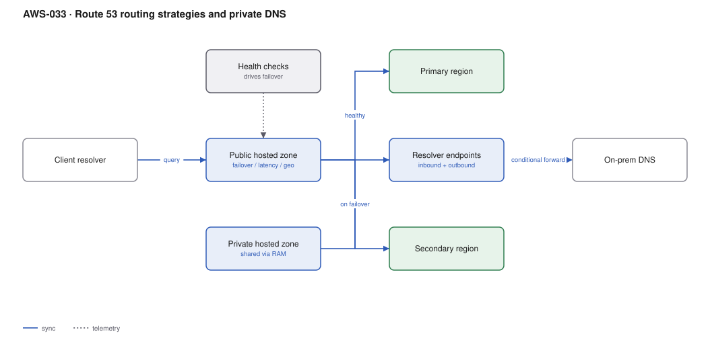

# AWS-033 · Route 53 routing strategies and private DNS

> **Category:** [04 · Networking & Connectivity](readme.md#04) · **Maturity:** Production · **Effort:** S

## The problem

DNS is the cheapest failover mechanism you own and the one most likely to be configured by
accident. Route 53 offers seven routing policies and a health-check system that can shift
traffic between regions in under a minute — and a private DNS layer that is the usual
sticking point in multi-account networking.

**Use it when** you need regional failover, latency-based routing, gradual migration between
two backends, or internal name resolution across accounts and on-prem.

**Don't rely on DNS failover alone** for sub-minute RTO. Clients and resolvers cache beyond
the TTL you set, and some JVMs cache forever by default. For true fast failover use
[`aws-034`](aws-034-global-accelerator.md).

## The routing policies

| Policy | Picks by | Typical use |
|---|---|---|
| Simple | Nothing | One target, no health |
| **Failover** | Health check | Active-passive DR |
| **Latency** | Lowest measured latency to region | Multi-region active-active |
| Weighted | Assigned weights | Canary, blue-green, migration |
| Geolocation | Client country/continent | Data residency, localisation |
| Geoproximity | Distance + a bias dial | Shifting load between regions |
| Multivalue answer | Random, health-checked | Poor man's load balancing |

Policies compose: a latency policy whose records are themselves weighted, each health-checked,
is a standard multi-region pattern.

## Components

| Service | Role | The setting that actually matters |
|---|---|---|
| Public hosted zone | Internet-facing names | **TTL** — the real determinant of failover speed |
| Health checks | Drive failover | Calculated and CloudWatch-alarm-based checks, not just endpoint pings |
| Private hosted zone | Internal names | Associated with VPCs, **shareable across accounts** |
| Resolver inbound endpoint | On-prem → AWS resolution | Needed for hybrid; one per AZ |
| Resolver outbound endpoint + rules | AWS → on-prem resolution | Conditional forwarding by domain |
| Alias records | Point at AWS resources | Free queries, and they work at the zone apex |

## Flow

1. A client resolves `app.example.com`. Route 53 evaluates the routing policy.
2. For latency routing, it returns the region with the lowest measured latency from the
   client's resolver.
3. Health checks continuously probe each regional endpoint from multiple global locations.
4. When a region fails its health check, Route 53 stops returning it; clients move as their
   cached TTL expires.
5. Internally, a private hosted zone shared via RAM resolves `svc.internal` consistently
   across every account's VPCs.
6. On-prem resolvers forward `*.internal` queries to a Resolver inbound endpoint; AWS
   workloads forward `*.corp.local` outbound to on-prem.

## Cost (us-east-1 — order of magnitude)

| Line item | Small · 5 zones, 10M queries | Medium · 50 zones, 500M | Large · 300 zones, 10B |
|---|---|---|---|
| Hosted zones @ $0.50/mo | $2.50 | $25.00 | $150.00 |
| Standard queries @ $0.40/M | $4.00 | $200.00 | $4,000.00 |
| Latency/geo queries @ $0.60/M | — | $120.00 | $2,400.00 |
| Alias queries to AWS resources | $0 | $0 | $0 |
| Health checks @ $0.50–$2.00 each | $5.00 | $40.00 | $200.00 |
| Resolver endpoints @ ~$0.125/hr per ENI | $182.50 | $182.50 | $365.00 |
| **Total** | **~$194** | **~$568** | **~$7,115** |

**Cost cliff:** **Resolver endpoints are ~$91/month per endpoint** (two ENIs minimum for
resilience), so an inbound plus an outbound endpoint is ~$182/month per region before a single
query. Teams create them per-VPC; they should be created once in a shared networking VPC and
reached over Transit Gateway.

**Biggest lever:** alias records to AWS resources are **free**. Pointing at an ALB, CloudFront
distribution or S3 website with an alias instead of a CNAME eliminates the query charge
entirely for that record.

## Failure modes

| Failure | Symptom | Mitigation |
|---|---|---|
| TTL too high | Failover takes an hour | 60 s on records that participate in failover; accept the query cost |
| Client-side DNS caching | Some clients never move | Java's `networkaddress.cache.ttl` defaults to caching forever in some configs — set it |
| Health check from one location | Transient network blip triggers a failover | Health checks aggregate across regions; require a threshold of failures |
| Private zone not associated | Resolution works in one VPC, not another | Associate the zone with every VPC, including cross-account via RAM |
| Split-horizon confusion | Internal clients get the public IP | A private zone for the same name overrides the public one *only* inside associated VPCs |
| Deleted zone, delegated NS unchanged | Domain goes dark, and the NS records cannot be recreated | Never delete a hosted zone casually — new ones get different name servers |

## Security notes

- Enable DNSSEC signing on public zones that matter. DNS hijacking is a real attack and
  DNSSEC is the mitigation.
- Route 53 Resolver DNS Firewall blocks queries to known-malicious domains and is a cheap,
  high-value control — it catches data exfiltration over DNS that a network firewall may not.
- Query logging to CloudWatch or S3 gives you a record of what your workloads looked up,
  which is often the most useful artefact in an incident.
- Private hosted zones shared via RAM are a cross-account trust relationship. Audit who can
  associate VPCs with them.

## What people miss

- **Alias records are free and work at the apex.** A CNAME cannot exist at `example.com`;
  an alias can. Using CNAMEs for AWS targets costs money and loses the apex capability.
- **Route 53 ARC routing controls** are the correct tool for deliberate, tested regional
  failover — a safety-gated on/off switch independent of health checks
  ([`aws-087`](aws-087-dr-pilot-light.md)).
- **One Resolver endpoint pair serves the whole region** if you route to it. Per-VPC endpoints
  are a common and expensive misunderstanding.
- **Geolocation is not geoproximity.** Geolocation answers by the client's *country*;
  geoproximity by distance with a tunable bias. Using the wrong one produces baffling routing.
- **Health checks cost more with HTTPS and string matching** and are billed per check per
  month, not per probe — 300 health checks at $2 is $600/month that nobody budgeted.

## See also

- [`aws-034`](aws-034-global-accelerator.md) — when DNS failover is too slow
- [`aws-087`](aws-087-dr-pilot-light.md) — ARC routing controls for deliberate failover
- [`aws-032`](aws-032-hybrid-dx-vpn.md) — the hybrid DNS half of hybrid networking
- [`aws-006`](aws-006-private-api-gateway.md) — private DNS for internal endpoints
