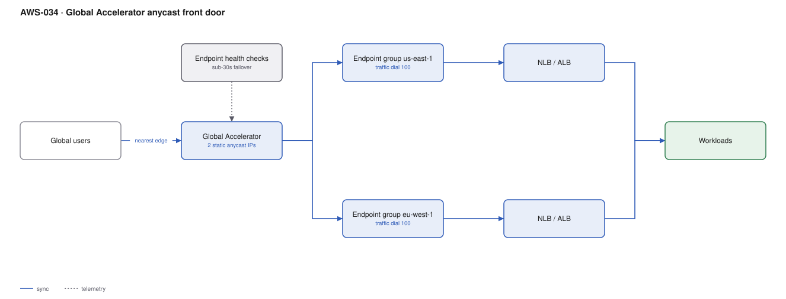

# AWS-034 · Global Accelerator anycast front door

> **Category:** [04 · Networking & Connectivity](readme.md#04) · **Maturity:** Specialist · **Effort:** S

## The problem

Two things DNS cannot do: give you a **static IP** that works globally, and fail over in
seconds rather than minutes. Global Accelerator gives you two anycast IP addresses announced
from AWS edge locations worldwide. Clients connect to the nearest edge, and traffic rides the
AWS backbone to your regional endpoints — bypassing the public internet for most of the path.

**Use it when** you need static IPs (because clients hardcode them or firewalls allow-list
them), when the protocol is not HTTP, or when failover must be under 30 seconds.

**Don't use it when** you serve cacheable HTTP content — CloudFront caches and is cheaper for
that. Global Accelerator does not cache anything; it is a network-layer front door.

## Global Accelerator vs CloudFront

| | Global Accelerator | CloudFront |
|---|---|---|
| Layer | TCP/UDP (L4) | HTTP/HTTPS (L7) |
| Caching | **No** | Yes |
| Static IPs | **Yes, 2 anycast** | No |
| Non-HTTP protocols | **Yes** — gaming, VoIP, MQTT, IoT | No |
| Failover speed | **< 30 s** | Origin failover, slower |
| Pricing | $0.025/hr + premium per GB | Per GB + per request |
| Best for | Latency-sensitive L4, static IPs | Cacheable web content |

They compose: CloudFront for the web tier, Global Accelerator for the API or game server.

## Components

| Service | Role | The setting that actually matters |
|---|---|---|
| Accelerator | Owns the two static anycast IPs | Standard vs **custom routing** (deterministic client→instance mapping) |
| Listener | Port and protocol | TCP, UDP, or both; client affinity setting |
| Endpoint group | One per region | **Traffic dial** (0–100%) — the manual failover and blue-green control |
| Endpoints | ALB, NLB, EC2, or Elastic IP | **Weight** within the group |
| Health checks | Drive automatic failover | Inherited from the ALB/NLB health check if you use one |
| Client IP preservation | Keeps the real source IP | Supported for ALB and EC2 endpoints; changes your security group rules |

## Flow

1. The client resolves your domain to one of the two static anycast IPs.
2. BGP anycast routes the packet to the nearest AWS edge location — often within the client's
   own ISP network.
3. From the edge, traffic travels the AWS global backbone rather than the public internet.
4. The accelerator selects an endpoint group by proximity and traffic dial, then an endpoint
   by weight.
5. Health checks run continuously; an unhealthy region is removed within ~30 seconds and
   traffic shifts to the next-closest healthy group.
6. For a deliberate failover, setting a region's traffic dial to 0 drains it gracefully.

## Cost (us-east-1 + eu-west-1 — order of magnitude)

| Line item | Small · 1 TB/mo | Medium · 20 TB/mo | Large · 300 TB/mo |
|---|---|---|---|
| Accelerator fixed @ $0.025/hr | $18.25 | $18.25 | $18.25 |
| Data transfer premium @ ~$0.015/GB (NA/EU) | $15.00 | $300.00 | $4,500.00 |
| Standard AWS egress (still charged) | $90.00 | $1,800.00 | $27,000.00 |
| ALB/NLB in each region | $40.00 | $80.00 | $400.00 |
| **Total** | **~$163** | **~$2,198** | **~$31,918** |

**Cost cliff:** the data transfer premium is charged **on top of** normal AWS egress, and it
is higher for traffic originating in Asia-Pacific or South America (up to ~$0.105/GB) than in
North America (~$0.015/GB). A globally distributed user base can make the premium several
times the North American estimate — model it by region, not as one blended rate.

**Biggest lever:** whether you need it at all for HTTP traffic. If the content is cacheable,
CloudFront both reduces egress (cache hits never reach the origin) and costs less per GB.

## Failure modes

| Failure | Symptom | Mitigation |
|---|---|---|
| Expecting caching | Origin load unchanged, bill higher | GA accelerates, it does not cache. Put CloudFront in front if content is cacheable |
| Client IP preservation off | Backend sees edge IPs, geo-logic and rate limits break | Enable it (ALB/EC2 endpoints) and update security groups to allow the GA IP ranges |
| Traffic dial forgotten at 0 | A region silently receives nothing after a test | Alarm on per-endpoint-group traffic; dials are a manual setting people forget |
| Health check too shallow | Fails over on a blip, or not at all | Use the ALB's own health check with a meaningful path and threshold |
| UDP with client affinity off | Session state scattered across endpoints | Set client affinity to `SOURCE_IP` for stateful UDP |
| Assuming DDoS protection is included | Standard Shield only | Shield Advanced is separate; GA does include cost protection benefits under it |

## Security notes

- The two static IPs can be allow-listed by partner firewalls — frequently the entire reason
  for adopting it, in regulated B2B integrations.
- With client IP preservation on, your security groups must allow the original client IPs, not
  the accelerator's. Without it, they must allow the GA edge ranges. Pick one and document it.
- Global Accelerator sits in front of your regional endpoints, so WAF still attaches to the
  ALB behind it, not to the accelerator.
- You can bring your own IP range (BYOIP) and announce it through the accelerator, which
  preserves an existing allow-listed address during a migration.

## What people miss

- **BYOIP is a migration superpower.** Moving a service to AWS while keeping the IP address
  that a hundred partner firewalls allow-list removes the single hardest coordination problem
  in many migrations.
- **Custom routing accelerators** map a specific client to a specific instance and port
  deterministically — the right tool for game servers and real-time sessions, and almost
  unknown.
- **The traffic dial is a blue-green control for whole regions.** Shifting from 100/0 to 50/50
  to 0/100 is a safe, reversible regional migration with no DNS involved.
- **It works for non-HTTP.** MQTT, SIP, game protocols and raw TCP all benefit, and these are
  exactly the workloads CloudFront cannot help.
- **Latency improvement is real but variable** — typically 20–60% on long-haul connections,
  near zero if the client is already next to your region. Measure before committing.

## See also

- [`aws-033`](aws-033-route53-strategies.md) — DNS-based failover, slower and cheaper
- [`aws-003`](aws-003-cloudfront-s3-oac.md) — the caching front door
- [`aws-087`](aws-087-dr-pilot-light.md) — regional failover as a whole strategy
- [`aws-099`](aws-099-local-zones-wavelength.md) — when latency needs compute closer, not routing
