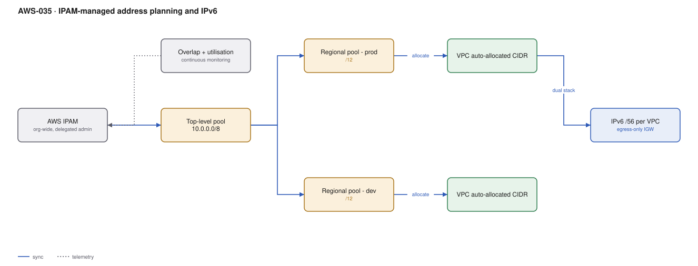

# AWS-035 · IPAM-managed address planning and IPv6

> **Category:** [04 · Networking & Connectivity](readme.md#04) · **Maturity:** Growing · **Effort:** M

## The problem

Someone creates a VPC with `10.0.0.0/16` because it is the default in the console. Two years
later three accounts have the same CIDR, they cannot be attached to the same Transit Gateway,
and the fix is renumbering production. AWS IPAM is the registry that prevents this: a
hierarchy of pools, automatic allocation, overlap detection, and utilisation monitoring
across the whole organisation.

**Use it when** you have more than a handful of accounts, or any plan to connect VPCs to each
other or to on-prem. The cost of adopting it is a week; the cost of not adopting it is a
renumbering project.

**Don't bother when** you have one account and three VPCs and no connectivity plans — though
even then, a documented plan costs nothing.

## Components

| Service | Role | The setting that actually matters |
|---|---|---|
| IPAM | The registry | **Delegated admin** in the networking account, scoped to the organisation |
| Top-level pool | The whole space, e.g. `10.0.0.0/8` | Reserve generously; also register your on-prem ranges here |
| Regional pools | Per region, per environment | Allocation rules: min/max netmask, required tags |
| VPC allocation | CIDRs handed out automatically | `--ipv4-ipam-pool-id` at VPC creation instead of a hand-picked CIDR |
| Monitoring | Utilisation and overlap | Alerts before a pool is exhausted, not after |
| IPv6 pools | Amazon-provided or BYOIP | A `/56` per VPC, `/64` per subnet — effectively unlimited |

## Flow

1. The networking account is delegated as IPAM administrator for the organisation.
2. A top-level pool is created for the private space actually in use, including on-prem
   ranges registered so overlap detection sees them.
3. Regional and environment pools are carved from it with allocation rules (for example,
   "prod VPCs get between /20 and /16, and must be tagged `env=prod`").
4. A team creates a VPC referencing the pool rather than a literal CIDR; IPAM allocates a
   non-overlapping block automatically.
5. IPAM continuously monitors utilisation and flags pools approaching exhaustion and any
   CIDRs that overlap.
6. For IPv6, each VPC receives a `/56` from an Amazon-provided pool, subnetted as `/64`s.

## Cost (us-east-1 — order of magnitude)

| Line item | Small · 20 VPCs | Medium · 150 VPCs | Large · 800 VPCs |
|---|---|---|---|
| IPAM free tier (basic) | $0 | $0 | $0 |
| IPAM Advanced @ $0.0027/active IP/hr | ~$29 | ~$219 | ~$1,166 |
| Public IPv4 addresses @ $0.005/hr each | ~$36 | ~$180 | ~$1,100 |
| Egress-only IGW (IPv6) | $0 | $0 | $0 |
| *NAT gateways avoided by IPv6-only subnets* | *(-$99/VPC)* | — | — |
| **Total (Advanced)** | **~$65** | **~$399** | **~$2,266** |

**Cost cliff:** since 2024, **every public IPv4 address costs $0.005/hour** — about $3.65 per
month each, whether attached or idle, including the ones on your NAT gateways and load
balancers. An estate with 300 public IPv4 addresses pays ~$13,000/year for addresses alone.
IPAM's public IP insights tell you which ones are unused, and IPv6 avoids the charge entirely.

**Biggest lever:** the basic IPAM tier is **free** and covers pool management, allocation and
overlap detection. Advanced adds cross-region/cross-account monitoring and compliance
checks. Start free.

## Failure modes

| Failure | Symptom | Mitigation |
|---|---|---|
| Overlapping CIDRs discovered late | Cannot attach to TGW, cannot peer, renumbering required | Register on-prem ranges in IPAM too, not just AWS ones |
| Pool too small | New VPC creation fails organisation-wide | Alarm on pool utilisation above 70%, not 95% |
| VPC CIDR chosen manually | IPAM does not know about it | Enforce pool-based allocation with an SCP denying `CreateVpc` without an IPAM pool |
| IPv6 enabled, security groups not updated | Workloads unexpectedly reachable over IPv6 | IPv6 rules are **separate** from IPv4 rules in both SGs and NACLs — a `0.0.0.0/0` deny does not cover `::/0` |
| Egress-only IGW confused with NAT | IPv6 instances unreachable, or unintentionally reachable | Egress-only IGW is the IPv6 equivalent of NAT: outbound only, and it is free |
| `/28` subnet minimum | Cannot subnet as small as planned | AWS subnets cannot be smaller than /28 (IPv4) or /64 (IPv6) |

## Security notes

- IPv6 addresses are globally routable by default. Enabling IPv6 on a subnet without matching
  security group and NACL rules can expose workloads that were previously behind NAT.
- An egress-only internet gateway is the correct IPv6 pattern for private subnets — outbound
  only, stateful, and free.
- IPAM's public IP insights surface Elastic IPs that are attached to nothing, which are both
  a cost and an inventory-hygiene problem.
- Allocation rules can require tags, which makes IPAM a quiet enforcement point for your
  tagging standard ([`aws-092`](aws-092-finops-cur-pipeline.md)).

## What people miss

- **IPv4 addresses now cost money** and most organisations have not audited them since the
  charge was introduced. This is often a few thousand dollars a month of pure waste.
- **IPv6 eliminates the NAT gateway entirely.** No hourly charge, no $0.045/GB processing,
  no address scarcity. For greenfield workloads with IPv6-capable dependencies, that is the
  largest structural networking saving available —
  see [`aws-028`](aws-028-three-tier-vpc.md).
- **Dual-stack is the pragmatic path**, not IPv6-only, because some AWS services and many
  third-party endpoints are still IPv4-only. IPv6-only subnets with DNS64/NAT64 bridge the
  gap but add a component.
- **IPAM can manage BYOIP ranges** you have brought to AWS, keeping owned public space in the
  same registry as private space.
- **Secondary CIDRs rescue an undersized VPC** but cannot overlap anything you want to
  connect to — which is precisely the thing IPAM would have prevented.

## See also

- [`aws-028`](aws-028-three-tier-vpc.md) — the VPC whose CIDR this governs
- [`aws-029`](aws-029-transit-gateway-hub.md) — what overlapping CIDRs break
- [`aws-090`](aws-090-landing-zone.md) — where IPAM belongs in the landing zone
- [`aws-095`](aws-095-rightsizing-waste.md) — idle Elastic IPs as reclaimable waste
