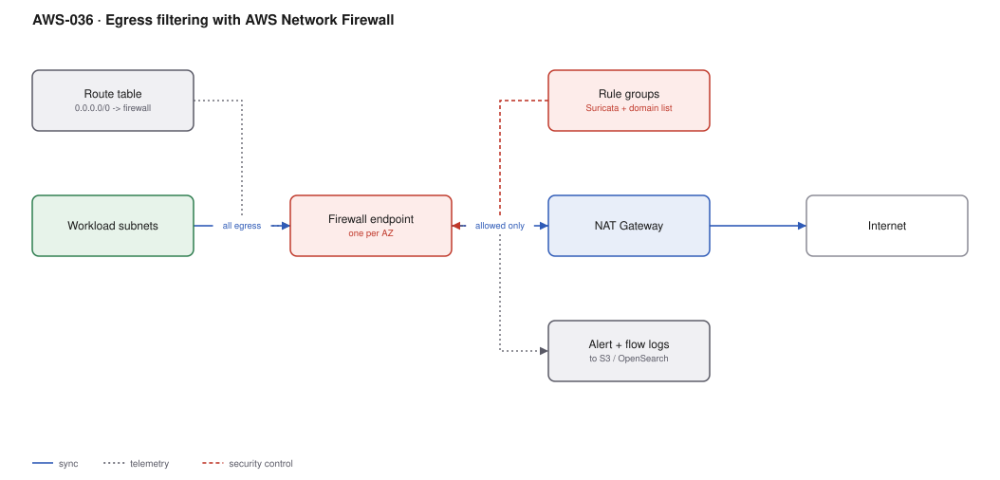

# AWS-036 · Egress filtering with AWS Network Firewall

> **Category:** [04 · Networking & Connectivity](readme.md#04) · **Maturity:** Growing · **Effort:** M

## The problem

Security groups control *where* traffic can go by IP and port. They cannot express "this
workload may reach `api.stripe.com` and nothing else", because that is a hostname, and the IP
behind it changes hourly. Nor can they see inside the connection. AWS Network Firewall is a
stateful, managed IPS that filters by domain, inspects traffic with Suricata rules, and gives
you an auditable record of what left your network.

**Use it when** you must prove data cannot leave to arbitrary destinations — PCI, HIPAA,
handling regulated data — or when you want real containment after a workload compromise.

**Don't use it when** a VPC endpoint policy or a security group would do. It is expensive and
operationally heavy; the control it provides should be one you can point at a requirement for.

## Components

| Service | Role | The setting that actually matters |
|---|---|---|
| Firewall endpoint | The inspection point, one per AZ | ~$288/month each — the dominant fixed cost |
| Stateless rule groups | Fast pass/drop/forward by 5-tuple | Forward everything interesting to the stateful engine |
| Stateful rule groups | Suricata rules, domain lists, IPS signatures | **Strict vs default rule order** — strict gives you default-deny |
| Managed rule groups | AWS-maintained threat intelligence | Low effort, decent coverage, enable first |
| TLS inspection (optional) | Sees inside HTTPS | Needs a CA you control; large privacy and cost implications |
| Logging | Alert and flow logs | To S3 for retention, OpenSearch for hunting |

## Flow

1. Subnet route tables send outbound traffic to the firewall endpoint in the same AZ instead
   of straight to the NAT gateway.
2. Stateless rules make a fast first pass, forwarding anything that needs context to the
   stateful engine.
3. The stateful engine evaluates rules in strict order: allow-listed domains pass, everything
   else hits the default deny.
4. Domain filtering uses SNI for TLS and the Host header for plain HTTP — no decryption
   needed for the common case.
5. Allowed traffic continues to the NAT gateway and out.
6. Alerts and flow records go to S3 and a search backend for investigation.

## Cost (us-east-1 — order of magnitude)

| Line item | Small · 2 AZ, 1 TB | Medium · 3 AZ, 20 TB | Large · 3 AZ, 300 TB |
|---|---|---|---|
| Firewall endpoints @ ~$0.395/hr | $576.70 | $865.05 | $865.05 |
| Traffic processing @ $0.065/GB | $65.00 | $1,300.00 | $19,500.00 |
| Logs to S3 | ~$5 | ~$60 | ~$800 |
| NAT gateway (still required) | $65.70 | $98.55 | $98.55 |
| NAT data processing @ $0.045/GB | $45.00 | $900.00 | $13,500.00 |
| **Total** | **~$757** | **~$3,224** | **~$34,764** |

**Cost cliff:** **$0.065/GB processing**, charged on top of the NAT gateway's $0.045/GB. Every
inspected gigabyte is billed at $0.11/GB before internet egress. At 300 TB that is $33,000 a
month in transit charges alone. The fixed endpoint cost is also unavoidable: ~$865/month for
three AZs even with no traffic.

**Biggest lever:** inspect less. VPC endpoints keep S3, ECR and AWS API traffic off the
inspected path entirely, and that is frequently the majority of egress volume. Route only
genuine internet-bound traffic through the firewall.

## Failure modes

| Failure | Symptom | Mitigation |
|---|---|---|
| Deployed in block mode immediately | Everything breaks at once, emergency rollback | Alert-only for two weeks, build the allow-list from real logs, then enforce |
| Default rule order | Rules evaluated by action, not order; implicit allow | Use **strict** rule order for a genuine default-deny posture |
| Asymmetric routing | Stateful engine drops half the flows | Appliance mode on the TGW attachment; AZ-local routing throughout |
| Single AZ endpoint | AZ failure removes all egress | One endpoint per AZ, with per-AZ route tables |
| Domain rules bypassed by IP | Workload connects to a raw IP, skipping SNI checks | Block direct-to-IP egress in the stateless rules; force DNS |
| DNS over HTTPS | Exfiltration channel that domain rules do not see | Block known DoH providers; use Route 53 DNS Firewall alongside |

## Security notes

- The firewall is the enforcement point for egress policy, but **DNS is the other half**.
  Route 53 Resolver DNS Firewall blocks resolution of malicious domains at a fraction of the
  cost and catches DNS-tunnelling exfiltration this will not see.
- TLS inspection requires a private CA and installing a trust anchor on every workload. It is
  the only way to see inside encrypted payloads, and it is a significant privacy, performance
  and cost decision — not a checkbox.
- Alert logs are the evidence trail. Retain them where an investigator can query them
  ([`aws-055`](aws-055-security-lake.md)).
- Pair with an SCP that prevents workload accounts from creating their own internet gateways,
  or the control is advisory ([`aws-091`](aws-091-scp-guardrails.md)).

## What people miss

- **Route 53 DNS Firewall is the cheap 80%.** At a fraction of the price it blocks resolution
  of known-bad and newly-registered domains, which stops a large share of commodity malware
  callbacks. Many teams need that and not full packet inspection.
- **Domain filtering works without decryption** by reading the TLS SNI field. You get
  hostname-level allow-listing without the TLS inspection machinery — this is the sweet spot.
- **Gateway Load Balancer plus a third-party appliance** is the alternative, and at very high
  throughput it can be cheaper, especially if you already license the vendor.
- **The firewall does not replace security groups.** It is north-south egress control;
  east-west is still security groups and NetworkPolicy.
- **Suricata rule syntax is standard**, so existing IDS rule sets and threat-intel feeds can
  be imported rather than rewritten.

## See also

- [`aws-030`](aws-030-centralized-egress.md) — where to put this so you only run one
- [`aws-048`](aws-048-vpc-flow-flink.md) — detecting exfiltration from flow data instead
- [`aws-055`](aws-055-security-lake.md) — where the alert logs should land
- [`aws-091`](aws-091-scp-guardrails.md) — making the bypass impossible
