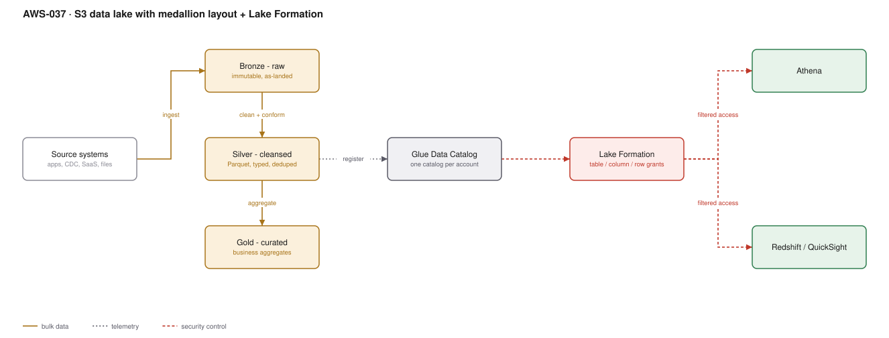

# AWS-037 · S3 data lake with medallion layout + Lake Formation

> **Category:** [05 · Data Engineering & Analytics](readme.md#05) · **Maturity:** Production · **Effort:** M

## The problem

"Put everything in S3 and query it" becomes a swamp in about six months: nobody knows which
prefix is authoritative, schemas drift silently, every query scans terabytes, and access
control is a bucket policy with three wildcards. The medallion layout (bronze/silver/gold)
plus a catalog and a permissions layer is the structure that keeps a lake usable.

**Use it when** you have data from more than two sources and more than one consumer.

**Don't use it when** one team queries one dataset — a Parquet prefix and an Athena table is
fine, and you can add the rest when it hurts.

## The three zones

| Zone | Contains | Format | Who reads it |
|---|---|---|---|
| **Bronze** | Exactly what arrived, immutable | Source format, or Parquet with raw types | Pipelines only |
| **Silver** | Cleansed, typed, deduplicated, conformed | Parquet / Iceberg, partitioned | Analysts, pipelines |
| **Gold** | Business aggregates, joined, modelled | Parquet / Iceberg, often denormalised | BI, applications |

Bronze is the one people skip and later wish they had: it is what lets you reprocess when a
transformation turns out to be wrong.

## Components

| Service | Role | The setting that actually matters |
|---|---|---|
| S3 buckets | Storage, one per zone | Separate **buckets**, not prefixes — policies, lifecycle and replication differ per zone |
| Partitioning | Makes queries cheap | Partition by what you filter on, usually date; aim for 128 MB–1 GB files |
| Glue Data Catalog | Schema registry | One catalog per account; share across accounts via Lake Formation or RAM |
| Lake Formation | Fine-grained permissions | Table, **column** and **row**-level grants — this is why it exists |
| Iceberg | Table format for silver/gold | ACID, schema evolution, time travel ([`aws-041`](aws-041-iceberg-tables.md)) |
| Lifecycle policies | Cost control | Bronze to Glacier after 90 days, almost always |

## Flow

1. Sources land data in bronze, partitioned by arrival date, never modified afterwards.
2. A transformation job reads bronze, applies typing, deduplication and conformance, and
   writes silver as Iceberg or partitioned Parquet.
3. Aggregation jobs build gold tables shaped for specific consumption patterns.
4. Each table is registered in the Glue Data Catalog as it is written.
5. Lake Formation grants control who sees which tables, which columns, and which rows —
   enforced for Athena, Redshift Spectrum, EMR and Glue alike.
6. Consumers query through Athena or Redshift; they never receive raw bucket access.

## Cost (us-east-1 — order of magnitude)

| Line item | Small · 1 TB | Medium · 50 TB | Large · 1 PB |
|---|---|---|---|
| S3 Standard storage @ $0.023/GB | $23.00 | $1,150.00 | $23,000.00 |
| *With lifecycle to Glacier IR / Deep Archive* | $15.00 | $500.00 | $8,500.00 |
| PUT/GET requests | $5.00 | $60.00 | $800.00 |
| Glue Data Catalog (first 1M objects free) | $0 | $0 | ~$100 |
| Athena scans @ $5/TB (poorly partitioned) | $50.00 | $2,500.00 | $50,000.00 |
| **Athena scans (partitioned + Parquet)** | **$2.00** | **$100.00** | **$2,000.00** |
| Lake Formation | $0 | $0 | $0 |
| **Total (optimised)** | **~$22** | **~$660** | **~$11,300** |

**Cost cliff:** **Athena charges $5 per TB scanned**, and a query against unpartitioned CSV
scans everything. Converting to Parquet with partition pruning routinely cuts scan volume by
**95–99%** — the same query going from $2.50 to $0.03. This is the single highest-leverage
change in any data lake, and it is a format conversion, not an architecture change.

**Biggest lever:** file format and partitioning, then lifecycle. Note also the small-file
problem: ten thousand 1 MB files cost far more to query than ten 1 GB files, because Athena
pays per-object overhead.

## Failure modes

| Failure | Symptom | Mitigation |
|---|---|---|
| Small files | Queries slow and expensive despite small data volume | Compaction job; Iceberg handles this with scheduled rewrites |
| Over-partitioning | Thousands of tiny partitions, catalog slow, queries slower | Partition by day, not by hour and customer and region |
| No bronze zone | A transformation bug loses data permanently | Bronze is immutable and cheap. Keep it |
| Schema drift | Pipelines fail, or worse, silently null out a column | Iceberg schema evolution plus contract checks ([`aws-046`](aws-046-data-quality-contracts.md)) |
| Direct bucket access granted | Lake Formation grants bypassed entirely | Remove IAM S3 access to lake buckets; Lake Formation must be the only path |
| Crawlers run on everything hourly | Surprising Glue bill, catalog churn | Crawl on ingest of new partitions, or register partitions directly |

## Security notes

- Lake Formation only works if **IAM S3 access is removed**. A consumer with `s3:GetObject`
  on the bucket reads the raw files and every column-level grant is theatre.
- Column-level grants are the practical way to handle personal data: analysts get the table
  without the email and date-of-birth columns, with no separate copy to maintain.
- Row-level filters give per-tenant or per-region isolation from one physical table.
- Enable S3 default encryption with a KMS key per zone, and note that KMS request charges
  are real at high object counts.
- Turn on S3 access logging or CloudTrail data events for the lake buckets — they are usually
  the most sensitive data you own.

## What people miss

- **The small-file problem is the most common data lake performance complaint** and it is
  almost always caused by a streaming writer with a short flush interval. Compact.
- **Partition projection** in Athena lets you skip the catalog lookup for predictable
  partition schemes, which is dramatically faster on tables with many partitions, and it is
  configured in table properties with no extra infrastructure.
- **Lake Formation tag-based access control (LF-TBAC)** scales far better than per-table
  grants. Tag a table `confidentiality=pii` once; grant on the tag, not the table.
- **Bronze does not have to be expensive.** Lifecycle it to Glacier Instant Retrieval after
  90 days — still queryable, roughly a quarter of the price.
- **Separate accounts per zone** is a legitimate pattern for regulated estates: the producer
  account owns bronze, a curation account owns silver/gold, and consumers only ever see the
  consumption account.

## See also

- [`aws-041`](aws-041-iceberg-tables.md) — the table format that makes silver/gold manageable
- [`aws-038`](aws-038-glue-etl.md) — the jobs that move data between zones
- [`aws-039`](aws-039-athena-federated.md) — querying it
- [`aws-046`](aws-046-data-quality-contracts.md) — stopping bad data at the boundary
