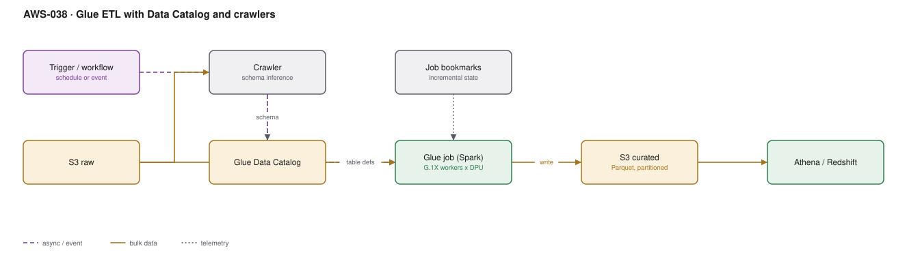

# AWS-038 · Glue ETL with Data Catalog and crawlers

> **Category:** [05 · Data Engineering & Analytics](readme.md#05) · **Maturity:** Production · **Effort:** M

## The problem

You need to transform data on a schedule — clean it, join it, repartition it, write it back
as Parquet — and you do not want to run a Spark cluster. Glue is serverless Spark with a
catalog attached: you provide a script, it provisions workers, runs, and bills per second.

**Use it when** transformations are Spark-shaped, run periodically, and you want zero cluster
management.

**Don't use it when** the transformation is a SQL statement — do it in Athena or Redshift and
skip the Spark overhead. And don't use it for very large or heavily tuned jobs; EMR
Serverless ([`aws-042`](aws-042-emr-serverless.md)) gives you the same serverless model with
real Spark configurability.

## Components

| Service | Role | The setting that actually matters |
|---|---|---|
| Glue job | Serverless Spark | **Worker type and count** (G.1X/G.2X/G.4X) — the entire cost |
| Job bookmarks | Incremental processing state | On, or every run reprocesses the whole dataset |
| Glue Data Catalog | Table definitions | Shared with Athena, Redshift Spectrum and EMR — one catalog, many engines |
| Crawlers | Infer schema and partitions | Useful initially, a liability on a schedule — see below |
| Workflows / triggers | Orchestration | Fine for simple chains; use MWAA or Step Functions for real DAGs |
| Glue Studio / notebooks | Development | Interactive sessions are billed per second too |

## Flow

1. A trigger starts the job — on a schedule, on a workflow predecessor, or from EventBridge.
2. The job reads its source, either directly from S3 or through a catalog table definition.
3. Job bookmarks tell it which objects or partitions it has already processed, so only new
   data is read.
4. Spark applies the transformation across the requested number of workers.
5. Output is written to S3 as partitioned Parquet (or an Iceberg table).
6. New partitions are registered in the catalog — ideally by the job itself, not by a crawler.
7. Athena and Redshift Spectrum see the new data immediately through the shared catalog.

## Cost (us-east-1 — order of magnitude)

| Line item | Small · daily, 10 DPU-hr/mo | Medium · hourly, 400 DPU-hr/mo | Large · 5,000 DPU-hr/mo |
|---|---|---|---|
| Glue ETL @ $0.44/DPU-hour | $4.40 | $176.00 | $2,200.00 |
| Minimum billing (1 min, 2 DPU floor) | included | included | included |
| Crawlers @ $0.44/DPU-hour | $2.00 | $44.00 | $150.00 |
| Data Catalog storage/requests | $0 | $0 | ~$50 |
| S3 reads/writes | $1.00 | $20.00 | $300.00 |
| **Total** | **~$7** | **~$240** | **~$2,700** |

**Cost cliff:** Glue bills a **minimum of 1 minute per job run with at least 2 DPUs**. A job
that takes 8 seconds and runs every minute costs the same as one that takes 60 seconds. For
frequent small transformations, batch them or use Lambda instead. Also note Glue **4.0+**
reduced the old 10-minute minimum to 1 minute — if someone sized your pipeline on the old
behaviour, revisit it.

**Biggest lever:** job bookmarks and partition pruning. A job reprocessing the full history
every night because bookmarks are off costs 30× what an incremental job costs, and the
output is identical.

## Failure modes

| Failure | Symptom | Mitigation |
|---|---|---|
| Bookmarks off | Full reprocess every run, duplicated output | Enable bookmarks; understand they key on object path and timestamp |
| Crawler on a schedule | Catalog churn, schema flip-flopping, real cost | Crawl once to bootstrap, then have jobs register partitions directly |
| Too many workers | Job runs no faster, costs 4× | Scale workers to data volume; check the Spark UI for idle executors |
| Skewed joins | One executor runs for hours | Salt the join key, or broadcast the small side |
| Small output files | Downstream queries slow and expensive | `coalesce`/`repartition` before write; target 128 MB–1 GB files |
| Catalog schema conflict | Job fails with a type mismatch after a source change | Contract checks upstream ([`aws-046`](aws-046-data-quality-contracts.md)) |

## Security notes

- The job role needs read on source prefixes and write on target prefixes — not bucket-level
  wildcards. Glue jobs are a common over-permissioned role.
- Connect to databases in a VPC via a Glue **connection**, which places elastic network
  interfaces in your subnets. That requires NAT or endpoints for AWS API access.
- Enable job bookmarks encryption and S3 encryption through a Glue security configuration;
  it covers CloudWatch logs and the shuffle data too.
- Lake Formation permissions apply to Glue jobs. A job reading through the catalog is subject
  to the same column and row filters as an analyst ([`aws-037`](aws-037-s3-data-lake.md)).

## What people miss

- **Crawlers are a bootstrapping tool, not a production component.** On a schedule they
  repeatedly re-infer schemas, flip column types when a sample differs, and cost money. Have
  the job that writes the data register the partition.
- **Glue 4.0+ billing changed to a 1-minute minimum**, which makes small frequent jobs far
  more viable than the old guidance suggests.
- **Flex execution** runs non-urgent jobs on spare capacity for roughly 34% less. For nightly
  batch where a variable start time is fine, it is free money.
- **Auto Scaling** for Glue jobs adjusts workers during the run rather than requiring you to
  guess. It is off by default.
- **The Data Catalog is the shared asset**, not Glue ETL. Many teams use the catalog with
  Athena, EMR and Redshift while doing transformation elsewhere entirely — that is a
  perfectly good architecture.

## See also

- [`aws-042`](aws-042-emr-serverless.md) — when the Spark job needs real tuning
- [`aws-043`](aws-043-mwaa-orchestration.md) — orchestrating more than a simple chain
- [`aws-037`](aws-037-s3-data-lake.md) — the zones these jobs move data between
- [`aws-041`](aws-041-iceberg-tables.md) — writing to Iceberg instead of raw Parquet
