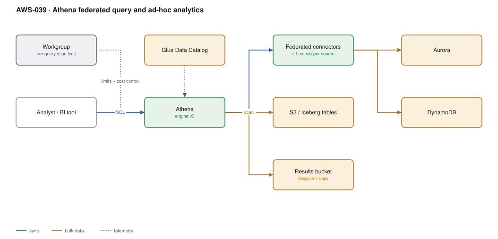

# AWS-039 · Athena federated query and ad-hoc analytics

> **Category:** [05 · Data Engineering & Analytics](readme.md#05) · **Maturity:** Growing · **Effort:** S

## The problem

The answer to a business question is spread across the data lake, a production Aurora
database and a DynamoDB table. The usual response is to build pipelines to centralise all
three, which takes weeks and is wrong if the question is asked once. Athena federated query
runs one SQL statement across all of them using a Lambda connector per source.

**Use it when** the question is exploratory, the data is genuinely in several places, and
building a pipeline is not justified yet.

**Don't use it when** the query runs daily and is slow — that is the signal to build the
pipeline. Federated queries are convenient, not fast, and they put load on operational
databases.

## Components

| Service | Role | The setting that actually matters |
|---|---|---|
| Athena | The SQL engine | **Engine version 3** (Trino-based) — materially faster, and supports more |
| Workgroup | Isolation, cost control, settings | **Per-query data scan limit** — the guardrail that prevents a $900 typo |
| Glue Data Catalog | Table definitions for S3 data | Shared with everything else |
| Federated connectors | A Lambda per external source | Deployed from the Serverless Application Repository; you own and patch them |
| Results bucket | Where output lands | **Lifecycle rule** — results accumulate forever otherwise |
| Query result reuse | Caches identical queries | Up to 7 days; free re-runs of the same query |

## Flow

1. An analyst or BI tool submits SQL to a workgroup.
2. Athena plans the query, consulting the Glue catalog for S3-backed tables.
3. For a federated table, Athena invokes the connector Lambda, which pushes down predicates
   where it can and streams rows back via S3 spill.
4. S3-backed scans read only the partitions and columns the query needs.
5. Results are written to the results bucket and returned.
6. The workgroup enforces the scan limit, and would have cancelled the query before it ran
   away.

## Cost (us-east-1 — order of magnitude)

| Line item | Small · 100 queries, 50 GB | Medium · 5K queries, 20 TB | Large · 100K queries, 500 TB |
|---|---|---|---|
| Athena scanned data @ $5/TB | $0.25 | $100.00 | $2,500.00 |
| *Same queries on unpartitioned CSV* | $5.00 | $2,000.00 | $50,000.00 |
| Federated connector Lambda | $1.00 | $25.00 | $400.00 |
| Connector S3 spill storage | $0.50 | $10.00 | $150.00 |
| Results bucket (no lifecycle) | $2.00 | $80.00 | $1,500.00 |
| **Total** | **~$4** | **~$215** | **~$4,550** |

**Cost cliff:** Athena has a **10 MB minimum charge per query**. Ten thousand tiny
`SELECT ... LIMIT 10` queries from a dashboard cost as if they each scanned 10 MB — about
$0.50 total, trivial, until a BI tool polls every 30 seconds across 200 dashboards. Also note
federated queries are billed on data **scanned from the source**, which for a full-table
federated read can be far more than you expected.

**Biggest lever:** the workgroup scan limit. Setting a per-query limit of, say, 100 GB turns
a catastrophic cross-join into an error message. Add **query result reuse** and repeated
dashboard queries become free.

## Failure modes

| Failure | Symptom | Mitigation |
|---|---|---|
| Federated query hammers production | Operational database latency spikes during analytics | Point connectors at a read replica, never the writer |
| No scan limit | One `SELECT *` on a petabyte costs $5,000 | Workgroup-level per-query data scan limit, always |
| Results bucket unbounded | Terabytes of old query output | Lifecycle rule, 7–30 days |
| Connector version drift | Queries fail after an AWS-side change | Connectors are Lambdas **you** own; patch and version them |
| Too many partitions | Query planning takes minutes | Partition projection, or fewer partition keys |
| Expecting low latency | 20-second queries in a user-facing app | Athena is an analytics engine; cache results or use a serving database |

## Security notes

- Lake Formation grants apply to Athena, including column and row filters — a federated query
  does not bypass them for catalog-registered tables.
- Connector Lambdas hold credentials to your operational databases. They are a high-value
  target: scope them to read-only users on replicas, store credentials in Secrets Manager.
- The results bucket contains query output, which may be more sensitive than the source. It
  needs the same encryption and access controls, and it is routinely forgotten.
- Workgroups let you enforce encryption of results and prevent clients from overriding the
  output location.

## What people miss

- **Query result reuse is off by default** and is a one-click cost reduction for any dashboard
  workload. Results are reused for up to 7 days if the query text matches.
- **Athena can write, not just read.** `CREATE TABLE AS SELECT` and `INSERT INTO` make it a
  credible lightweight transformation engine — often replacing a Glue job entirely for
  SQL-shaped work at a fraction of the cost.
- **`UNLOAD`** writes query results in Parquet or ORC rather than CSV, which matters when the
  output feeds another process.
- **Partition projection** eliminates catalog lookups for predictable date-based partitions
  and is dramatically faster on tables with tens of thousands of partitions.
- **Athena for Spark** exists for notebook-style work, and Athena can also query Iceberg
  tables with time travel syntax.

## See also

- [`aws-037`](aws-037-s3-data-lake.md) — the lake most of these queries hit
- [`aws-040`](aws-040-redshift-zero-etl.md) — when the query pattern deserves a warehouse
- [`aws-041`](aws-041-iceberg-tables.md) — time travel queries from Athena
- [`aws-045`](aws-045-quicksight-rls.md) — the BI layer that drives most query volume
