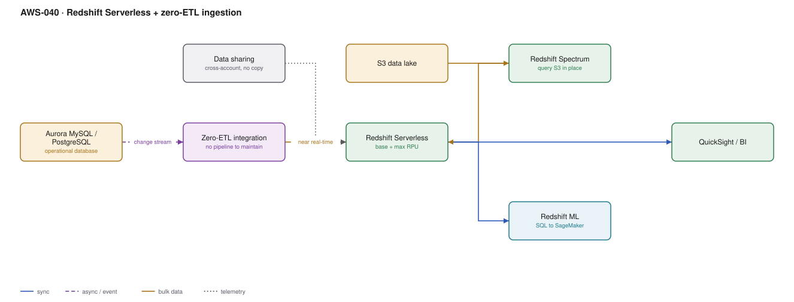

# AWS-040 · Redshift Serverless + zero-ETL ingestion

> **Category:** [05 · Data Engineering & Analytics](readme.md#05) · **Maturity:** Growing · **Effort:** M

## The problem

Analysts want to join operational data with historical data, fast, with concurrency, using
SQL they already know. Athena over S3 is cheap but has no indexes, no sort keys and variable
latency. A warehouse gives you consistent sub-second queries — at the cost of a cluster to
size and a pipeline to feed it. Redshift Serverless removes the cluster; zero-ETL removes
the pipeline.

**Use it when** query latency and concurrency matter, or when the workload is
dashboard-driven with many users.

**Don't use it when** the workload is a handful of exploratory queries per day — Athena is
cheaper and has no idle cost. And don't use it as an operational database; it is columnar and
not built for single-row lookups.

## Components

| Service | Role | The setting that actually matters |
|---|---|---|
| Redshift Serverless workgroup | Compute | **Base RPU** (minimum 8) and max RPU — the whole cost model |
| Namespace | Data and credentials | Separate from the workgroup, so compute can be resized independently |
| Zero-ETL integration | Aurora → Redshift replication | No pipeline code; near real-time; source must be Aurora or RDS MySQL |
| Redshift Spectrum | Query S3 in place | Lets gold tables stay in the lake and still be joined |
| Data sharing | Cross-account/cross-workgroup reads | **No copy** — producer and consumer query the same data |
| Redshift ML | SQL-driven model training/inference | `CREATE MODEL`, backed by SageMaker |

## Flow

1. A zero-ETL integration is created from the Aurora cluster to a Redshift namespace.
2. Aurora streams committed changes; tables appear in Redshift within seconds and stay in
   sync with no pipeline to operate.
3. Historical and lake-resident data stays in S3 and is queried through Spectrum as external
   tables.
4. Analysts join the near-real-time operational tables with historical lake tables in one
   query.
5. Compute scales between base and max RPU with load; it pauses when idle.
6. Other teams consume via data sharing — reading the same storage from their own workgroup,
   without a copy and without affecting the producer.

## Cost (us-east-1 — order of magnitude)

| Line item | Small · 8 RPU, 20 hr/mo | Medium · 32 RPU, 200 hr/mo | Large · 128 RPU, 500 hr/mo |
|---|---|---|---|
| Redshift Serverless @ $0.375/RPU-hour | $60.00 | $2,400.00 | $24,000.00 |
| Managed storage @ $0.024/GB-mo (5/50/500 TB) | $120.00 | $1,200.00 | $12,000.00 |
| Zero-ETL integration | $0 | $0 | $0 |
| Spectrum scans @ $5/TB | $10.00 | $100.00 | $1,000.00 |
| Data sharing | $0 | $0 | $0 |
| **Total** | **~$190** | **~$3,700** | **~$37,000** |

**Cost cliff:** **the minimum base capacity is 8 RPU** and you are billed per second while a
query runs, with a **60-second minimum per session**. A dashboard issuing one query a minute
keeps the workgroup permanently warm — you pay for 8 RPU continuously, about $2,160/month,
even though actual compute time is minutes. For sporadic workloads that is far worse than
Athena; for steady workloads it is far better.

**Biggest lever:** base RPU, and knowing your usage shape. Provisioned Redshift with reserved
instances is substantially cheaper than serverless for predictable 24/7 load — serverless
wins on variable and intermittent workloads, and loses on constant ones.

## Failure modes

| Failure | Symptom | Mitigation |
|---|---|---|
| Sporadic dashboard queries | Workgroup never scales to zero, constant spend | Batch dashboard refreshes; or use SPICE in QuickSight ([`aws-045`](aws-045-quicksight-rls.md)) |
| Zero-ETL on an unsupported source | Integration cannot be created | Check the supported engine versions; it is not universal across RDS |
| DDL on the source | Replication pauses or the table is resynced | Zero-ETL tolerates less schema change than a hand-built pipeline |
| No sort/dist keys | Queries scan everything, concurrency collapses | Let automatic table optimisation run, then verify it chose sensibly |
| Spectrum scanning unpartitioned S3 | $5/TB charges dwarf the compute | Partition external tables as you would for Athena |
| Treated as OLTP | Single-row lookups are slow, locking issues | Columnar store; route point lookups to Aurora or DynamoDB |

## Security notes

- Zero-ETL replicates data, including anything sensitive, into the warehouse. Column-level
  access control and dynamic data masking in Redshift are the compensating controls.
- Data sharing crosses account boundaries without copying. Audit who you have shared with —
  a share is persistent and easy to forget.
- Use IAM authentication rather than database passwords, and federate analyst access through
  Identity Center ([`aws-060`](aws-060-identity-center-abac.md)).
- Enable audit logging to S3; Redshift query history is also a useful cost-attribution source.

## What people miss

- **Zero-ETL is genuinely zero pipeline.** No DMS instance, no Glue job, no bookmarks, no
  on-call. For Aurora-to-Redshift this eliminates the most commonly operated pipeline in a
  data platform. It is a much bigger deal than the name suggests.
- **Serverless is not automatically cheaper.** For 24/7 workloads, reserved provisioned
  Redshift can be half the price. Model your actual usage curve.
- **Data sharing changes team topology.** A central team can own curation and publish shares;
  consumer teams get their own compute and their own bill, with no copies to reconcile.
- **Spectrum means you do not have to load everything.** Keep cold history in S3, hot data in
  Redshift managed storage, and join across them — the warehouse does not need to hold it all.
- **Automatic table optimisation** picks sort and distribution keys by observing workloads.
  It works well and removes a traditionally expert-only tuning task, but verify its choices
  after the first few weeks.

## See also

- [`aws-039`](aws-039-athena-federated.md) — the cheaper, slower alternative
- [`aws-044`](aws-044-cdc-dms.md) — the pipeline zero-ETL replaces, for non-Aurora sources
- [`aws-045`](aws-045-quicksight-rls.md) — the BI layer on top
- [`aws-037`](aws-037-s3-data-lake.md) — the lake Spectrum reads
