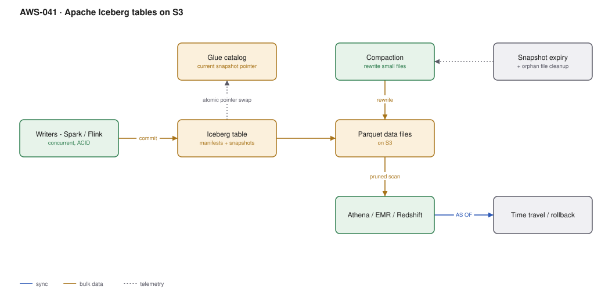

# AWS-041 · Apache Iceberg tables on S3

> **Category:** [05 · Data Engineering & Analytics](readme.md#05) · **Maturity:** Growing · **Effort:** M

## The problem

Plain Parquet on S3 gives you cheap storage and nothing else: no transactions, so a reader
can see a half-written partition; no updates, so a GDPR deletion means rewriting a partition
by hand; no schema evolution beyond adding a column at the end; and no way to ask what the
table looked like yesterday. Iceberg is a metadata layer over the same Parquet files that
provides all four.

**Use it when** the lake has mutable data, concurrent writers, compliance deletions, or
schema that changes. For a silver or gold layer, this should be the default.

**Don't use it when** data is strictly append-only, written once by one job, and read by one
engine. Plain partitioned Parquet is simpler and has no maintenance jobs.

## What it actually buys you

| Capability | Without Iceberg | With Iceberg |
|---|---|---|
| Atomic writes | Readers see partial data | Snapshot swap, all-or-nothing |
| Row-level update/delete | Rewrite the partition | `MERGE INTO`, `DELETE FROM` |
| Schema evolution | Append columns only | Rename, reorder, retype, drop |
| Partition changes | Rewrite the whole table | Partition evolution, no rewrite |
| Time travel | No | `FOR TIMESTAMP AS OF` |
| Concurrent writers | Corruption | Optimistic concurrency with retries |

## Components

| Service | Role | The setting that actually matters |
|---|---|---|
| Glue Data Catalog | Holds the pointer to the current snapshot | This pointer swap is what makes commits atomic |
| Metadata files | Snapshots, manifests, manifest lists | They accumulate; expiry is a job you must schedule |
| Data files | Ordinary Parquet on S3 | Target 128 MB–1 GB; small files are the main performance problem |
| Compaction | Rewrites small files into large ones | **Scheduled maintenance, not optional** |
| Snapshot expiry | Drops old snapshots and orphan files | Controls both storage cost and metadata bloat |
| Engines | Athena, EMR, Glue, Redshift, Flink, Spark | All read the same table through the catalog |

## Flow

1. A writer (Spark, Flink or Athena) begins a transaction and writes new Parquet data files.
2. It writes a new manifest describing the files, and a new snapshot referencing it.
3. It atomically swaps the catalog pointer to the new snapshot. Readers mid-query continue
   against the old snapshot and see a consistent view.
4. Concurrent writers that conflict retry against the new snapshot (optimistic concurrency).
5. Readers prune at three levels: partition, manifest statistics, and Parquet row group —
   so a well-maintained table scans very little.
6. Scheduled maintenance compacts small files, expires old snapshots, and removes orphans.

## Cost (us-east-1 — order of magnitude)

| Line item | Small · 1 TB | Medium · 50 TB | Large · 1 PB |
|---|---|---|---|
| S3 storage (data) | $23.00 | $1,150.00 | $23,000.00 |
| S3 storage (metadata + old snapshots, unmanaged) | $5.00 | $250.00 | $5,000.00 |
| *Same, with snapshot expiry* | $0.50 | $25.00 | $500.00 |
| Compaction jobs (Glue/EMR) | $10.00 | $150.00 | $1,500.00 |
| Athena scans, **uncompacted** | $50.00 | $1,500.00 | $25,000.00 |
| **Athena scans, compacted + pruned** | **$5.00** | **$120.00** | **$2,000.00** |
| **Total (maintained)** | **~$39** | **~$1,445** | **~$27,000** |

**Cost cliff:** an unmaintained Iceberg table is **worse than plain Parquet**. Every streaming
write creates small files and a new snapshot; after a few months you have millions of tiny
files, a huge metadata tree, and query planning that takes longer than the scan. The
maintenance jobs are not an optimisation — they are part of the architecture.

**Biggest lever:** compaction frequency matched to write pattern. A streaming ingest writing
every minute needs hourly compaction; a daily batch load needs weekly.

## Failure modes

| Failure | Symptom | Mitigation |
|---|---|---|
| No compaction | Queries degrade steadily over months | Scheduled `OPTIMIZE` / `rewrite_data_files`, sized to write frequency |
| No snapshot expiry | Storage grows without bound; old data never truly deleted | `expire_snapshots` plus `remove_orphan_files`, on a schedule |
| Time travel defeats deletion | A GDPR delete is still readable in an old snapshot | Expire snapshots within your deletion SLA, and document the window |
| Concurrent writer conflicts | Jobs fail with commit conflicts under load | Retry with backoff; partition writers so they do not touch the same files |
| Engine version mismatch | One engine cannot read another's table | Pin the Iceberg format version; verify each engine supports it |
| Too many partitions | Planning is slow despite compaction | Use **hidden partitioning** with transforms rather than many explicit columns |

## Security notes

- Lake Formation supports Iceberg tables, including row and column filters — the governance
  model carries over from [`aws-037`](aws-037-s3-data-lake.md).
- **Time travel is a data-retention surface.** If you must prove a record is gone, snapshot
  expiry must run inside your retention commitment. Auditors do ask.
- The catalog pointer is the integrity control. Write access to the Glue catalog entry is
  equivalent to write access to the table.
- Encrypt data and metadata files with the same KMS key; metadata contains column statistics
  including min/max values, which can leak information.

## What people miss

- **Hidden partitioning** is the standout feature: you partition by `day(ts)` and queries
  filtering on `ts` prune automatically, with no `WHERE partition_date = ...` in the SQL and
  no partition column in the table. It eliminates an entire class of user error.
- **Partition evolution** changes the partitioning scheme without rewriting history. Old data
  keeps its old layout, new data uses the new one, and queries work across both.
- **`MERGE INTO` makes CDC straightforward.** Upserting a change stream into a lake table was
  previously a partition-rewrite exercise; now it is one statement
  ([`aws-044`](aws-044-cdc-dms.md)).
- **S3 Tables** (managed Iceberg buckets) run compaction and snapshot expiry for you, which
  removes the main operational burden described on this page — worth evaluating before you
  build the maintenance jobs yourself.
- **Delta Lake and Hudi solve the same problem.** Iceberg has the widest AWS engine support,
  which is usually the deciding factor on AWS.

## See also

- [`aws-037`](aws-037-s3-data-lake.md) — where Iceberg tables live
- [`aws-044`](aws-044-cdc-dms.md) — the upsert pattern this enables
- [`aws-042`](aws-042-emr-serverless.md) — running the compaction jobs
- [`aws-039`](aws-039-athena-federated.md) — querying with time travel
