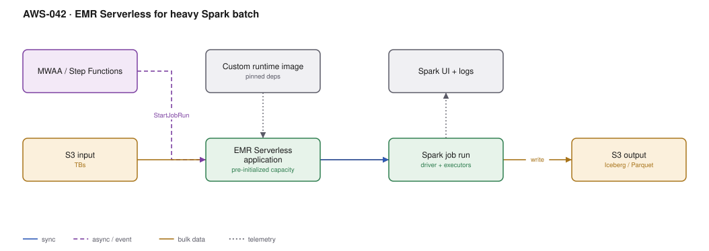

# AWS-042 · EMR Serverless for heavy Spark batch

> **Category:** [05 · Data Engineering & Analytics](readme.md#05) · **Maturity:** Production · **Effort:** M

## The problem

Glue is excellent until you need to tune Spark. You want a specific Spark version, custom
JARs, a particular shuffle configuration, more memory per executor than a worker type offers,
or simply to run an existing Spark application unchanged. EMR Serverless gives you real EMR
Spark with no cluster to provision, billed per second of vCPU and memory actually used.

**Use it when** jobs are large, need Spark tuning, or already exist as Spark applications.

**Don't use it when** Glue handles it — Glue is simpler and the catalog integration is more
seamless. And don't use it for interactive, sub-second work; this is batch.

## Glue vs EMR Serverless vs EMR on EC2

| | Glue | EMR Serverless | EMR on EC2 |
|---|---|---|---|
| Cluster management | None | None | Yours |
| Spark version choice | Limited | **Full** | Full |
| Custom runtime image | No | **Yes** | Yes |
| Spark config tuning | Partial | **Full** | Full |
| Spot support | No | No | **Yes** |
| Billing | per DPU-hour | per vCPU-s + GB-s | per instance-hour |
| Best for | Routine ETL | Heavy, tuned batch | Long-running, Spot-heavy |

## Components

| Service | Role | The setting that actually matters |
|---|---|---|
| EMR Serverless application | The runtime container | **Pre-initialized capacity** — warm workers, billed while warm |
| Job run | One Spark submission | Driver and executor sizing; this is where the money goes |
| Custom image | Pinned dependencies | An ECR image, so no `--packages` downloads at runtime |
| Spark configuration | Tuning | Adaptive query execution, shuffle partitions, dynamic allocation |
| S3 | Input and output | Use the S3A committers; the default one is slow and unsafe on S3 |
| Spark UI / logs | Debugging | Persistent application UI, available after the job ends |

## Flow

1. An orchestrator (MWAA or Step Functions) submits a job run to the application.
2. If pre-initialized capacity is configured, workers are already warm and the job starts in
   seconds; otherwise cold start is roughly 1–2 minutes.
3. The driver plans the job; executors scale within the application's configured maximum.
4. Input is read from S3 — ideally Iceberg or partitioned Parquet so pruning applies.
5. Spark executes, with shuffle data held on local worker storage.
6. Output is committed to S3 using a safe committer and registered in the catalog.
7. Workers release; billing stops, apart from any pre-initialized capacity.

## Cost (us-east-1 — order of magnitude)

| Line item | Small · 50 vCPU-hr/mo | Medium · 1,000 vCPU-hr/mo | Large · 20,000 vCPU-hr/mo |
|---|---|---|---|
| vCPU @ ~$0.052/hr | $2.60 | $52.00 | $1,040.00 |
| Memory @ ~$0.0057/GB-hr (4 GB per vCPU) | $1.14 | $22.80 | $456.00 |
| Pre-initialized capacity (if always on, 8 vCPU) | $303.00 | $303.00 | $303.00 |
| Ephemeral storage above 20 GB default | $1.00 | $20.00 | $300.00 |
| S3 reads/writes | $5.00 | $80.00 | $1,200.00 |
| **Total (no pre-init)** | **~$10** | **~$175** | **~$3,000** |

**Cost cliff:** **pre-initialized capacity is billed from the moment the application starts
until it stops**, whether jobs are running or not. Configuring 8 warm vCPUs "for faster
starts" on a job that runs twice a day costs ~$303/month to save two minutes. Use it for
genuinely interactive or frequent workloads, and set an idle timeout.

**Biggest lever:** executor sizing and the number of shuffle partitions. Over-provisioned
executors sit idle and are billed; `spark.sql.shuffle.partitions` left at the default of 200
is wrong for almost every real dataset.

## Failure modes

| Failure | Symptom | Mitigation |
|---|---|---|
| Pre-init capacity left on | Steady unexplained spend | Set `idleTimeoutMinutes` on the application; alarm on application uptime |
| Default output committer | Slow writes, possible duplicate output on retry | Use the EMRFS S3-optimized committer or Iceberg's own commit protocol |
| Data skew | One task runs for hours while the rest finish | Enable adaptive query execution; salt skewed keys |
| Executor OOM | Job dies late, after hours of work | Size memory per executor explicitly; watch for wide transformations |
| Ephemeral storage exhausted | Shuffle spill fails | Increase disk per worker; default is 20 GB |
| Dependency downloads at runtime | Slow, flaky starts | Bake dependencies into a custom image in ECR |

## Security notes

- The job role should scope to specific S3 prefixes. Spark jobs frequently get broad lake
  access because it is convenient.
- Run inside a VPC when reading from databases or private endpoints; that requires subnets
  with sufficient IPs for all executors.
- Lake Formation permissions apply when reading through the Glue catalog.
- Custom images go through the same supply chain controls as any other container
  ([`aws-027`](aws-027-container-supply-chain.md)).
- Logs can contain data samples. Encrypt the log destination and apply retention.

## What people miss

- **Custom images are the real differentiator** over Glue. Pinning Python and JAR
  dependencies into an ECR image eliminates the single most common source of
  "it worked yesterday" failures in Spark pipelines.
- **The S3-optimized committer matters more than most tuning.** The default Hadoop committer
  renames files on commit, and rename is not atomic on S3 — it is slow and can produce
  incorrect output on retry.
- **EMR on EC2 with Spot is still cheaper** for large, interruption-tolerant jobs — often by
  60–70%. EMR Serverless does not support Spot, which is the main reason to keep EMR on EC2
  in the toolkit.
- **Application-level concurrency limits** prevent one runaway orchestration from launching a
  hundred job runs. Set `maximumCapacity` on the application.
- **The persistent Spark UI survives the job**, which makes post-mortem debugging possible —
  a significant improvement over ephemeral clusters.

## See also

- [`aws-038`](aws-038-glue-etl.md) — the simpler option to rule out first
- [`aws-041`](aws-041-iceberg-tables.md) — the compaction jobs this often runs
- [`aws-043`](aws-043-mwaa-orchestration.md) — what submits these jobs
- [`aws-026`](aws-026-aws-batch.md) — for non-Spark batch compute
