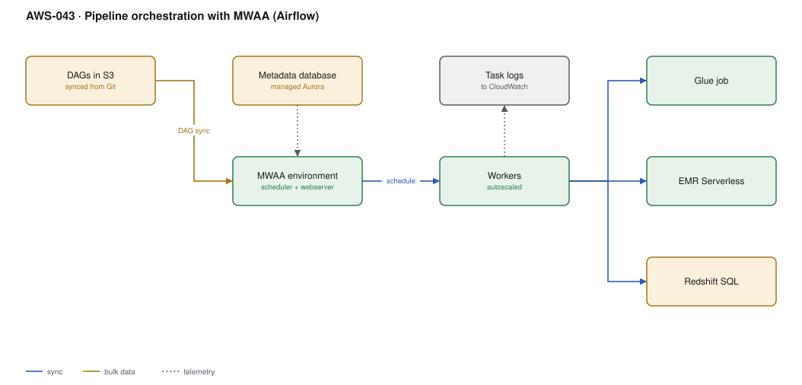

# AWS-043 · Pipeline orchestration with MWAA (Airflow)

> **Category:** [05 · Data Engineering & Analytics](readme.md#05) · **Maturity:** Production · **Effort:** M

## The problem

A data platform is a dependency graph: forty tables, each built from others, some hourly,
some daily, some only after a partner file arrives. Step Functions handles orchestration well
but expresses dependencies awkwardly at this scale and bills per transition. Airflow is the
industry standard for data DAGs, and MWAA runs it without you operating the scheduler,
metadata database or web server.

**Use it when** you have a genuine DAG — dozens of interdependent tasks, backfills, retries
per task, and data engineers who already know Airflow.

**Don't use it when** you have fewer than about ten scheduled jobs. MWAA has a **fixed
monthly floor of roughly $350** whether it runs anything or not. EventBridge Scheduler plus
Step Functions is far cheaper below that threshold.

## MWAA vs Step Functions

| | MWAA (Airflow) | Step Functions |
|---|---|---|
| Fixed cost | **~$350+/month** | $0 |
| Marginal cost | ~free per task | $0.025/1K transitions |
| Dependency expression | Natural, Pythonic | Verbose JSON/ASL |
| Backfill | **Built in** | Build it yourself |
| Data-engineering ecosystem | Huge | AWS-native |
| Operational burden | Patching, DAG hygiene, upgrades | Essentially none |

The crossover is real: below ~10 pipelines Step Functions wins on cost and simplicity; above
~50 interdependent tasks Airflow wins on expressiveness and backfill.

## Components

| Service | Role | The setting that actually matters |
|---|---|---|
| MWAA environment | Managed Airflow | **Environment class** (mw1.small → mw1.2xlarge) sets the fixed cost |
| S3 DAG bucket | Where DAGs live | Synced from Git by CI; never edited in place |
| Metadata database | Airflow state | Managed Aurora, invisible to you, but it is why the floor cost exists |
| Workers | Task execution | Min/max worker autoscaling — the variable cost |
| `requirements.txt` / plugins | Python dependencies | Pin versions and test against the exact Airflow version |
| Operators | How tasks call AWS | Prefer **deferrable** operators — see below |

## Flow

1. CI validates DAGs and syncs them to the S3 DAG bucket.
2. The scheduler parses DAGs (every 30 seconds by default) and queues due tasks.
3. Workers pick up tasks and autoscale between the configured minimum and maximum.
4. Each task submits work to the service that actually does it — a Glue job, an EMR
   Serverless run, a Redshift statement — and waits for completion.
5. Deferrable operators release the worker slot while waiting, so a three-hour Glue job does
   not occupy a worker for three hours.
6. Task logs stream to CloudWatch; failures retry per the task's own policy.

## Cost (us-east-1 — order of magnitude)

| Line item | Small · mw1.small | Medium · mw1.medium, 4 workers | Large · mw1.large, 15 workers |
|---|---|---|---|
| Environment @ $0.49–$0.99/hr | $357.70 | $512.10 | $722.70 |
| Additional workers @ ~$0.055–$0.11/hr each | $0 | $160.60 | $1,204.50 |
| Additional schedulers | $0 | $0 | $357.70 |
| Metadata storage | ~$5 | ~$10 | ~$25 |
| CloudWatch Logs | ~$10 | ~$40 | ~$150 |
| **Total (orchestration only)** | **~$373** | **~$723** | **~$2,460** |

**Cost cliff:** the **fixed floor**. An `mw1.small` environment that orchestrates three
nightly jobs costs ~$358/month to sit idle 23 hours a day. Teams adopt Airflow for three
pipelines and are surprised by a bill larger than the pipelines themselves. The work being
orchestrated (Glue, EMR, Redshift) is billed separately and is usually the larger number —
but the floor is what catches people out.

**Biggest lever:** deferrable operators, which let one worker supervise hundreds of waiting
tasks instead of one each. This commonly cuts required workers by 5–10× on pipelines
dominated by waiting.

## Failure modes

| Failure | Symptom | Mitigation |
|---|---|---|
| Heavy compute inside a task | Workers OOM; Airflow becomes the bottleneck | Airflow **orchestrates**; it should not transform. Submit to Glue/EMR and wait |
| Non-deferrable sensors | Workers all blocked waiting, nothing schedules | Use deferrable operators and the triggerer |
| DAG parse errors | Scheduler slows down or stops | CI must import every DAG before sync; keep top-level code trivial |
| Dependency conflict | Environment fails to start after a requirements change | Pin everything; test in a non-prod environment first |
| `catchup=True` by default | A new DAG immediately backfills a year of runs | Set `catchup=False` unless you mean it |
| No SLA or alerting | A pipeline silently stops producing | SLA misses to EventBridge → [`aws-065`](aws-065-notification-bus.md) |

## Security notes

- The execution role is used by all DAGs in the environment. A single over-broad role is the
  norm and the risk; consider separate environments for separate trust domains.
- Airflow connections and variables can hold credentials — back them with Secrets Manager
  rather than the metadata database.
- Put the environment in private subnets; the web server can be private-only with access via
  a VPC endpoint.
- Anyone who can write to the DAG bucket can execute arbitrary code as the execution role.
  Treat that bucket as a production deployment target with CI-only write access.

## What people miss

- **Deferrable operators are the single biggest MWAA optimisation.** A standard sensor
  occupies a worker slot while it waits; a deferrable one hands off to the triggerer and
  releases the slot. Pipelines that are mostly waiting become dramatically cheaper.
- **Airflow is for orchestration, not computation.** The most common anti-pattern is a
  `PythonOperator` doing a pandas transformation on a worker. It does not scale, and it makes
  the scheduler everyone's problem.
- **Datasets (data-aware scheduling)** let a DAG trigger when an upstream dataset is updated
  rather than on a clock, which removes a whole class of "the upstream job was late" failures.
- **Backfill is the feature you cannot easily replicate** in Step Functions, and it is why
  data teams insist on Airflow.
- **Amazon MWAA is not the only managed option** — Step Functions with Distributed Map, or
  Dagster/Prefect on ECS, are credible and avoid the fixed floor.

## See also

- [`aws-014`](aws-014-eventbridge-scheduler.md) — the cheap option below the crossover
- [`aws-011`](aws-011-step-functions-saga.md) — orchestration without the fixed cost
- [`aws-042`](aws-042-emr-serverless.md) — what the tasks should actually submit to
- [`aws-046`](aws-046-data-quality-contracts.md) — quality gates between DAG stages
