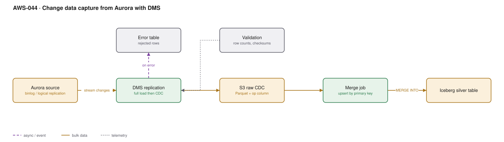

# AWS-044 · Change data capture from Aurora with DMS

> **Category:** [05 · Data Engineering & Analytics](readme.md#05) · **Maturity:** Production · **Effort:** M

## The problem

The analytics team needs operational data, and nightly `SELECT *` exports are slow, load the
production database, and are always a day stale. CDC reads the database's own transaction log
— binlog for MySQL, logical replication for PostgreSQL — and streams every insert, update and
delete out with minimal load on the source.

**Use it when** you need operational data in the lake with minutes of latency, from a source
zero-ETL does not cover.

**Don't use it when** the source is Aurora MySQL or PostgreSQL feeding Redshift — **zero-ETL
([`aws-040`](aws-040-redshift-zero-etl.md)) does this with no pipeline at all**. Check that
first; it eliminates everything on this page.

## Components

| Service | Role | The setting that actually matters |
|---|---|---|
| Source database | Where changes originate | Binlog format `ROW`, retention long enough to survive an outage |
| DMS replication instance (or Serverless) | Reads the log, writes the target | Instance size; CDC is memory-hungry on wide tables |
| Full load + CDC task | Initial snapshot then ongoing stream | Must run as one task, or you lose changes between snapshot and start |
| S3 target | Raw CDC landing zone | Parquet with an **operation column** (`I`/`U`/`D`) and a sequence number |
| Merge job | Applies changes to the analytical table | `MERGE INTO` an Iceberg table, keyed on the primary key |
| Validation | Confirms source and target agree | DMS data validation, plus your own row counts |

## Flow

1. The task performs a **full load**: a consistent snapshot of each table into S3.
2. Simultaneously it buffers ongoing changes from the transaction log so nothing is missed.
3. After the full load completes, cached changes are applied and the task enters pure CDC.
4. Each change is written to S3 as a row carrying the operation type and a monotonically
   increasing sequence or timestamp.
5. A periodic merge job reads the new CDC files and applies them to the Iceberg silver table:
   insert, update, or soft-delete by primary key, taking the latest change per key.
6. Validation compares row counts and checksums between source and target.

## Cost (us-east-1 — order of magnitude)

| Line item | Small · 1 small DB | Medium · 10 DBs, 50 GB/day | Large · 50 DBs, 1 TB/day |
|---|---|---|---|
| DMS instance (dms.t3.medium / r6i.large / r6i.2xlarge) | $52.56 | $153.30 | $613.20 |
| DMS storage (50–500 GB) | $5.75 | $23.00 | $57.50 |
| S3 storage for raw CDC | $2.00 | $35.00 | $700.00 |
| Merge jobs (Glue/EMR) | $15.00 | $150.00 | $1,200.00 |
| Cross-AZ data transfer | ~$1 | ~$15 | ~$300 |
| **Total** | **~$76** | **~$376** | **~$2,871** |

**Cost cliff:** the **merge jobs usually cost more than DMS itself.** CDC is cheap to capture
and expensive to apply, because every merge rewrites files. Merging every five minutes on a
large table can cost ten times what hourly merging costs for data that nobody reads more than
hourly. Match merge frequency to actual freshness requirements, not to how fast the data
arrives.

**Biggest lever:** merge frequency and target table layout. Partitioning the target so merges
touch few files, and batching changes, is the difference between a $200 and a $2,000 line.

## Failure modes

| Failure | Symptom | Mitigation |
|---|---|---|
| Binlog retention too short | Task fails after an outage, cannot resume, full reload needed | Retain logs for at least 24–72 hours, more than your longest expected outage |
| Source DDL change | Task fails, or columns silently stop replicating | Enable DDL handling explicitly; monitor for schema drift |
| No primary key | DMS cannot apply updates or deletes correctly | CDC requires a primary key; tables without one need one added |
| LOB columns | Truncated data, or very slow replication | Configure LOB mode and size limits deliberately; full LOB mode is slow |
| Target lag unmonitored | Analytics silently hours behind | Alarm on `CDCLatencySource` and `CDCLatencyTarget` |
| Merge job and CDC writer collide | Duplicate or lost changes | Merge from a committed, immutable set of files; never from a prefix being written |

## Security notes

- Point DMS at a **read replica**, not the writer, wherever the engine supports CDC from a
  replica. Replication slots on a primary consume resources and can block log reclamation.
- A stalled PostgreSQL logical replication slot prevents WAL cleanup and can **fill the source
  disk and take production down**. Alarm on replication slot lag; this is the most dangerous
  failure in this architecture.
- Credentials live in Secrets Manager; the DMS endpoint references the secret.
- CDC carries everything, including personal data. Apply column filtering in the task, or
  mask on merge, rather than landing it and hoping.
- Encrypt the S3 landing zone and restrict it — raw CDC is a complete shadow copy of
  production.

## What people miss

- **Zero-ETL has removed the need for this in the most common case.** Aurora MySQL/PostgreSQL
  to Redshift needs no DMS, no merge job, and no on-call. Check whether your source and
  target are supported before building a pipeline.
- **The replication slot risk is the one that causes outages.** A DMS task that stops while a
  PostgreSQL slot stays open means WAL accumulates until the source runs out of disk. It has
  taken down production at many organisations.
- **DMS Serverless** removes instance sizing and scales automatically, which addresses the
  most common operational complaint — at a higher per-unit cost.
- **Full load and CDC must be one task.** Running them separately leaves a gap where changes
  are lost, and the gap is invisible until someone reconciles counts months later.
- **Soft deletes matter.** If the merge job hard-deletes, you lose the ability to answer
  "what did this record look like before". Keep a deleted flag and let retention remove it.

## See also

- [`aws-040`](aws-040-redshift-zero-etl.md) — check this first; it may replace the whole page
- [`aws-041`](aws-041-iceberg-tables.md) — the `MERGE INTO` target
- [`aws-053`](aws-053-ddb-streams-views.md) — the DynamoDB equivalent
- [`aws-097`](aws-097-heterogeneous-db-migration.md) — DMS for migration rather than analytics
