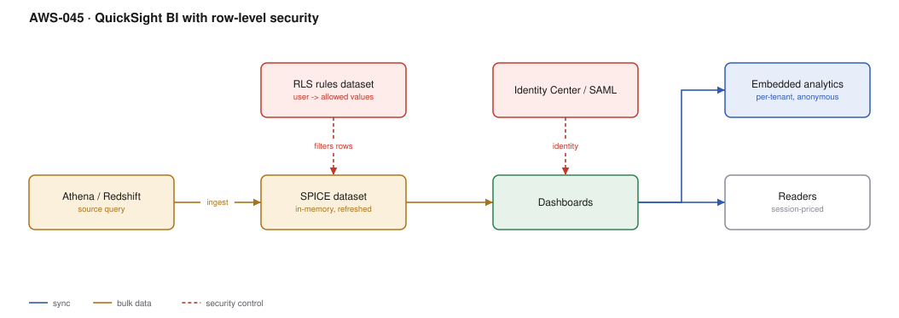

# AWS-045 · QuickSight BI with row-level security

> **Category:** [05 · Data Engineering & Analytics](readme.md#05) · **Maturity:** Growing · **Effort:** S

## The problem

The data platform is only useful if non-engineers can get answers from it. That means
dashboards, and dashboards mean two hard requirements: they must be fast (nobody waits 30
seconds for a chart), and each viewer must see only their own rows — their region, their
customer, their team.

**Use it when** you need internal dashboards or embedded per-tenant analytics and you are
already on AWS.

**Don't use it when** your organisation already runs Tableau, Power BI or Looker well.
QuickSight's advantage is price and AWS integration, not features; migrating a mature BI
estate for either is rarely worth it.

## Components

| Service | Role | The setting that actually matters |
|---|---|---|
| Data source | Athena, Redshift, RDS, S3 | Query performance here determines dashboard performance, unless SPICE is used |
| **SPICE** | In-memory columnar cache | The reason dashboards are fast; refresh schedule is the trade-off |
| Dataset | The query plus transformations | Where RLS and column-level security attach |
| **RLS rules dataset** | Maps user/group → permitted values | A table with `UserName`/`GroupName` plus filter columns |
| Dashboards and analyses | What people see | Analyses are editable, dashboards are published snapshots |
| Identity | Identity Center, SAML, or QuickSight-native | Groups drive RLS at scale, not individual users |
| Embedding | Dashboards inside your own app | Anonymous embedding for per-tenant SaaS, with session tags |

## Flow

1. A dataset is defined over Athena or Redshift, with joins and calculated fields.
2. It is ingested into SPICE on a schedule — typically nightly, or incrementally hourly.
3. An RLS rules dataset maps each user or group to the values they may see (for example,
   `region IN ('EMEA')`).
4. A viewer opens a dashboard. QuickSight resolves their identity, looks up their RLS rules,
   and applies the filter **before** any data is returned.
5. Charts render from SPICE in milliseconds; no query reaches Athena.
6. For embedded SaaS use, the application generates an anonymous embed URL carrying session
   tags that drive the same RLS rules.

## Cost (us-east-1 — order of magnitude)

| Line item | Small · 5 authors, 50 readers | Medium · 20 authors, 500 readers | Large · 50 authors, 5,000 readers |
|---|---|---|---|
| Authors @ $24/mo (or $18 annual) | $120.00 | $480.00 | $1,200.00 |
| Readers @ $0.30/session, capped $5/mo each | $75.00 | $750.00 | $7,500.00 |
| SPICE capacity @ $0.38/GB-mo (10/100/500 GB) | $3.80 | $38.00 | $190.00 |
| Athena scans for SPICE refresh | $5.00 | $50.00 | $300.00 |
| **Total** | **~$204** | **~$1,318** | **~$9,190** |

**Cost cliff:** reader pricing is **$0.30 per session, capped at $5 per reader per month**.
A reader who opens one dashboard a month costs $0.30; a daily user hits the $5 cap. With
5,000 occasional readers the difference between a 20% and an 80% engagement rate is roughly
$18,000 a year. Capacity pricing (a flat monthly commitment) becomes cheaper above a few
hundred active readers — model both.

**Biggest lever:** SPICE. Without it, every chart interaction is an Athena query at $5/TB
and several seconds of latency. With it, dashboard queries cost nothing marginal and are
instant. The trade is data freshness equal to your refresh interval.

## Failure modes

| Failure | Symptom | Mitigation |
|---|---|---|
| RLS rules dataset missing a user | That user sees **nothing** (fail-closed) | Deliberate choice — but make it visible; monitor for empty-result users |
| RLS applied in the analysis, not the dataset | A user duplicates the analysis and sees everything | RLS **must** be on the dataset; filters in an analysis are cosmetic |
| SPICE refresh exceeds the window | Stale data, overlapping refreshes | Incremental refresh on a date column, not full refresh |
| Direct query on a slow source | Dashboards time out under concurrency | Use SPICE, or fix the source query |
| SPICE row limits | Ingest fails on very large datasets | Aggregate before ingest; SPICE is for serving, not for raw data |
| Author licences handed out widely | Cost creeps up unnoticed | Authors cost 80× a light reader — audit who actually builds content |

## Security notes

- **RLS is enforced server-side before data is returned**, so it is a real control, not a UI
  filter. Column-level security similarly removes columns entirely.
- RLS fails closed: a user with no matching rule sees no rows. That is the correct default
  and it will generate support tickets — document it.
- For embedded multi-tenant analytics, use **session tags** rather than creating a QuickSight
  user per tenant customer. Tags scale; users do not.
- SPICE holds a copy of your data inside QuickSight. It is encrypted, but it is a copy —
  include it in data inventory and retention thinking.
- Dashboards can be shared by link. Audit sharing settings; "anyone in the account" is often
  broader than intended.

## What people miss

- **RLS belongs on the dataset.** Putting a filter in an analysis and calling it security is
  a genuine and common data-exposure bug.
- **Anonymous embedding with session tags** turns QuickSight into a per-tenant analytics
  feature for your SaaS product, billed per session rather than per named user. Far cheaper
  than licensing every customer.
- **Incremental refresh** exists and most teams do full refreshes out of habit, paying for
  repeated Athena scans of unchanged history.
- **QuickSight Q / natural-language querying** requires topic modelling work to be useful;
  it is not a toggle, and expectations need managing.
- **Readers can be cheaper than you think, or much more expensive.** The session model
  rewards occasional use and penalises nothing — but capacity pricing wins at scale, and
  nobody revisits the choice after launch.

## See also

- [`aws-039`](aws-039-athena-federated.md) — the usual data source
- [`aws-040`](aws-040-redshift-zero-etl.md) — the alternative source for high concurrency
- [`aws-037`](aws-037-s3-data-lake.md) — where the gold tables live
- [`aws-092`](aws-092-finops-cur-pipeline.md) — the FinOps dashboards this often builds
