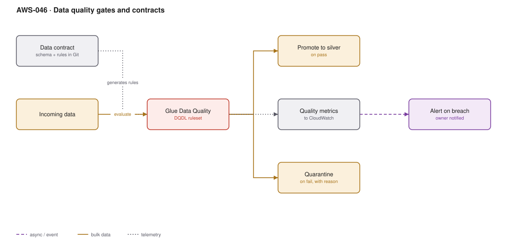

# AWS-046 · Data quality gates and contracts

> **Category:** [05 · Data Engineering & Analytics](readme.md#05) · **Maturity:** Growing · **Effort:** M

## The problem

A producer renames a column. Nobody told the data team. The pipeline does not fail — it
writes nulls. Three weeks later a finance dashboard is wrong, someone notices, and the
reconciliation takes a week. The failure was not technical; it was that nothing checked, and
nothing had been agreed.

Data quality gates make bad data **fail loudly at the boundary** instead of silently
propagating. Data contracts make the expectations explicit and owned.

**Use it when** more than one team depends on a dataset. That is the threshold — the moment
data crosses a team boundary, it needs a contract.

**Don't** build a quality framework before you have a pipeline. Start with three rules on
your most important table.

## Components

| Service | Role | The setting that actually matters |
|---|---|---|
| Data contract | The agreement, in Git | Schema, semantics, freshness SLA, and **a named owner** |
| Glue Data Quality | Rule evaluation engine | DQDL rules; recommendations can bootstrap a ruleset from a sample |
| Quarantine location | Where failing rows go | Rows plus the **reason** — otherwise nobody can act on them |
| Quality metrics | Scores over time | To CloudWatch, so trends are visible before they breach |
| Pipeline gate | Stops promotion on failure | The gate is what makes it a control rather than a report |
| Alerting | Tells the owner | The **producer**, not just the consumer |

## The rules that catch most real problems

| Rule type | Example | Catches |
|---|---|---|
| Freshness | `ColumnValues "updated_at" > now() - 1 day` | Upstream job stopped |
| Volume | `RowCount between 90000 and 110000` | Partial loads, duplicated loads |
| Completeness | `Completeness "customer_id" > 0.99` | A renamed or dropped source column |
| Uniqueness | `IsUnique "order_id"` | Double-processing |
| Referential | `ColumnValues "region" in ["EMEA","AMER","APAC"]` | New enum value nobody announced |
| Distribution | `Mean "order_total" between 40 and 80` | Unit changes, currency mix-ups |

Volume and freshness alone catch the majority of real incidents, and they take an hour to add.

## Flow

1. Producer and consumer agree a contract — schema, semantics, freshness, owner — and commit
   it to Git next to the pipeline.
2. CI generates or validates the DQDL ruleset from the contract.
3. On each load, Glue Data Quality evaluates the ruleset against the incoming data.
4. Passing data is promoted to silver.
5. Failing rows go to quarantine with the rule that failed attached; depending on severity,
   the whole load is blocked or only the bad rows are diverted.
6. Scores publish to CloudWatch; a breach alerts the **producer**, who owns the fix.

## Cost (us-east-1 — order of magnitude)

| Line item | Small · 10 datasets | Medium · 100 datasets | Large · 1,000 datasets |
|---|---|---|---|
| Glue Data Quality @ $0.44/DPU-hour | $15.00 | $150.00 | $1,500.00 |
| Quarantine storage (S3) | $1.00 | $10.00 | $120.00 |
| CloudWatch custom metrics @ $0.30 each | $3.00 | $30.00 | $300.00 |
| Alerting (SNS/EventBridge) | $0.10 | $1.00 | $10.00 |
| **Total** | **~$19** | **~$191** | **~$1,930** |

**Cost cliff:** running the full ruleset over the **entire table** on every load. A
completeness check across a 50 TB history, nightly, is an enormous recurring scan. Evaluate
rules against the **incremental partition** only, and run full-table profiling weekly.

**Biggest lever:** scoping rules to new data. The second lever is cost avoided rather than
spent — the quality incident you do not have. A week of reconciliation effort is worth more
than years of this bill.

## Failure modes

| Failure | Symptom | Mitigation |
|---|---|---|
| Rules that only warn | Everyone ignores the dashboard, bad data still lands | At least one rule must **block promotion**, or this is a report, not a gate |
| Alerting the consumer | The team that cannot fix it gets paged | Route to the producer; the contract names them |
| Too many rules at once | Constant noise, alert fatigue, gate disabled | Start with freshness and volume; add rules in response to actual incidents |
| Quarantine with no reason | Rows pile up, nobody can triage | Attach the failing rule and the value to every quarantined row |
| Full-table evaluation | Quality checks cost more than the pipeline | Evaluate the incremental partition |
| Contract in a wiki | Drifts immediately, unenforceable | Contract lives in Git next to the code, validated in CI |

## Security notes

- Quarantined data is still production data with the same sensitivity. Apply the same
  encryption, access controls and retention — quarantine buckets are frequently forgotten in
  access reviews.
- Quality metrics can leak information: a rule reporting "mean salary outside expected range"
  publishes a fact. Keep metric names and values non-sensitive.
- The contract is also a privacy artefact — it is the natural place to record which columns
  are personal data and what the retention is.

## What people miss

- **Freshness and volume are the two rules that matter most** and they are the two most often
  missing. Almost every "silently wrong dashboard" incident would have been caught by
  "did the row count change by more than 20% today?".
- **Glue Data Quality can recommend a ruleset** by profiling existing data, which turns a
  blank page into a starting point in minutes.
- **The contract needs an owner, not just a schema.** The hardest part of data quality is
  organisational: who is woken up when the contract is breached. Without a name, nothing
  improves.
- **Fail-the-load vs quarantine-the-rows is a per-rule decision.** A single malformed row in
  a clickstream should not block the load; a 50% drop in volume should.
- **Great Expectations and dbt tests** solve the same problem and may fit better if your
  transformation layer already uses them. The pattern matters more than the tool.

## See also

- [`aws-037`](aws-037-s3-data-lake.md) — the zone boundary this gate protects
- [`aws-043`](aws-043-mwaa-orchestration.md) — where the gate sits in the DAG
- [`aws-044`](aws-044-cdc-dms.md) — a common source of silent schema drift
- [`aws-065`](aws-065-notification-bus.md) — routing the breach to the right human
