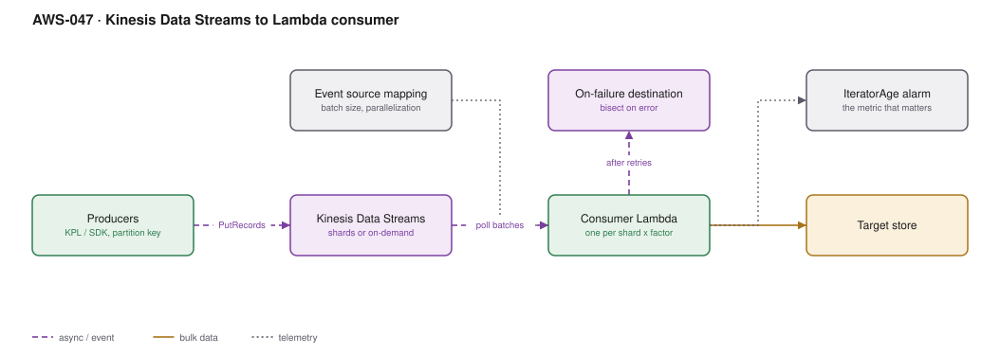

# AWS-047 · Kinesis Data Streams to Lambda consumer

> **Category:** [06 · Streaming & Real-Time](readme.md#06) · **Maturity:** Production · **Effort:** S

## The problem

You have a continuous event stream — orders, telemetry, clicks, price ticks — that several
consumers need, in order, within seconds. SQS gives you a queue with no ordering and
one-consumer-takes-the-message semantics. Kinesis gives you an ordered, replayable log that
many independent consumers can read at their own pace.

**Use it when** you need ordering per key, replay, or multiple independent consumers of the
same events.

**Don't use it when** a queue would do. SQS is cheaper, simpler, scales without shard
arithmetic, and most "streaming" requirements are actually queue requirements
([`aws-012`](aws-012-async-job-submission.md)).

## Kinesis vs SQS vs MSK

| | Kinesis | SQS | MSK (Kafka) |
|---|---|---|---|
| Ordering | Per partition key | FIFO queues only | Per partition |
| Replay | **Yes**, up to 365 days | No | **Yes**, configurable |
| Multiple consumers | **Yes**, independent | No, competing | **Yes** |
| Ops burden | Very low | None | Real |
| Cost at 1 TB/day | ~$1,100 | ~$400 | ~$900 + ops |
| Right when | Ordered multi-consumer | Work distribution | Kafka ecosystem needed |

## Components

| Service | Role | The setting that actually matters |
|---|---|---|
| Kinesis Data Streams | The log | **On-demand vs provisioned** — on-demand removes shard maths at ~2× unit cost |
| Partition key | Determines ordering and distribution | High cardinality, or you create a hot shard |
| Event source mapping | Connects stream to Lambda | `ParallelizationFactor`, `BatchSize`, `MaximumRetryAttempts`, `BisectBatchOnFunctionError` |
| Consumer Lambda | Processing | Must be **idempotent**; delivery is at-least-once |
| Enhanced fan-out | Dedicated 2 MB/s per consumer | Needed past ~2 consumers; billed per consumer-shard-hour |
| `IteratorAge` | The health metric | The single most important alarm in this architecture |

## Flow

1. Producers write records with a partition key; the key hashes to a shard and determines
   ordering.
2. The event source mapping polls each shard and invokes the Lambda with a batch.
3. By default one Lambda instance processes one shard at a time, preserving order.
   `ParallelizationFactor` up to 10 runs concurrent invocations per shard, still ordered
   **per partition key**.
4. On failure, the batch is retried. With `BisectBatchOnFunctionError`, the batch is split to
   isolate the poison record.
5. After `MaximumRetryAttempts` or `MaximumRecordAgeInSeconds`, the batch metadata goes to the
   on-failure destination and processing advances.
6. `IteratorAge` reports how far behind the consumer is — the number to alarm on.

## Cost (us-east-1 — order of magnitude)

| Line item | Small · 10 GB/day | Medium · 500 GB/day | Large · 5 TB/day |
|---|---|---|---|
| Provisioned shards (1 / 10 / 100) | $10.95 | $109.50 | $1,095.00 |
| PUT payload units @ $0.014/M | $1.50 | $75.00 | $750.00 |
| *On-demand equivalent* | $38.00 | $1,250.00 | $12,000.00 |
| Extended retention (7 days) | $3.00 | $30.00 | $300.00 |
| Enhanced fan-out (2 consumers) | $13.00 | $130.00 | $1,300.00 |
| Consumer Lambda | $5.00 | $120.00 | $1,100.00 |
| **Total (provisioned)** | **~$33** | **~$465** | **~$4,545** |

**Cost cliff:** **on-demand is roughly 2–3× provisioned** at steady load. It is excellent for
unpredictable traffic and for not thinking about shards, and expensive for a steady 5 TB/day.
Provisioned with a scaling Lambda is the cheaper path once your volume is predictable.

**Biggest lever:** shard count, and avoiding enhanced fan-out unless you need it. Each EFO
consumer costs ~$0.015/shard-hour plus data retrieval — with 100 shards and 3 consumers that
is ~$3,300/month on top of everything else. Shared-throughput consumers are free.

## Failure modes

| Failure | Symptom | Mitigation |
|---|---|---|
| Poison record | One bad record blocks its shard **forever** | `BisectBatchOnFunctionError` + `MaximumRetryAttempts` + on-failure destination. This is the classic Kinesis outage |
| Hot shard | Throttling on one shard while others idle | High-cardinality partition key; never use a constant or a low-cardinality field |
| `IteratorAge` climbing | Consumer falling behind, data will expire unprocessed | Alarm at 60 s; scale shards or `ParallelizationFactor` |
| Non-idempotent consumer | Duplicates on retry corrupt downstream state | Deduplicate on a record-level idempotency key |
| Records expire | Silent data loss after 24 h default retention | Extend retention; alarm well before the limit |
| Too many shared consumers | All consumers throttle each other at 2 MB/s per shard | Enhanced fan-out past two consumers |

## Security notes

- Enable server-side encryption with a KMS key. Note KMS request charges apply per record
  batch and are non-trivial at high volume.
- Producers need only `kinesis:PutRecord*` on the specific stream; consumers only
  `GetRecords`/`GetShardIterator`. These are commonly over-granted.
- VPC endpoints for Kinesis keep traffic off the NAT gateway — at 5 TB/day that is a
  meaningful saving as well as a security improvement.
- Records may contain personal data and sit in the stream for the retention period. Factor
  retention into data-deletion commitments.

## What people miss

- **The poison-pill failure is the one that will page you.** A single unparseable record
  blocks its shard indefinitely because Kinesis preserves order. Three settings prevent it,
  and they are off by default.
- **`ParallelizationFactor` gives you concurrency without more shards.** Up to 10 concurrent
  invocations per shard, with ordering preserved per partition key — often cheaper than
  re-sharding.
- **Kinesis Data Streams can now be a direct destination for VPC Flow Logs, CloudWatch Logs
  and EventBridge Pipes**, removing glue code from several common designs.
- **Resharding is online but not instant**, and the shard-splitting API is awkward. This is
  the main reason people choose on-demand despite the price.
- **EventBridge Pipes** can consume a Kinesis stream and filter, enrich and route it to 20+
  targets with no Lambda at all. For simple forwarding it removes the consumer function
  entirely.

## See also

- [`aws-050`](aws-050-flink-stateful.md) — when the consumer needs windowed state
- [`aws-051`](aws-051-clickstream-firehose.md) — when you only need to land data in S3
- [`aws-049`](aws-049-msk-kafka.md) — when you need Kafka semantics specifically
- [`aws-012`](aws-012-async-job-submission.md) — when a queue was the right answer
