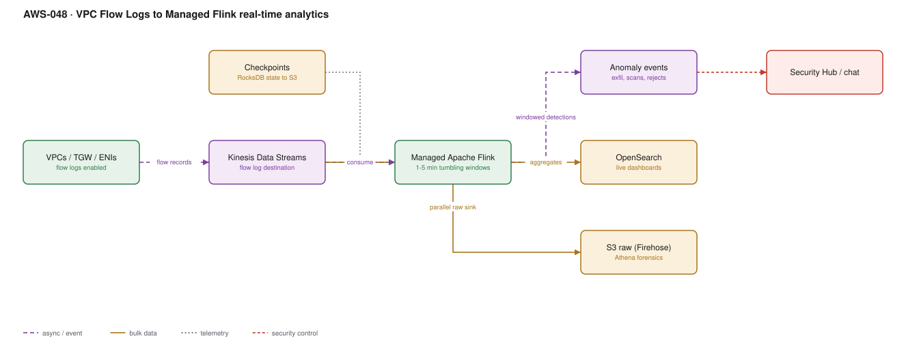

# AWS-048 · VPC Flow Logs to Managed Flink real-time analytics

> **Category:** [06 · Streaming & Real-Time](readme.md#06) · **Maturity:** Specialist · **Effort:** L

## The problem

VPC Flow Logs usually land in S3 and are queried with Athena when somebody already suspects
something. That is forensics: useful, and always after the fact. Streaming the same records
through Apache Flink turns them into **detection** — a windowed, stateful view of your
network that can say "this instance has sent 40× its normal egress in the last five minutes"
while it is still happening.

**Use it when** you need near-real-time network detection: data exfiltration, lateral
movement, port scanning, or a sudden cost anomaly driven by egress.

**Don't use it when** Athena-on-S3 answers your questions within an acceptable delay. This is
a genuinely expensive and operationally heavy architecture. GuardDuty
([`aws-056`](aws-056-guardduty-response.md)) already analyses flow logs for known-bad
patterns at a fraction of the cost — build this for detections GuardDuty does not do, in
*your* environment's terms.

## What the windows actually detect

| Detection | Window | Signal |
|---|---|---|
| Data exfiltration | 5 min tumbling | `bytes_out` per ENI vs its own 7-day baseline |
| Port scan | 1 min sliding | Distinct `dstport` per `srcaddr` above a threshold |
| Lateral movement | 5 min | New `src→dst` pairs never seen before, inside private space |
| Rejected-flow spike | 1 min | `action=REJECT` ratio per security group |
| Beaconing | 30 min | Low-variance inter-arrival times to one destination |
| Egress cost anomaly | 15 min | Bytes to non-AWS destinations, by account and tag |

The per-ENI baseline is the part that needs Flink specifically: it is stateful, keyed, and
continuously updated. A stateless rule engine cannot do it.

## Components

| Service | Role | The setting that actually matters |
|---|---|---|
| VPC Flow Logs | The source data | **Custom format** — include `pkt-srcaddr`, `flow-direction`, `tcp-flags`; the default format omits what you need |
| Kinesis Data Streams | The transport | On-demand, or shards sized for peak; this is a high-volume stream |
| Managed Service for Apache Flink | Stateful processing | **KPU count** and checkpoint interval; RocksDB state backend for large keyed state |
| Checkpoints to S3 | Durability of state | Checkpoint interval vs recovery time trade-off |
| OpenSearch | Live dashboards | Aggregates only — never the raw flows |
| S3 via Firehose | Cheap raw retention | Parallel sink for forensics; Athena over Parquet |
| Alerting | Detections out | To Security Hub and the notification bus |

## Flow

1. Flow logs are enabled on VPCs, subnets or ENIs with a custom format, delivered to Kinesis
   Data Streams (directly, or via Firehose for the S3 copy).
2. A parallel Firehose sink lands raw records in S3 as Parquet for forensics and Athena.
3. The Flink application consumes the stream, assigns event-time watermarks, and keys by ENI,
   source address, or security group.
4. Tumbling and sliding windows compute per-key aggregates; keyed state holds rolling
   baselines per ENI.
5. A detection fires when a window breaches its baseline or a static rule; the event is
   enriched with account, VPC, tag and instance metadata.
6. Aggregates stream to OpenSearch for dashboards; detections go to Security Hub and chat.
7. Checkpoints to S3 mean a restart resumes with its baselines intact rather than
   re-learning for a week.

## Cost (us-east-1 — order of magnitude)

| Line item | Small · 50 GB/day | Medium · 500 GB/day | Large · 5 TB/day |
|---|---|---|---|
| Flow log delivery to Kinesis | $0 | $0 | $0 |
| Kinesis Data Streams (on-demand) | $150 | $1,250 | $12,000 |
| Managed Flink @ $0.11/KPU-hr (2 / 8 / 40 KPU) | $160 | $642 | $3,212 |
| Flink running storage @ $0.10/GB-mo | $5 | $25 | $150 |
| OpenSearch (aggregates only) | $200 | $500 | $1,500 |
| Firehose to S3 @ $0.029/GB | $44 | $435 | $4,350 |
| S3 storage (Parquet, 90 days) | $35 | $350 | $3,500 |
| **Total** | **~$594** | **~$3,202** | **~$24,712** |

**Cost cliff:** **flow log volume is proportional to packet count, not bytes.** A chatty
microservice mesh generates far more flow records than a few large transfers, and teams size
this on bandwidth and are wrong by an order of magnitude. Before building, enable flow logs
to S3 for a week and measure the actual record rate.

Second cliff: sending **raw** flows to OpenSearch. At 5 TB/day that is a six-figure annual
OpenSearch bill. Send aggregates to OpenSearch and keep raw in S3.

**Biggest lever:** sampling and scope. Flow logs on every ENI at a 1-minute aggregation
interval is the maximum-cost configuration. Use a 10-minute interval for low-risk subnets,
1-minute only where detection matters, and consider enabling at subnet rather than ENI level.

## Failure modes

| Failure | Symptom | Mitigation |
|---|---|---|
| Default log format | Detections impossible — no direction, no original source behind NAT | Custom format from day one; changing it later loses baseline continuity |
| Flow logs are aggregated, not per-packet | Beaconing detection less precise than expected | Capture windows are 1 or 10 minutes; design detections for aggregates |
| Checkpoint failures | Flink restarts and loses all baselines | Alarm on `numberOfFailedCheckpoints`; size state and interval together |
| Under-provisioned KPUs | `millisBehindLatest` grows; detection latency becomes hours | Autoscaling on, and alarm on consumer lag |
| Shard hot-spotting | One shard throttles while others idle | Partition key must be high-cardinality — ENI id, not VPC id |
| Alert storms | A misconfigured app triggers thousands of detections | Deduplicate by key and suppress for a cooldown window before alerting |
| Baseline poisoned | Learned during an active compromise | Seed baselines from a known-good period; alert on *change in baseline* too |

## Security notes

- Flow logs capture metadata, not payloads. They tell you *who talked to whom, how much* —
  never what was said. That is both the privacy benefit and the detection limit.
- Behind a NAT gateway, `srcaddr` is the NAT. Include `pkt-srcaddr` in the custom format or
  every detection points at the NAT gateway.
- The S3 raw copy is a complete record of your network topology and traffic patterns. It is
  sensitive; encrypt it, restrict it, and consider Object Lock
  ([`aws-083`](aws-083-s3-replication-worm.md)).
- Detections should reach the same pipeline as every other security finding so there is one
  queue, not a separate dashboard nobody opens ([`aws-055`](aws-055-security-lake.md)).

## What people miss

- **Security Lake may be the better foundation.** It already normalises flow logs to OCSF and
  lands them in your own S3 in Parquet. Pointing Flink at Security Lake data rather than
  building the ingest yourself removes a large part of this architecture
  ([`aws-055`](aws-055-security-lake.md)).
- **GuardDuty already does the commodity detections** — crypto-mining callbacks, known-bad
  IPs, Tor, unusual API patterns — using flow logs, DNS logs and CloudTrail, with no
  infrastructure. Build this only for detections that require *your* baselines.
- **Flow logs cannot see intra-ENI or same-security-group traffic** in all cases, and they
  omit some AWS-internal traffic (DNS to the Amazon resolver, instance metadata, licence
  activation). A detection assuming complete visibility will have blind spots.
- **Transit Gateway flow logs** are a separate, extremely valuable source — they show
  inter-VPC traffic that per-VPC logs make you reconstruct.
- **Flink savepoints are how you deploy.** Stop with a savepoint, deploy, restore from it, and
  your baselines survive the release. Teams that redeploy without savepoints silently reset
  their detections every sprint.
- **The hardest part is not the pipeline, it is the thresholds.** Expect to spend more effort
  tuning what counts as anomalous than building any of the infrastructure above.

## See also

- [`aws-055`](aws-055-security-lake.md) — the normalised source this should probably read from
- [`aws-056`](aws-056-guardduty-response.md) — the managed detections you do not need to build
- [`aws-050`](aws-050-flink-stateful.md) — the Flink mechanics in general
- [`aws-036`](aws-036-network-firewall-egress.md) — preventing rather than detecting egress
