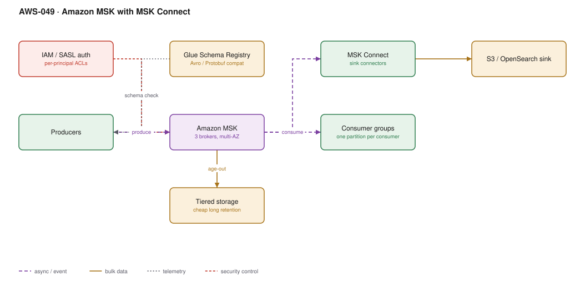

# AWS-049 · Amazon MSK with MSK Connect

> **Category:** [06 · Streaming & Real-Time](readme.md#06) · **Maturity:** Production · **Effort:** L

## The problem

You need Kafka specifically — because of compaction, consumer group semantics, exactly-once
transactions, the connector ecosystem, an existing Kafka codebase, or portability off AWS.
MSK runs the brokers, patches them and handles AZ failure, while leaving you the Kafka
semantics and the Kafka operational model.

**Use it when** Kafka itself is the requirement, not merely "we need streaming".

**Don't use it when** Kinesis would do. MSK has a meaningful operational floor: partition
planning, consumer group rebalancing, topic configuration, broker sizing, upgrades. Choose it
deliberately, not by familiarity.

## MSK provisioned vs Serverless vs Kinesis

| | MSK provisioned | MSK Serverless | Kinesis |
|---|---|---|---|
| Floor cost | ~$450/mo (3 × m5.large) | ~$550/mo + usage | ~$11/shard-mo |
| Broker sizing | Yours | None | N/A |
| Max throughput | Very high | 200 MB/s write per cluster | Per-shard |
| Kafka API | **Full** | Full | No |
| Tiered storage | **Yes** | No | Extended retention |
| Best for | High volume, tuned | Variable, no ops | AWS-native streaming |

## Components

| Service | Role | The setting that actually matters |
|---|---|---|
| MSK cluster | Brokers | 3 brokers across 3 AZs minimum; `min.insync.replicas=2` with RF=3 |
| Topics and partitions | Parallelism unit | Partition count caps consumer parallelism and cannot be reduced |
| Glue Schema Registry | Schema evolution | Compatibility mode — `BACKWARD` is the usual choice |
| MSK Connect | Managed Kafka Connect | Sink connectors to S3, OpenSearch, Redshift with no code |
| Tiered storage | Cheap long retention | Moves old segments to S3 at a fraction of EBS cost |
| IAM / SASL auth | Authentication | IAM access control is the AWS-native option and removes certificate management |

## Flow

1. Producers serialise with Avro or Protobuf, validating against the Glue Schema Registry.
2. Records are written to a topic partition determined by the key, replicated across three
   AZs before acknowledgement.
3. Consumer groups read independently; each partition is consumed by exactly one member of a
   group, which is what caps parallelism at the partition count.
4. Segments older than the local retention threshold move to tiered storage on S3,
   transparently readable by consumers.
5. MSK Connect runs sink connectors that drain topics into S3, OpenSearch or a warehouse
   without bespoke consumer code.
6. Offsets are committed per consumer group so each consumer tracks its own position.

## Cost (us-east-1 — order of magnitude)

| Line item | Small · 3 × m5.large | Medium · 6 × m5.2xlarge | Large · 15 × m5.4xlarge |
|---|---|---|---|
| Broker instance hours | $459.90 | $3,679.20 | $18,396.00 |
| EBS storage (1/10/50 TB @ $0.10/GB) | $102.40 | $1,024.00 | $5,120.00 |
| *Tiered storage equivalent @ ~$0.021/GB* | $21.50 | $215.00 | $1,075.00 |
| MSK Connect workers | $100.00 | $300.00 | $900.00 |
| Cross-AZ replication traffic | $0 | $0 | $0 |
| **Total (with tiered storage)** | **~$581** | **~$4,194** | **~$20,371** |

**Cost cliff:** **EBS storage for long retention.** Keeping 30 days of a high-volume topic on
broker EBS at $0.10/GB-month is frequently larger than the broker bill itself. Tiered storage
moves older segments to S3 at roughly a fifth of the cost and is close to free to enable.
Teams run for years without it.

**Biggest lever:** broker right-sizing and tiered storage. Note that in-cluster replication
traffic across AZs is **not** charged for MSK, which removes a cost that self-managed Kafka
on EC2 would incur — a real argument for MSK over DIY.

## Failure modes

| Failure | Symptom | Mitigation |
|---|---|---|
| Too few partitions | Cannot scale consumers; cannot reduce later either | Plan partitions for future consumer parallelism, not current |
| Consumer group rebalance storms | Consumers thrash, lag spikes | Tune `session.timeout.ms` and `max.poll.interval.ms`; use cooperative rebalancing |
| `min.insync.replicas` misconfigured | Data loss on broker failure, or writes blocked | RF=3 with `min.insync.replicas=2` and `acks=all` |
| Disk full | Brokers stop accepting writes, cluster degrades | Storage autoscaling on, plus tiered storage, plus alarms |
| Schema breaking change | Consumers crash across the estate | Schema Registry with `BACKWARD` compatibility, enforced in CI |
| Unbalanced partitions | One broker hot | Cruise Control, or MSK's automatic rebalancing |

## Security notes

- IAM access control is the simplest authentication option on AWS and removes mTLS
  certificate rotation entirely. Use it unless a client library cannot.
- Topic-level ACLs matter: without them any authenticated principal can read every topic.
- Encryption in transit between brokers and between client and broker should both be on;
  in-cluster encryption is off by default on some older configurations.
- Private subnets only; MSK has no public endpoint by default and should not be given one.
- Records in a topic persist for the retention period, which interacts with data-deletion
  obligations — compacted topics in particular can retain a key indefinitely.

## What people miss

- **Partition count is effectively permanent.** You can increase it, but doing so changes key
  distribution and breaks ordering guarantees for existing keys. Decide carefully.
- **Tiered storage is the single biggest MSK cost saving** and it is a cluster-level toggle
  plus a topic-level retention setting.
- **MSK Connect removes most custom consumer code.** S3, OpenSearch, Redshift and JDBC sinks
  all exist as managed connectors — teams routinely write and operate consumers that a
  connector would handle.
- **MSK Replicator** does cross-region and cross-cluster replication as a managed service,
  which used to mean operating MirrorMaker 2.
- **Kafka is not a database.** Compacted topics look like one and tempt people into using
  them as a source of truth. They are a log with a retention policy.

## See also

- [`aws-047`](aws-047-kinesis-lambda.md) — the simpler AWS-native alternative
- [`aws-050`](aws-050-flink-stateful.md) — the usual stateful consumer
- [`aws-051`](aws-051-clickstream-firehose.md) — when you only need to land data
- [`aws-041`](aws-041-iceberg-tables.md) — the usual sink target
