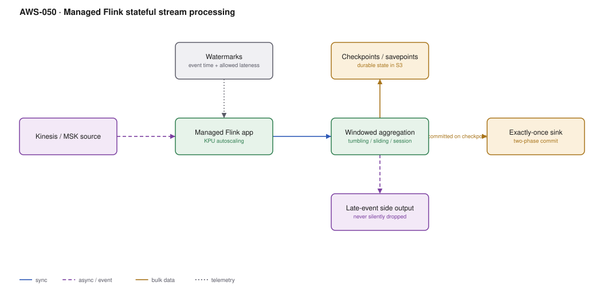

# AWS-050 · Managed Flink stateful stream processing

> **Category:** [06 · Streaming & Real-Time](readme.md#06) · **Maturity:** Specialist · **Effort:** L

## The problem

A Lambda consumer sees one batch at a time and remembers nothing. That is fine for
transformation and routing, and useless for "the average over the last five minutes",
"sessions of user activity separated by 30 minutes of inactivity", or "join this order
stream against the payment stream, allowing for either arriving first". Those need
**state**, and they need to handle events arriving out of order.

**Use it when** the computation is windowed, joins two streams, or maintains per-key state
across events.

**Don't use it when** processing is per-record and stateless — Lambda is far cheaper and
simpler. Flink is a real distributed system with real operational demands.

## The concepts that actually matter

| Concept | What it means | Why you care |
|---|---|---|
| **Event time** | Timestamp from the record | Results are correct regardless of arrival order or replay |
| **Watermark** | "No events older than T will arrive" | Decides when a window closes |
| **Allowed lateness** | Grace period after the watermark | Trade correctness against latency |
| **Checkpoint** | Periodic snapshot of state | Automatic recovery after failure |
| **Savepoint** | Manual, versioned snapshot | How you deploy without losing state |
| **Exactly-once** | Via two-phase commit to the sink | Only if the sink supports it |

Processing time is easy and wrong under replay. Event time is the reason to use Flink.

## Components

| Service | Role | The setting that actually matters |
|---|---|---|
| Managed Service for Apache Flink | The runtime | **KPU count** and parallelism; autoscaling on |
| State backend (RocksDB) | Holds keyed state | Required past a few GB; incremental checkpoints |
| Checkpoints to S3 | Durability | Interval vs recovery-time trade-off |
| Savepoints | Deployment mechanism | Stop-with-savepoint, deploy, restore |
| Source | Kinesis, MSK, or custom | Must support replay for correctness guarantees |
| Sink | Kinesis, S3, OpenSearch, JDBC, Iceberg | Exactly-once needs a transactional sink |

## Flow

1. The application reads from Kinesis or MSK, extracting an event-time timestamp from each
   record.
2. Watermarks advance as the maximum observed timestamp less a configured out-of-orderness
   bound.
3. Records are keyed and routed to the subtask owning that key.
4. Windows accumulate state in RocksDB. A window fires when the watermark passes its end
   plus allowed lateness.
5. Events arriving after that go to a **side output**, so they are visible rather than
   silently dropped.
6. Checkpoints snapshot all state to S3 at the configured interval; on failure the job
   restarts from the last one.
7. With a transactional sink, output is committed only on checkpoint completion — which is
   what makes exactly-once real, and what adds checkpoint-interval latency to the sink.

## Cost (us-east-1 — order of magnitude)

| Line item | Small · 2 KPU | Medium · 8 KPU | Large · 40 KPU |
|---|---|---|---|
| KPUs @ $0.11/KPU-hour | $160.60 | $642.40 | $3,212.00 |
| Orchestration KPU (1 per app, always) | $80.30 | $80.30 | $80.30 |
| Running application storage @ $0.10/GB-mo | $5.00 | $50.00 | $500.00 |
| Durable backups (savepoints) @ $0.023/GB | $1.00 | $10.00 | $100.00 |
| Source stream (Kinesis) | $50.00 | $400.00 | $2,000.00 |
| **Total** | **~$297** | **~$1,183** | **~$5,892** |

**Cost cliff:** there is a **fixed orchestration KPU per application** (~$80/month) on top of
the processing KPUs, so ten small applications cost ~$800/month in orchestration alone before
any work. Consolidating related logic into fewer applications is a real saving — within
reason, since one application is also one blast radius.

**Biggest lever:** parallelism matched to partition count. Parallelism above the source
partition count buys nothing, because a partition is consumed by one subtask. Teams raise
KPUs and see no improvement for exactly this reason.

## Failure modes

| Failure | Symptom | Mitigation |
|---|---|---|
| Deploy without a savepoint | All state lost; baselines and sessions reset | **Stop-with-savepoint → deploy → restore.** Make it the only deploy path |
| Checkpoint timeouts | Job restart-loops, never makes progress | Incremental checkpoints with RocksDB; increase the timeout; reduce state |
| State grows unbounded | Memory and storage climb until failure | **State TTL** on every keyed state — this is the number one Flink production issue |
| Watermark never advances | Windows never fire; output stops with no error | An idle source partition stalls the watermark — configure idleness detection |
| Parallelism > partitions | Extra KPUs idle, no speedup | Match parallelism to source partitions, or repartition |
| Late events dropped silently | Quietly incorrect results | Route late events to a side output and monitor the rate |

## Security notes

- The application role needs access to the source, the sink, and the S3 checkpoint bucket.
  Checkpoints contain your in-flight data — encrypt that bucket and restrict it tightly.
- Running in a VPC is required to reach private sources and sinks; that needs subnets with
  enough IPs for the parallelism you configure.
- Savepoints are long-lived copies of application state. Apply retention to them, and include
  them in data-deletion thinking.
- Application logs can contain record samples; set log levels deliberately in production.

## What people miss

- **State TTL is the setting that prevents the most production incidents.** Keyed state for a
  user id that never reappears lives forever. With millions of keys the job eventually dies.
- **Savepoints are the deployment mechanism**, not a backup feature. Teams that redeploy
  without them lose all accumulated state on every release and wonder why aggregates reset.
- **Exactly-once has a latency cost.** Output is only visible after a checkpoint commits, so
  a 60-second checkpoint interval means up to 60 seconds of sink latency. At-least-once plus
  an idempotent sink is often the better trade.
- **Flink SQL and the Table API** handle a large share of real use cases without writing Java
  or Scala, and Managed Flink supports Python. The perceived barrier is higher than the real one.
- **An idle partition stalls everything.** In event-time processing, one quiet shard holds
  the watermark back and no windows fire anywhere. Idleness detection is a one-line fix for a
  baffling symptom.

## See also

- [`aws-048`](aws-048-vpc-flow-flink.md) — a concrete application of all of this
- [`aws-047`](aws-047-kinesis-lambda.md) — the stateless, cheaper alternative
- [`aws-049`](aws-049-msk-kafka.md) — the other common source
- [`aws-041`](aws-041-iceberg-tables.md) — a transactional sink that supports exactly-once
